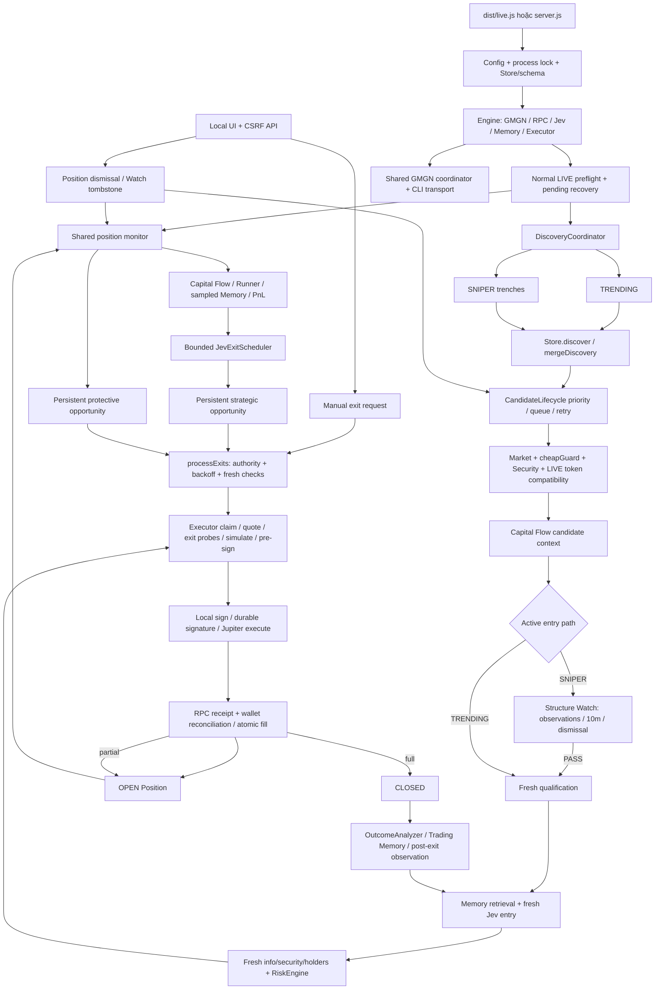

# BOT B — FULL END-TO-END AUDIT

**Ngày:** 30/10/2026 — Asia/Bangkok. **Verdict: FLOW HAS MATERIAL ISSUES.** Đây là kết luận về tính nhất quán của luồng hiện tại, không phải một quyết định bật/tắt LIVE.

## 1. Executive Summary

BOT B hiện là một Engine điều phối discovery GMGN, phân tích entry, execution Jupiter, quản lý từng Position và học từ giao dịch đã đối soát. Hai nguồn TRENDING và SNIPER dùng chung candidate store/scheduler. SNIPER phải qua Structure Watch tối đa 10 phút; Trending không phải qua guard đó. Cả hai vẫn cần Security, Jev, Risk, quote, exit feasibility, simulation và execution validation.

Normal strategic SELL hiện do Jev đề xuất; user/manual và protective security/liquidity/smart-money EXIT có quyền ưu tiên. Không có Stop Loss hoặc Max Hold đang thực thi. TP/trailing cũ còn helper và cấu hình tham chiếu, nhưng bị loại khỏi đường protective tự động của normal Engine. Xóa Position là overlay dừng quản lý, không SELL hoặc giả zero balance; bỏ Watch thu hồi unsigned entry authority.

Đã truy trực tiếp source, schema, các call sites, tests và các operator scripts liên quan. Không lấy kết luận cũ làm bằng chứng thay source. Phát hiện quan trọng nhất là **listing field cũ có thể được “làm mới” bằng timestamp discovery mới**, rồi được Security dùng làm fallback. Ngoài ra có chênh lệch PnL UI/Memory được xác nhận trong DB, khác biệt kiểm tra simulation/receipt, và một số giới hạn startup, cadence, pre-sign và observability.

**Phạm vi không thay đổi:** không sửa source/config/package/`.env`, không chạy migration/rebuild DB, không tạo JS/TS harness, không gọi POST, không ký hoặc gửi transaction. Chỉ tạo báo cáo, JSON evidence và log quality trong `docs/`/`data/`. Bot LIVE đã chạy từ lượt trước được giữ nguyên; hoạt động độc lập của Engine/operator có thể tiếp tục làm DB thay đổi. Vì vậy không tuyên bố toàn DB LIVE bất biến trong thời gian audit.

Các checkpoint độc lập, không phải một snapshot xuyên nhiều phút:

| Nguồn | Checkpoint Asia/Bangkok | Ghi nhận |
| --- | --- | --- |
| GET status | 07:07:39 | PID 14980; LIVE; policy SNIPER_DEFENSE_V5_2; scanner running; không global halt; active Position count 0 |
| Read-only DB transaction | 07:10:15 | 224 Position: 42 CLOSED, 173 FAILED, 9 OPEN + MANUALLY_REMOVED; 890 executions; không execution pending trong nhóm trạng thái đọc được |
| Read-only DB transaction | 07:13:01 | Hai closed Position có PnL khác outcome Memory đúng bằng failed SELL fees; Watch có các trường hợp NEW/UNKNOWN chưa nhận observation hợp lệ |

Build runtime và source được audit: `1ae9957f3b01d0741b231f716f88cb6997e1f827d1395525c9de1add384a9b88`, Node 22.22.0. Evidence: [runtime](../data/full-flow-audit-2026-10-30-runtime.json), [DB](../data/full-flow-audit-2026-10-30-db.json), [accounting/Watch](../data/full-flow-audit-2026-10-30-accounting-watch.json). Active Position count 0 **không** có nghĩa ví không còn token: 9 dismissed records vẫn OPEN và quantity dương.

## 2. Actual Architecture



GMGN nắm intelligence/discovery, không thực hiện swap. RPC đọc chain/simulate/confirm; Jupiter build/land transaction; private wallet ký trong backend. UI/SSE là projection và command interface, không có signer. Nguồn: [Engine](../src/engine.ts), [Server](../src/server.ts), [Execution provider](../src/execution-provider.ts).

## 3. Startup Flow

Thứ tự thực tế không giống một sơ đồ “wallet trước mọi provider” chung chung:

| Thứ tự / file:function | Input → output | Lỗi và phạm vi |
| --- | --- | --- |
| 1. `config.ts` module load | dotenv; global GMGN credential precedence; Zod env → typed env | Invalid config có thể dừng process trước Engine. Không in giá trị `.env`. |
| 2. `live.ts` → `startServer({normalLive:true})` | Chọn normal LIVE; `server.ts` trực tiếp không tự gọi normal-live preflight | Startup exception được log mã lỗi và exit code 1. |
| 3. `server.ts:acquireLock` | DATABASE_PATH + `.lock` PID → exclusive installation lock | PID sống: BOT_ALREADY_RUNNING; lock sai cần review. Dừng startup, không là lỗi candidate. |
| 4. `Store` constructor | SQLite → WAL, synchronous FULL, tables/indexes/triggers, migration markers | Writable startup có schema/migration và normalization cũ. DB lỗi dừng startup. Audit không chạy constructor writable. |
| 5. `Engine` constructor | Gmgn → Solana → Jev → TradingMemory/Runner → Executor/Jupiter | Đây là thứ tự constructor thật. Chưa có BUY hoặc ví ký tại bước tạo client. |
| 6. Settings | DB `strategyV2` nếu có, nếu không file/default; parse, persist lại | DB override có ưu tiên hơn JSON. Unknown key không nằm trong normalization whitelist làm parse fail. |
| 7. GMGN/Structure/Flow/Discovery | Configure coordinator; Structure reconcile TTL; tạo flow/discovery/exit-liquidity/candidate scheduler | GMGN mở local cooldown DB; Structure/Candidate constructors có write lifecycle. Không phải chỉ đọc state. |
| 8. Legacy exits/manual migration | `migrateManualRequests`, `migrateExitOpportunities`, `migrateJevExitPolicy`; hủy unsigned strategic restart jobs | Có persistent policy markers. Giữ signed pending; không replay approval cũ. |
| 9. JevExitScheduler | Tạo bounded queue/client pool | Không có quyền wallet/sign. |
| 10. `normal-live.ts:activateNormalLive` | Require mode/ACK/scanner/entries; localWallet kiểm tra signer; RPC mainnet; recover; existing halt/pending checks | Thiếu signer, wrong chain, signed unresolved, existing halt hoặc balance mismatch → dừng normal LIVE startup. |
| 11. Verify OPEN holdings | BUY signature confirmed/finalized + current token quantity đúng DB | Đọc **mọi core OPEN**, gồm dismissed; xem F05. Không verify mọi CLOSED/history receipt. |
| 12. Activate entries | Balance read; persistent `normal_live_start`; enable entries trong transaction | Không tự clear SYSTEM/TRANSACTION halt ở đường này. |
| 13. Initial `engine.status()` → server listen | Snapshot status ban đầu; localhost HTTP server | Có thể thấy cached scanner=false khi `Engine.start()` chưa xong. |
| 14. `Engine.start()` | balance attempt; recover lần nữa; legacy-provider check; initial LIVE monitor; set running | Legacy provider có thể halt entries. Initial monitor thất bại có thể halt nhưng server/process không nhất thiết chết. |
| 15. Shared timers | exit/monitor/Structure due mỗi 5s; discovery due mỗi 5s; scanner tick ngay rồi `SCAN_INTERVAL_MS` sau tick | Không có timer GMGN riêng cho từng token. |
| 16. Server timers | status/SSE 5s; flow projection 1s; SIGINT/SIGTERM graceful stop | Stop chờ workers, executor và reconciliation-related work, đóng DB/lock/server. |

Các scope CANDIDATE/POSITION/TRANSACTION chủ yếu áp dụng khi Engine đã chạy. Lỗi constructor/startup không tự được “isolate theo token” nếu exception thoát `startServer()`. `Store.halt()` dừng mua mới bằng flag, không tắt toàn process và không tự ngừng mọi protective monitoring.

Các entrypoint khác: `dev/start` dùng server thường; `live:controlled` có one-BUY/session cap riêng; `smoke:live` là chương trình giao dịch thật có ACK riêng; `ui` ép PAPER/scanner=false nhưng vẫn dùng Store writable, không nên gọi là read-only audit tool. Không chạy các entrypoint này trong audit.

## 4. Configuration

**Nguồn/override:** `config.ts:env` đọc process env + dotenv một lần khi module load; global GMGN credential file có precedence được code chỉ rõ. Không liệt kê giá trị env thật. `Engine.settings` lấy DB `strategyV2` trước file `config/strategy.json`, rồi schema/default; `POST /api/settings` cập nhật runtime + DB và gọi Structure reconcile. Learning settings đọc riêng `config/learning.json` qua schema khi tạo Memory, không nằm trong settings POST.

Trong API checkpoint, các nonsecret strategy settings dưới đây khớp default được nêu. Cột consumer cũng xác định setting có quyền trade hay chỉ cadence/reference.

| Nhóm / setting | Schema default; runtime nonsecret checkpoint | Consumer / tác động |
| --- | --- | --- |
| Discovery `trendingInterval`, `trendingLimit` | 5m; 100 | Gmgn.trending: interval/order/limit của rank provider |
| `trendingPollMs`, `sniperPollMs` | 60.000; 30.000ms | Discovery due; feed cache bằng nửa interval |
| `trendingFreshMs`, `trendingMaxAgeSeconds` | 180.000ms; 2.592.000s | Fresh entry path/priority; age limit Trending 30 ngày |
| `maxAgeSeconds` | 3.600s | Sniper age filter; không là thời gian giữ Position |
| `trendingPriorityBoost`, `multiSourcePriorityBoost` | 40; 10 | Queue ranking, không BUY authority |
| `candidateAgingPointsPerMinute`, `sniperMaxWaitMs` | 20; 180.000ms | Aging/promotion, không deadline guarantee |
| `sniperWatchReserve`, `trendingAnalysisBurst`, `queueReplacementMargin` | 5; 4; 10 | CandidateLifecycle fairness/replacement |
| Scheduler `candidateQueueSize`, `candidatesPerCycle` | 10; 5 | Queue slots và max candidates/tick; không phải max holdings |
| `watchMaxSize`, `watchRecheckMs` | 30; 60.000ms | Generic WATCH list, khác Structure Watch |
| `deferredMaxSize`, `deferredTtlMs`, `deferredRecheckMs`, `deferredMaxRechecks` | 20; 900.000ms; 60.000ms; 3 | Bounded defer retry |
| `tokenFailureThreshold`, `recentRejectTtlMs` | 3; 1.800.000ms | Failure circuit/reject và sell backoff; số 30m này không phải Structure TTL |
| GMGN `gmgnRequestIntervalMs` | 2.000ms, schema min 1.200 | One-client transport start spacing |
| `gmgnBackoffBaseMs`, `gmgnBackoffMaxMs`, `gmgnQueueMaxSize` | 10.000; 300.000ms; 200 | Fallback cooldown/jitter/queue; authoritative Retry-After có thể dài hơn cap fallback |
| `intelligenceCacheMs` | 60.000ms | Optional holders/history; final authoritative holders TTL0 |
| Structure `structureWatchTtlMs` | 600.000ms; numeric legacy >600.000 bị clamp | One max source `STRUCTURE_WATCH_MAX_MS`; không có minimum wait |
| `structureWatchMaxSize` | 50 | Active Sniper admission capacity, khác Position count |
| `structureObservationMs`, `structureMaxGapMs`, `structureConfirmations` | 15.000ms; 120.000ms; 2 | Accepted sequence cadence/gap/confirmation counts |
| Security `criticalRugRatio`, `warningRugRatio`, `maxTaxPercent` | 0,8; 0,3; 20% | Rug/tax findings; warning dùng so sánh `>` |
| Risk `minLiquidityUsd` | 10.000 USD | Final BUY denial; cheap guard chỉ yêu cầu liquidity >0 |
| `maxTop1Percent`, `maxTop10Percent`, `maxCreatorPercent` | 30%; 70%; 30% | Block concentration known vượt limit; UNKNOWN không giả thành 0 |
| `maxSnapshotAgeMs`, `maxDecisionPriceMovePercent` | 45.000ms; 10% | Market/security/Jev/holder freshness; post-Jev price drift; intent TTL; exit drift guard |
| BUY `positionSizePercent` | Literal 1 | `size()` luôn floor 1% spendable sau reserve/pending; không cho tùy ý đổi % |
| `feeReserveLamports` | 20.000.000 | Operational reserve, size and execution fee bounds |
| Jupiter `slippagePercent` | 1% | ExactIn quote BPS; schema cho 1–30%, audit không đổi |
| `paperFeeLamports` | 100.000 | Chỉ synthetic PAPER fill |
| Exit probes `exitProbeEntryBps` | [2000,5000] | Chỉ cần một level được policy chấp nhận và economically meaningful; luôn probe 20/50/100 |
| `exitProbeFeeBudgetLamports`, `exitProbeMinNetLamports` | 110.000; 10.000 | Conservative cost floor + required net margin |
| `exitProbeMaxImpactPercent`, `exitProbeMaxAgeMs` | 15%; 15.000ms | High-impact estimate và quote-bound gate age |
| `positionExitProbeMs`, `positionExitProbeSpacingMs` | 300.000; 30.000ms | Position quote-only observation cadence, không tự SELL |
| Position `positionRecheckMs` | 60.000ms | Monitor failures / sell failures trước threshold |
| `liquidityCollapseBps`, `smartMoneyExitMode` | 5000; WARNING | Protective liquidity dưới 50% initial; smart-money chỉ SELL nếu mode EXIT |
| `takeProfits` | +30% bán 50%; +70% bán 100% còn lại | **Reference cho Jev/legacy helper**, không mandatory normal TP |
| `trailingActivationBps`, `trailingStopBps` | 3000; 2000 | **Reference cho Jev/legacy helper**, không mandatory normal trailing |
| Jev exit concurrency/queue | `jevExitConcurrency=2`, `jevExitQueueSize=100` | Pool cho phép schema concurrency 1–4; client pool 4 |
| Jev exit cadence/age | recheck 60s; min interval 15s; decision max age 120s | Scheduler trigger và stale-result rejection |
| Jev exit thresholds | material PnL 10 points; min confidence 0,6; trade cooldown 60s | Re-evaluation/debounce/authorization; không price stop |
| `exitExecutionsPerCycle` | 2 | Tối đa hai queue selections/cycle; không phải số lệnh đồng thời |
| Capital Flow history | max observations 120; history 1.800.000ms; transitions 30 | Bounded rolling history |
| Flow readiness | min observations 3; min span 30s; interval 15s | Warming-up vs READY |
| Flow classification | regime confirmations 2; meaningful change 10%; stale 90s | Advisory regime/signal changes, không tự BUY/SELL |
| Learning | confidence [20,50,100]; half-life14d; similarity0,7; shared≥4; max200 | Retrieval from up to5.000 eligible recent outcomes |
| Learning observation | 30s; checkpoints30/60/120/300/600s | Sampled evidence, không continuous peak |
| Post-exit learning | window600s; interval60s; max2/cycle | Optional GMGN info; không mua lại |
| Learning classification defaults | breakeven0; good MFE20%; poor capture gap20%; bad max MFE5%/loss10%; counterfactual move20% | OutcomeAnalyzer labels, không strategy rule tự áp dụng |

Env names/defaults theo schema, **không phải giá trị `.env` được công bố**: TRADING_MODE=paper; LIVE_TRADING_ACK=false; NEW_ENTRIES_ENABLED=true; SCANNER_ENABLED=true; SCAN_INTERVAL_MS=15000; PORT=3000; DATABASE_PATH=data/bot.sqlite; PAPER_INITIAL_SOL=1; OBSERVATION_CYCLES=3. RPC có HTTP/WS override; fallback public mainnet URL trong source. Jev model literal `jev-1.14.0`; HTTP timeout15s; GMGN CLI timeout20s. `OBSERVATION_CYCLES` chủ yếu phục vụ verify/operator code, không là số lần bắt buộc trước normal BUY. `analysisRefreshMs=60000` còn trong schema/settings nhưng không tìm thấy normal Engine consumer; không dùng setting này để suy ra cadence Jev hoặc candidate thực tế.

Max Position/Max Hold/Stop Loss legacy keys bị loại khi normalize config. Normal LIVE không có Position-count gate; controlled session riêng vẫn có one-open/one-trade cap và principal cap5.000.000 lamports, không được nhầm là normal policy.

## 5. Discovery

Nguồn: [Gmgn.parseDiscovery/parseTrending](../src/gmgn.ts):68/126, [DiscoveryCoordinator](../src/discovery.ts):139, [Store.discover](../src/store.ts):162. Endpoint đối chiếu pinned `gmgn-cli` 1.6.9 `dist/client/OpenApiClient.js`, không suy đoán từ docs cũ.

| Đường | Thực thi |
| --- | --- |
| TRENDING | CLI `market trending --chain sol --interval 5m --order-by volume --direction desc --limit 100`; GET `/v1/market/rank`. Pinned CLI có Solana default filter renounced/frozen. Rank là rank trong bộ query, không phải global rank bất biến. |
| SNIPER | CLI `market trenches --chain sol`; POST `/v1/trenches`; parse new_creation, near_completion/pump, completed. Không phải buy ngay token mới. |
| Cadence | Shared 5s due check; per-source active promise tránh overlap; poll60s/30s tính từ attempt start. `poll()` chờ cả hai promises nhưng mỗi source tự catch lỗi. |
| Cache/freshness | Feed TTL30s/15s; metadata fetchedAt từ coordinator. Failed feed không cập nhật lastSuccessAt; failed nextAt ít nhất60s. |
| Candidate retention | Mint chuẩn Solana; symbol≤32/name≤128; discoveredAt/createdAt; source string; discovery source evidence. Malformed row bị bỏ riêng. |
| Sniper listing | Whitelist rug/authority/concentration/bundle/smart/KOL/liquidity/market-cap fields; nhiều raw fields không vào Candidate. |
| Trending listing | Giữ row + normalized price/window object; source metadata có rank/basis/history. |
| Shared feed observations | Một map RAM khác, tối đa300 mint, chỉ lấy allowlisted market/directional fields. Replace toàn snapshot; không merge old directional values vào new missing. Feed này có thể thiếu field dù candidate row còn advisory metadata. |

Same mint có thể đến từ cả hai nguồn; `discovery.sources` là union SNIPER/TRENDING, đồng thời giữ first/lastSeen từng source. `Candidate.source` top-level là nguồn incoming gần nhất, không phải source-of-entry authority; nên đọc `entryDiscoverySource` để biết entry thật.

Discovery vẫn có thể lưu mint đã owned/CLOSED/dismissed; nó không được phép BUY chỉ vì thấy lại mint. Candidate refill và `analyzeCandidate` kiểm tra `Store.bought`, final claim/RPC còn chặn độc lập. Source fresh ảnh hưởng priority và Structure bypass, không thay Security/transaction validation.

## 6. GMGN Coordinator

```text
consumer → Gmgn.run allowlist → canonical key → fresh cache
                                           ├─ SWR: trả labeled stale + single refresh
                                           └─ flights join / bounded enqueue
                                                → priority/aging/fair lanes
                                                → start spacing + persisted cooldown
                                                → ONE awaited CLI transport
                                                → parse/validate/cache/decorate
                                                → normalizer → consumers
```

Nguồn: [gmgn-coordinator.ts](../src/gmgn-coordinator.ts), [gmgn.ts:run](../src/gmgn.ts):582, [provider-state](../src/gmgn-provider-state.ts), [metadata relay](../src/gmgn-fetch-metadata.ts).

| Data/consumer | TTL / quyền sử dụng |
| --- | --- |
| Trending / trenches | Nửa poll interval, hiện30s/15s |
| Info/security normal candidate hoặc Position | 10s; cùng command/mint/key dùng chung |
| Final pre-buy info/security/holder | TTL0; không lấy stale cache làm fresh authority; có thể join đúng in-flight key |
| SOL/USD | 30s, chung các position valuations |
| Optional holders/creator history | 60s fresh, SWR đến120s qua optional intelligence method; current normal entry trước Jev chỉ `peek` advisory, không tự fetch enrichment |
| Smart-money | 30s; query key không có mint, kết quả filter per mint sau read |
| Post-exit info | 30s; SWR45s, priority5, advisory |
| Capital Flow / Jev context / UI | Không tự HTTP GMGN; nhận producer snapshots hoặc DB projection |
| Position and Watch | Khác mints vẫn khác requests; shared feed chỉ thay per-mint read nếu fields đầy đủ và fresh |
| Operator verify scripts | Có thể tạo Gmgn instance khác; chung local cooldown file nhưng không chung RAM cache/queue/start budget |

Key gồm capability + canonical command/flags, sort flags; window/amount/query khác giữ key khác. Cache max300 entries, flights Map xóa finally; queue max200 pending + active. Fresh cache/SWR được kiểm tra trước enqueue/cooldown. Khi đã cooldown, fresh cached analytical read vẫn có thể trả, nhưng critical execution path không được dựa vào stale authority.

Transport concurrency một trong mỗi coordinator. Start spacing≥2s, không phải mỗi2s bắt buộc có request. Priority0 có quyền trước; routine wheel watch/position/watch/other/watch/position/watch; aging mỗi30s. Bốn Watch workers là bốn logical reads có thể pending, không là bốn CLI đồng thời.

429: child preload relay allowlisted status/Retry-After/reset; adapter lấy delay dài nhất hợp lệ. Fallback exponential base10s, jitter0–25%, cap300s; authoritative delay không bị clip xuống cap. RATE_LIMIT_BANNED_MAX ít nhất300s. Pending jobs được reject provider-wait để tránh herd. Recovery6success chạy spacing3×; chỉ khi đủ6 mới HEALTHY. Local `data/gmgn-provider.sqlite` giữ max cooldown across restart/process trong cùng installation; **không** có global interprocess request lease, shared cache hoặc quota accounting cho toàn API key (F09).

CLI được allowlist read-only, `write=false`, automated trades disabled, debug tắt, auto-retry rate-limit tắt, timeout20s, maxBuffer4MB, hidden window. Raw stderr chỉ được parse để lấy error/timing, không persist nguyên văn. Không tìm thấy normal outbound GMGN bypass khác ngoài đường này. Fetch RPC/Jupiter/Jev là các provider khác, không được cộng thành GMGN traffic.

## 7. Candidate Lifecycle

Candidate chính là `{mint,symbol?,name?,source,discoveredAt,createdAt?,listing?,discovery?}`. Queue metadata nằm trong `candidate_lifecycle(mode,mint,payload)`: state, score/baseScore/priority, waitSince, failureCount, rechecks, firstDeferredAt, lastChecked, nextCheckAt, expiresAt, issue/recoveryPending, structureWatchExpiresAt/structureReadyAt. Market/security/intelligence/Jev/Risk lưu records riêng; không phải mọi field đều nằm trực tiếp trên Candidate.

Merge hai hướng đều dùng `mergeDiscovery(old,incoming)`: giữ discoveredAt đầu, union sources, merge listing shallow, giữ từng firstSeen; Trending sequence reset khi gap>180s hoặc basis đổi; rank history≤20 và delta rank tạo RISING/FALLING/FAST labels. Thứ tự source không là approval. Source path được tính từ freshness Trending; một Sniper đang analysis nếu đổi path sẽ fail authority check, phải phân tích mới.

Authority revision nằm ở settings key `candidateAuthority:<mode>:<mint>`, đưa vào Snapshot/Intent lúc bắt đầu analysis; không phải rank score. Persistence source fields không đồng nghĩa field-level freshness: xem F01.

Queue scoring: log liquidity/volume + tuổi listing, cap base100; Trending boost40 + multi10; aging có cap; Sniper bị chờ≥180s sau Trending streak4 có thêm promotion; PASS Structure có urgency hữu hạn. Chỉ tối đa10 queue slots, trừ protected ANALYZING/QUALIFIED/APPROVED; mỗi tick xử lý≤5 **tuần tự**, per-mint analyzing Set chống duplicate concurrent entry analysis.

Earliest filters/cost:

| Vị trí | Điều kiện → kết quả thực tế | Chi phí tránh được |
| --- | --- | --- |
| parseDiscovery/Trending | Invalid mint/row → bỏ row | Không vào queue |
| refill | Already bought; tombstone Sniper; old age; known listing liquidity≤0 | Không deep fetch/Jev |
| refill | Queue/full watch/defer limits; retry/expiry | Queue hoặc WATCH/DEFERRED/REJECTED; không phải Position capacity |
| analyze start | Store.bought; authority/path; existing ACTIVE Sniper | Trả về/structureWait; tránh chạy toàn deep pipeline lại |
| info → cheapGuard | Invalid/future/out-of-window age; unknown/nonpositive price; unknown/nonpositive liquidity | Chặn Security/token RPC/Jev phía sau, nhưng token-info đã tốn một read |
| Security/token compatibility | Critical/unknown mint-freeze; unsupported mint/extensions/decimals mismatch | Chặn Structure/Jev/quote/sign |
| Structure incomplete | STRUCTURE_WATCH / providerWait nếu capacity | Chặn Jev/Risk execution |

`SKIP_JEV/SKIP_RISK` thường về generic WATCH, next60s; `SKIP_MISSING_CRITICAL_DATA` vào typed retry; SKIP_MARKET/SKIP_RUG reject/invalidate. Retryable failures defer tối đa3 rechecks/3 failures/15m window; recent reject30m. Generic Watch max30, deferred20, terminal lifecycle retention500. STRUCTURE_WATCH có TTL/cap riêng. Restart ANALYZING/QUALIFIED/APPROVED chưa bought → WATCH, không khôi phục approval executable.

## 8. Security / Token Compatibility

Security không phải composite AI safety score. `normalizeSecurity()` tạo deterministic findings; `RiskEngine.evaluate()` chặn critical và critical-data absence.

| Evidence | Authority / outcome |
| --- | --- |
| renounced_mint/freeze false | CRITICAL MINT_CONTROL/FREEZE_CONTROL → block BUY; holding có protective path |
| Authority UNKNOWN | SKIP_MISSING_CRITICAL_DATA; không tự gọi đó là malicious |
| explicit is_honeypot/honeypot/can_not_sell true/1/yes | CRITICAL HONEYPOT_REPORTED |
| rug_ratio≥0,8 | CRITICAL; warning nếu >0,3; absent/out-of-unit → UNKNOWN |
| buy_tax/sell_tax known >20% | CRITICAL EXCESSIVE_TAX; đơn vị GMGN fraction được convert % |
| Top1/top10/creator concentration known >limits | Risk DENY; không tự tạo critical-rug evidence. Holder address rows loại addr_type không ordinary và address==mint. |
| Low liquidity | Entry liquidity below10k block; holding collapse<50% initial có full protective exit |
| Creator launches, bundlers, snipers, smart/KOL counts, burn/wash metadata | Advisory/context hoặc raw UI; không tự composite-authorize. Normal entry không fetch creator history fresh trước mọi analysis. |
| knownBadFunding | **Không tìm thấy production field/consumer** trong source; không có hard gate này. Test data/old text không tạo authority. |

Endpoint known critical rug thắng safe listing; endpoint newer known safe có thể thay listing cũ; UNKNOWN không được xóa current warning. Nhưng listing fallback dùng candidate-wide timestamp, không timestamp từng field (F01).

Token compatibility: [token-program.ts:inspectMint](../src/token-program.ts):30 đọc owner program thực, không nhận diện bằng chiều dài address. SPL owner/Token-2022 owner mới được xét; executable/missing/uninitialized/decimals>18/malformed TLV/duplicate extensions → typed candidate reject. Legacy SPL yêu cầu82bytes. LIVE candidate kiểm tra on-chain report trước Jev; provider simulation kiểm tra lại.

| Extension / trường hợp | Policy hiện tại |
| --- | --- |
| Token-2022 không active authority, không extension unsupported | Có thể ALLOW qua các lớp khác |
| MetadataPointer null/self | SUPPORTED_WITH_VALIDATION; external pointer UNSUPPORTED |
| TokenMetadata | Official codec + matching mint; wrong mint CRITICAL |
| DefaultAccountState | Initialized và không freeze authority mới được hỗ trợ |
| MintCloseAuthority/PermanentDelegate | PublicKey.default mới disabled/supported; active CRITICAL |
| NonTransferable/PausableConfig/PermissionedBurn | CRITICAL_RISK |
| TransferFeeConfig | UNSUPPORTED, có ghi fee details; không giả vờ hỗ trợ withholding/future fee changes |
| TransferHook hoặc unknown extension | UNSUPPORTED; exact IDs giữ trong reason |
| Token-2022 mint/freeze authority active | CRITICAL; Legacy SPL on-chain authorities được report nhưng không có cùng fatal check (F02) |

ATA dùng mint **và đúng token program**. Unpack token account kiểm tra owner/mint/program, initialized/unfrozen, delegate/close-authority, extension account chỉ cho ImmutableOwner. Transaction top-level Token-2022 instructions bị reject; swap phải qua Jupiter route đã inspect. Chỉ được tạo ATA cho target mint hoặc wSOL, không intermediate ATA tùy ý. Token-2022 dùng cùng BUY/SELL router restrictions và actual receipt token deltas; transfer-fee token bị loại trước khi coi output là spendable. Một unsupported mint unsigned được isolate CANDIDATE/POSITION; không mặc định halt toàn bot, khác systemic signer/transaction-invariant error.

## 9. Sniper Structure Watch

Nguồn: [sniper-structure.ts](../src/sniper-structure.ts), [Engine.observeStructureWatches](../src/engine.ts):670.

Sau info/cheap/security/LIVE token compatibility/Capital Flow, active path SNIPER gọi `structure.observe()`. Chưa PASSED+FRESH → `structureWait()` và không gọi Jev. T0 được tạo ở first structure observation attempt, **không phải token age hoặc mọi discovery timestamp**. T1=T0+TTL≤10m; migrate/reconcile lấy min với expiry cũ. Không reset qua failed support/provider gap/restart.

Evidence bắt buộc: price, liquidity, buy/sell USD cùng rolling window; unknown directional fields không được thay bằng0. Quan sát phải không tương lai, không quá maxGap120s; không nhận lại cùng fetchedAt; observation interval15s. Gap>120s hoặc window đổi reset chuỗi counters/observations, không reset T0/T1. Phase/failure mô tả behavior, không là scam classification.

Các điều kiện thực:

- Trước real selling: velocity>0 → INITIAL_EXPANSION; velocity=0 → PEAK_FORMING; giảm → WAITING_FOR_SELLING.
- Selling: sell USD>0 và sell tăng/pressure giảm/net giảm, kèm velocity hoặc pressure/net deterioration; cần2 confirmations để sellingSeen.
- Absorption: sell USD>0, liquidity còn dương và không giảm so observation trước, velocity≤0 nhưng cải thiện so previous velocity; cần2 confirmations để SUPPORT_CONFIRMED.
- Support lost/new low: SUPPORT_FAILED hoặc RECOVERY_FAILED; vẫn có thể tìm lại trong cửa sổ gốc.
- Recovery: velocity>0, pressure tăng, net flow tăng, liquidity không suy giảm; cần confirmations+1=3 để PASSED, phase ENTRY_ELIGIBLE, reason RECOVERY_CONFIRMED.
- PASSED vẫn giữ defense nếu nonnegative velocity/pressure/net và liquidityAlive; weakening có thể trả ACTIVE. Timely pass yêu cầu confirmedAt≥T0, <T1, ≤now; fresh checks vẫn áp dụng. PASS9:59 có thể hoàn tất fresh pipeline sau10m, không gia hạn Watch.
- Không PASS đúng T1 → EXPIRED. Hard deterministic invalidation → INVALIDATED ngay; không chờ phút10. Không universal drop/bounce/recovery/ATH-distance % unlock; drawdown/recoveryRatio chỉ descriptive.

Scheduler: shared5s checks, tối đa4 pending workers, sort theo last valid observation+maxGap (ưu tiên support thêm10s), rồi expiry. Reuse complete feed age≤10s; complete feed10–60s chờ poll kế tiếp, không tạo fake observation; nếu thiếu/older thì token-info qua coordinator. Cooling dừng reads nhưng `structure.expire()` chạy trước cooldown return. TTL không dừng khi provider outage. Fair lanes/aging giảm starvation; không có hard deadline/coverage guarantee. Distinct mints vẫn tiêu tốn transport; xem F06.

Manual remove: UI confirmation → `POST /api/watch/dismiss` → Engine → atomic SniperStructure.dismiss/Store.dismissCandidate → USER_REMOVED + actor/time/reason + revision/tombstone → CandidateLifecycle.dismiss, clear attempts. Active UI/scheduler loại row; old awaited info/Jev phải check state/revision. Tombstone nằm settings riêng nên terminal-row prune/restart không tạo lại Sniper đó. Already submitted BUY được reconcile không dùng lại candidate authority để giả hủy giao dịch. Fresh Trending có revision mới và pipeline riêng; không là permanent whole-mint blacklist.

## 10. Trending Path

Fresh `discovery.trending.lastSeenAt` trong180s tạo Trending boost/path; không phải chỉ có chữ TRENDING trong source history. Trending không chờ Watch, không cần pullback hoặc recovery curve. Sniper→Trending và Trending→Sniper path đổi khi async analysis đang chạy bị authority callback phát hiện, buộc phân tích mới.

Full path: Trending discovery/merge → queue → token-info → cheapGuard → security → LIVE token inspect → Capital Flow → advisory intelligence → Memory.retrieve/jevContext → fresh Jev → fresh info/security/holders → price-drift check → Snapshot/Risk → exact sizing → Executor. Nó **không bypass** mint/freeze/security, concentration/freshness, ownership, entry control, capital reserve, quote, exit probes, simulation, signer hoặc receipt reconciliation.

Entry source được lưu từ Snapshot đúng hash khi fill; `discoverySourcesAtEntry` giữ union history và `sniperStructureAtEntry` có thể giữ record cũ làm context, không làm Trending phải PASS Sniper.

## 11. Capital Flow

[capital-flow.ts](../src/capital-flow.ts): normalization chọn shortest window có buy/sell USD, fallback counts rồi volume; window set1m/5m/1h/6h/24h. Đây là rolling DEX trade volume, **không phải số SOL mới nạp vào pool**.

| Loại | Fields |
| --- | --- |
| Raw observed | Price, market cap, liquidity, selected-window volume, buy/sell USD, buy/sell counts, holder_count, smart_wallets khi provider có |
| Derived | netFlow=buy−sell; ratio; pressure từ USD hoặc counts fallback; % changes, slopes/minute, acceleration; holder/liquidity change; price momentum; peak retracement |
| Không có producer hiện tại | smartMoneyBuyUsd/sellUsd, largeBuyUsd/sellUsd luôn null trong normalizer; downstream net/imbalance cũng unavailable |
| Lookbacks | 1/3/5/15/30m, chọn base gần target có tolerance và ghi actualElapsedMs; không bịa điểm khi history chưa đủ |
| Quality | min3 same-window observations và span≥30s; coverage of fields; long windows confidence cap0,55; chưa đủ cap0,4; max0,95 |

Regimes gồm STRONG_INFLOW, INFLOW_ACCELERATING, HEALTHY_EXPANSION, INFLOW_DECELERATING, NEUTRAL, DISTRIBUTION, OUTFLOW, OUTFLOW_ACCELERATING, INSUFFICIENT_DATA. Có ngưỡng pressure/change/liquidity trong **phân loại advisory**, không là Structure universal entry threshold. Regime cần2confirmations, trừ insufficient transition/material negative reversal. Bucketed signalKey giúp debounce Jev exit.

Candidate history lưu `candidate_flow_states`, cap250mint/30m; Position history lưu `capital_flow_states` theo positionId/mode. Không nhận lại fetchedAt chưa đủ interval. Source observations≤120/history30m, transitions≤30. Monitor failure tạo DEGRADED summary giữ unavailable/missing; không fetch riêng từ Flow. Summary đi vào Jev entry/exit/Runner. Flow không tự approve BUY, gọi signer hay trực tiếp tạo SELL; protective liquidity exit là policy khác đọc Market.liquidity.

## 12. Trading Memory → Jev → Risk

Thứ tự entry sau Structure/Trending guard: advisory intelligence từ current info/security + cached holders `peek` → Memory.retrieve → bounded context → `Jev.decide(semantic,true)` → nếu BUY thì **mới** fetch fresh info/security + authoritative holders TTL0 → price drift → Risk. Không refresh tất cả optional enrichment trước mọi Jev call.

Memory retrieval ([trading-memory.ts](../src/trading-memory.ts):501): same mode, completed/reconciled outcomes available≤asOf, entry<asOf, closed<asOf, loại current mint, eligibleForStrategy và accountingComplete. Candidate pool≤5.000; shared features≥4; similarity≥0,7; weight=similarity×recency half-life14d; chọn≤200. Features normalize age/market cap/liquidity/volume/ratios/holders/top10/creator/history/smart/rug/momentum. Confidence thresholds20/50/100. Patterns chỉ so sánh khi cả group và comparison có sample đủ; suggestions có `applied:false`. Thua lỗ không tự biến thành config hoặc hard reject.

Jev entry endpoint `https://api.typesafe.ai/v1/systemone`, body `{model,state,questions}`. Model pinned `jev-1.14.0`; `Http` spacing1s, timeout15s, retry=false; missing key/invalid schema/transport fail không được BUY. Cache semantic30s tồn tại nhưng normal Engine gọi `fresh=true`, không dùng cached approval. Input schema projection:

| State category | Thực tế gửi |
| --- | --- |
| Identity | Không gửi một object Candidate đầy đủ/mint/name trong `currentToken` whitelist. Correlation mint giữ ngoài request ở records; không giả vờ Jev nhận raw identity. |
| Source | entryDiscoverySource, discovery sources và bounded Trending/Sniper metadata |
| Market/security | price/decimals/liquidity/cap/volume/counts/windows, renounced/rug/findings |
| Structure | phase/status/reason/quality/confirmedAt/lastObservedAt/T0/T1/counters; không gửi full observations |
| Flow | regime/confidence/window/quality/features/lookbacks |
| Intelligence | holders/count/top1/top10, creator percentage/history status/counts, bundle/sniper/smart/KOL, DD unknown score/findings |
| Token compatibility | program/decimals/extension policy summary |
| Freshness | gmgnQuality provider/fetchedAt/age/freshness; explicit marketObservedAt/securityObservedAt/flowObservedAt/structureUpdatedAt |
| History | Statistical aggregates/positive-negative patterns/confidence/sample counts; không raw trade rows/future observations |

Recursive serialization loại keys chính xác `at`; explicit renamed timestamps vẫn còn. Entry schema cần action BUY/SKIP, risk LOW/MEDIUM/HIGH, suspicious/data_sufficiency noul, momentum, historical assessment/strength/reason. suspicious≥0,5; sufficient≥0,7; history strength/count bị cap theo supplied facts, không cho model bịa sample count. Entry confidence được lưu nhưng **không có hard min entry-confidence gate** như SELL0,6.

Risk rules theo thứ tự ([risk.ts](../src/risk.ts):63):

1. Nếu có gmgnQuality thì phải FRESH.
2. SNIPER cần timely PASSED, FRESH, lastObservedAt không future và ≤maxGap.
3. Entries phải enabled; duplicate durable BUY bị deny.
4. Supplied tokenExecution SKIP bị deny theo severity.
5. cheapGuard lại: mint/age/price/liquidity.
6. Security CRITICAL → SKIP_RUG; mint/freeze UNKNOWN → SKIP_MISSING_CRITICAL_DATA.
7. Market/security/Jev age≤45s; known liquidity≥10k.
8. Known top1/top10/creator vượt30/70/30% → SKIP_RISK. Missing concentration không được convert safe0; code cũng không bắt mọi optional percentage phải KNOWN.
9. riskEvidence bắt buộc có FRESH metadata, fetchedAt≤now và ≤45s; normal final path refresh holder source TTL0. Metadata này không tự chứng minh từng listing-derived field mới (F01).
10. Jev pinned model, sufficient; action BUY, risk không HIGH, suspicious=false.
11. size(balance,reserve,pending)>0.

Risk DENY lưu reason/outcome rồi return, không tạo approved execution. `approve()` evaluate lại, tạo immutable intent bound Snapshot hash. Executor yêu cầu Snapshot đúng hash và finalValidation callback. Jev không có signer/submit quyền; Structure và Memory không thể thay Risk. Last async Risk validation và immediate pre-sign hook có phạm vi khác nhau, xem F07.

## 13. Capital / BUY Sizing

`size(balance,reserve,pending)` dùng BigInt:

```text
available = max(0, walletSOL − feeReserveLamports − reservedBUYPrincipal)
BUY amount = floor(available / 100)
```

Ví dụ giả định balance100.000.000, reserve20.000.000, pending0 → principal800.000 lamports. Đây là 1% **spendable**, không phải 1% balance tổng hoặc fixed SOL/ticket. Có rounding về0 thì WAITING_FOR_CAPITAL. Không nâng size để đáp ứng router minimum; no controlled-cap resizing.

Risk đọc current balance/reserved; Executor đọc lại capital trước atomic claim, claim kiểm tra exact `available/100`, tạo CREATED/PENDING_ENTRY để reservation có persistence. Trước quote đọc lại SOL/tokens; size phải còn đúng sau loại reservation của chính intent. Sau simulation/final validation đọc wallet lần nữa, đổi balance/token → abort. Phí/rent không lấy từ principal: reserve riêng, quote fees phải≤reserve, simulation fee bound còn chặt hơn≤5.000.000.

Normal holdings không có maximum count. Nhiều qualified candidates vẫn đi tuần tự qua global Executor busy; claim/SQLite pending counts chặn cùng capital. Signed pending freeze cả BUY và SELL mutation, không chỉ BUY của cùng mint.

## 14. Pre-Buy Exit Feasibility

[exit-feasibility.ts:probeExits](../src/exit-feasibility.ts): expected BUY `outAmount` → quote-only SELL **20%, 50%, 100%**, không có75% probe. Atomic amount floor(quantity×bps/10000); dust UNKNOWN, không fake route. Quote-only không taker, không transaction signing/simulation tương lai.

Mỗi level: validate mint/amount/side/slippage; fee=max(quoted signature+priority+rent, configured110.000); netMinimum=minimumSOL−fee; meaningful nếu net≥10.000 và impact absent hoặc≤15%. HEALTHY nếu meaningful, THIN nếu route có nhưng kinh tế/impact yếu, NO_ROUTE nếu typed no-route, UNKNOWN khi provider/insufficient evidence. Impact missing được giữ null; không chặn riêng chỉ vì missing impact.

Aggregate: 3healthy→HEALTHY; có healthy nhưng không đủ3→LIMITED; cả3NO_ROUTE→NO_EXIT; có route nhưng không meaningful→POOR; còn lại UNKNOWN. Không có enum ECONOMICALLY_UNVIABLE riêng, nó thể hiện bằng THIN/POOR + EXIT_OUTPUT_BELOW_COST_AND_MARGIN.

`assertEntryExit` buộc PRE_BUY, same mint/expected tokens, buyQuoteHash (wallet/principal/output/minimum/at/requestId), policyHash, checkedAt≥buy quote và age≤15s. Cần ít nhất một level trong entry policy [20%,50%] meaningful. Full100% THIN vẫn có thể BUY nếu partial gate tốt. Fail dùng NO_PREBUY_EXIT_ROUTE, EXIT_FEASIBILITY_UNAVAILABLE, EXIT_LIQUIDITY_TOO_THIN hoặc EXIT_FEASIBILITY_STALE; typed retry/defer, không force size/slippage.

Gate nằm **sau atomic claim và fresh BUY quote, trước simulation/sign**; claim có thể đã tạo PENDING_ENTRY nhưng chưa là holding BUY thành công. Executor check binding lại trước execute; không bảo đảm SELL tương lai sẽ còn route. Position monitor probes là advisory riêng, không là automatic SELL order.

## 15. BUY Execution

Nguồn: [Engine.analyzeCandidate](../src/engine.ts):803, [Executor.execute](../src/executor.ts):70, [JupiterExecutionProvider](../src/execution-provider.ts):232.

| Boundary | Thực tế / persistence / lỗi |
| --- | --- |
| Fresh approval | Risk.approve tạo UUID/key/mode/amount/expiry/snapshotHash/positionId/entryAuthority. Engine ghi approved_intents. |
| Retry key | Chỉ unsigned FAILED attempts được phân tích lại; Engine thêm `:unsigned-retry:<attempts.length>` vào BUY key. Không reuse approval cũ. |
| Execute guard | Global busy, mode/provider/ACK, expiry, entries, candidate revision; approved Snapshot hash + finalValidation required. |
| Claim | BEGIN IMMEDIATE; ownership/pending/unique key/capital checks; intents + CREATED execution + PENDING_ENTRY Position, reservation durable. |
| Wallet baseline | Before SOL/all-owned mint tokens; must not own target token; exact1% sizing lại. |
| Fresh quote | GET `https://api.jup.ag/swap/v2/order`; ExactIn SOL→mint, amount exact, taker wallet, slippage1% currently; exclude jupiterz,dflow,okx; router schema **metis only**. priorityFee cap100.000, broadcastFeeType=maxCap. |
| Quote validation | Chain/provider/wallet/mint/direction/amount/threshold/slippage, route endpoints, transaction/requestId/payer; age≤20s, not future>1s, expireAt valid. No fallback OKX/Dflow/JupiterZ path. |
| Exit feasibility | Quote-only20/50/100; bound report persisted in execution/records; all required checks trước simulation. |
| Simulation | Inspected mint/program/extensions, version0, exactly1signer wallet payer; resolve ALTs, decompile instructions, allowlist/recipient/principal/token accounts; RPC unsigned simulate. |
| After simulation | Async final Risk validation lại; re-read wallet SOL/tokens, compare baseline; parsed mint decimals match. Persist `before` cùng execution khi signature callback commit. |
| Immediate pre-sign | Provider.validate quote age/identity + checked WeakSet/not consumed; load localWallet; sync callback checks Executor.validate + Engine authority/path/current Structure. Xem F07 về những thứ không được rerun tại đây. |
| Sign | `tx.sign([wallet])`; clear secretKey finally. Đây là lần đầu có chữ ký chain. |
| Durable signature | consumed quote; synchronous `beforeBroadcast(signature)` atomically ghi SUBMITTED/signature/before + immutable BUY sample/preflight. Callback fail → không gọi HTTP execute. |
| Submit | POST `/swap/v2/execute` signedTransaction/requestId/lastValidBlockHeight; retry=false. Returned signature nếu có phải match. Không RPC sendRawTransaction fallback. |
| Confirmation | PENDING_CONFIRMATION persist; provider.confirm poll≤12×, 2s giữa polls; dù trả FAILED/UNKNOWN vẫn đọc RPC receipt để phân loại. |
| Reconcile | Receipt+wallet delta validation → execution_fills, Position OPEN, CONFIRMED, Memory evidence trong atomic commit. |

System invariant/signer/wallet/quote-binding mismatch có thể halt entries; typed token/layout/route/simulation errors unsigned là candidate rejection/defer. Provider auth và cross-mint outage có scope rộng hơn. Nếu chưa durable submitted, catch FAILED + Position FAILED; nếu đã submitted, catch UNKNOWN + TRANSACTION halt, không automatic broadcast retry.

## 16. Confirmation / Reconciliation

`Executor.reconcile` có per-execution promise single-flight; CONFIRMED trong DB là monotonic guard trước/sau awaits. Nó không tạo quote hay gửi lại transaction.

Receipt required: Jupiter provider, signature, before balances; signature đầu receipt đúng signature saved; meta có, meta.err null. `Solana.deltas()` xác định wallet trong account keys (kể cả lookups), yêu cầu payer index0, valid integer balances, pre/post token balances, owner/mint matching và sum toàn accounts của target mint. `beforeSOL/beforeTokens` phải khớp recorded preflight, delta arithmetic phải tự nhất quán.

Current wallet SOL/tokens phải bằng transaction-local post balances cộng các **later CONFIRMED bot fills** đã biết, slot rồi submittedAt/createdAt fallback cho cùng slot. Đây là ledger-aware guard, không còn chỉ so current SOL với delta của riêng một execution. Unknown external transfers/fees/unresolved subsequent effects vẫn có thể khiến manual reconciliation required; không bỏ wallet checks.

Atomic fill: chống signature đã có trong execution_fills/confirmed executions khác → insert unique(signature,executionId) → applyFill → execution CONFIRMED/evidence → sync manual/Jev + Memory.confirmed/Runner/outcome. Crash giữa các bước transaction rollback; receipt apply lại không nhân đôi fill.

Actual checks khác simulation: BUY `tokens>0`, SOL delta<0, debit≤principal+operational reserve; SELL exact−amount token và sold≤tracked quantity. **Không compare actual received với quoted minimumOutput trong applyFill/reconcile; SELL không có cùng positive-net check tại receipt như simulation; quote fee/rent bound không được dùng lại như simulation** (F03). Stored minimum/preflight vẫn có trong Memory, nhưng persistence không đồng nghĩa enforce.

Meta.err thật → FAILED, ghi failedFeeLamports, release BUY→FAILED hoặc SELL→OPEN, Memory.failure. Missing/unresolved receipt → UNKNOWN, TRANSACTION halt. Mismatch receipt/wallet → UNKNOWN/halt. Existing halt không tự clear khi recovery sau đó thành công; operator entry-control cần xử lý riêng.

`SIMULATED_BALANCE_MISMATCH` là details.reason của TOKEN_SAFETY_FAILED: BUY token delta phải≥minimum, SOL debit âm và≤principal+quote fees; SELL token debit exact và SOL net dương. `TOKEN_SIMULATION_FAILED` giữ simulation error/logs bounded. `Custom=6001` được giữ như raw numeric diagnostic, **code bot không có decoder riêng biến6001 thành NO_BUY_ROUTE**. Audit không tái mô phỏng hoặc gọi provider để giải thích từng incident lịch sử.

## 17. Position Creation / Recovery

PENDING_ENTRY được tạo **lúc claim**; chỉ fill confirmed/reconciled mới OPEN. BUY fill set actual quantity/originalQuantity, cost=full wallet SOL debit (principal+fees+retained rent), remainingCost=cost, highWater=cost, realized=0, signature, entryAt từ thời điểm apply/recovery. Symbol/source/entryPrice/cap/liquidity/decimals/tokenExecution lấy Snapshot; source/structure provenance chỉ set từ Snapshot khi hash match. Full Jev/Risk/Flow snapshots chủ yếu lưu immutable Memory sample/records, không nhét toàn bộ vào Position.

Restart load persistent Position/intent/execution, recover pending trước trading. CREATED chưa submitted → FAILED, không replay. Signed pending → RPC reconciliation; chưa rõ giữ PENDING_ENTRY/PENDING_EXIT và freeze new wallet mutation. OPEN managed được monitor; PENDING_EXIT vẫn có market/Flow observation riêng nhưng không tạo SELL chồng. CLOSED/FAILED không routine monitor. MANUALLY_REMOVED vẫn core OPEN trong DB, không vào managed monitoring; không tự scan ví rồi tạo lại Position.

Normal LIVE startup vẫn verify raw OPEN gồm dismissed, xem F05. Source không bảo đảm entryAt luôn là block execution time: receipt được recovery muộn sẽ ghi thời điểm apply. Historical signatures/receipt evidence là nguồn thời gian chain nếu cần forensic accuracy.

## 18. Position Monitoring

[Engine.monitor](../src/engine.ts):1266 chạy shared5s + được scanner tick gọi nonblocking. Global monitoring flag chống overlap; **không còn global executor-busy guard dừng toàn monitor**. Positions trong mỗi lượt vẫn await tuần tự.

Một managed OPEN Jupiter Position:

```text
monitoring.nextCheckAt due + lastQuoteAt≥15s
→ security (10s cache) → persist position_security
→ nếu CRITICAL: rememberProtection ngay
→ info (10s cache) → position_market
→ SOL/USD shared30s → mark token value
→ total-return MFE/MAE + quantity-scaled highWater
→ optional shared smart-money feed
→ saveObservation with current-state/quantity/cost guards
→ Capital Flow → Runner → save Position
→ enqueue bounded position exit probes (LIVE)
→ sampled TradingMemory.observe
→ protectiveExitDecision → rememberProtection
→ scheduleExitAnalysis (không await Jev)
```

PENDING_EXIT branch: security/info, saveObservation giữ current state/quantity, Flow và next check15s; bỏ valuation/normal strategic decision trên quantity đang chờ thay đổi. Sau awaited provider boundaries, removed/current-state checks ngăn stale monitoring overwrite fills/dismissal.

PRE_SELL attention BACKOFF **không skip market/PnL/Flow**. `monitoring.nextCheckAt` là lịch riêng cho lỗi monitoring, có thể skip lượt dữ liệu đó; successful save chỉ clear relevant POSITION_MONITOR attention, không xóa PRE_SELL execution issue tùy tiện. Trong catch, Flow degraded rồi isolate; một token lỗi thường không break cả for-loop, nhưng DB/error-handler exception có thể thoát lượt.

Cadence không là cam kết mọi Position15s: số mint, API latency, coordinator budget và tuần tự hóa vẫn kéo dài lượt. Exit-liquidity probes tối đa một active, queue≤100, due5m và spacing30s; yield khi wallet executor/pending signature bận. Post-exit learning≤2items/cycle chạy sau position loop, priority5.

## 19. Manual Position Removal

`BOTRemovalMenu` → `BOTConfirmRemoval` → CSRF POST `/api/positions/dismiss {positionId}` → Engine.dismissPosition → atomic Store.dismissPosition. Require existing Position, OPEN, không pending execution cho Position đó (CREATED cũng block); repeat dismissal idempotent.

Persist overlay `{status:MANUALLY_REMOVED,dismissedAt,dismissedBy:USER,reason:USER_MANUAL}`, tăng decisionRevision, cancel active manual/decision references, remove queued Jev/exit-liquidity jobs. Active position view/flow projection dùng managedPositions/relevant=false. Stale `savePosition` giữ overlay/revision; stale observation bị bỏ. Đang in-flight GMGN/Jev có thể kết thúc, kết quả không được tiếp tục cấp quyền quản lý.

Không gọi quote/execute/sign/transfer/burn/close-account; không sửa quantity/cost/realized thành0, không core CLOSED giả. Không DELETE evidence/Memory/history. Capital Flow state của dismissed được giữ khi prune để không xóa lịch sử, nhưng không nhận routine observations mới. Wallet-level recovery hoặc startup verification không bị biến mất chỉ vì UI ẩn record.

Restart không re-enable overlay. Store.bought đọc cả dismissed và CLOSED/raw durable BUY, final wallet preflight còn đọc balance thật; rediscovery không tự cho mua lại token đang sở hữu. Không có undo/re-adopt endpoint trong UI hiện tại. F05 nêu startup verification vẫn có thể ảnh hưởng liveness khi balance của dismissed token đổi ngoài bot.

## 20. SELL Decision

Không suy luận SELL từ các legacy setting names. Normal Engine gọi `protectiveExitDecision()`; helper này gọi exitDecision rồi **lọc Take profit/Trailing profit**. `detectExits()` còn export ở exit-lifecycle.ts nhưng không có normal Engine call site; chủ yếu legacy/tests. Runtime schema đã loại Max Hold/Stop Loss/Max Positions.

Mọi cơ chế normal có thể tạo SELL:

1. User manual request qua emergency: API có optional sellPercent0,01–100%; Position UI thông dụng50/100.
2. Security CRITICAL → full protective.
3. Liquidity dưới50% initialLiquidity → full protective.
4. Smart-money sell signal chỉ full protective nếu smartMoneyExitMode=EXIT; hiện WARNING không tạo lệnh từ signal đó.
5. Jev strategic PARTIAL_SELL/FULL_SELL sau parser/confidence/staleness/current-state checks.

Queue selection toàn portfolio: manual FULL rank1; critical protective rank2; manual partial rank3; other protective rank4; Jev full rank5; Jev partial rank6; cùng rank theo created/triggered age. Trong cùng Position, manual request được chọn trước, nhưng fresh/saved critical có thể **hủy manual partial và thay full protective**. Manual full giữ authority MANUAL.

Protective opportunity persistent/sticky: đã latch critical/liquidity/smart-money có thể retry sau cooldown mà không đòi trigger còn đúng. Đặc biệt `processExits` bỏ bước re-evaluate market khi selected opportunity đã PROTECTIVE. Đây là policy/lifecycle thực tế, không khẳng định mọi retry reason phản ánh current market. Jev HOLD chỉ supersede strategic, không cancel protection/manual.

Jev exit input gồm exact Position identity/quantity/cost/remainingCost/current value, realized/unrealized/total PnL, MFE/MAE/highWater/retracement, exposure, previous decisions/execution attention, market/security/holder/smart counts, Flow, source/rank, exit-liquidity age/status, Memory và Runner similar examples. Prompt nêu không sell chỉ vì âm PnL, tuổi hay số Position; đó là **instruction cho model**, parser không chứng minh causal rationale của một lựa chọn hợp lệ.

Output HOLD0%, PARTIAL10/20/25/50/75%, FULL100%; action/fraction mismatch reject; data sufficiency<0,7 hoặc reason INSUFFICIENT_DATA/UNCHANGED cho sell → HOLD; confidence<0,6 scheduler đổi HOLD. Transport/schema failure → scoped FAILED/HOLD, không tự protective sell vì Jev outage. Fresh trigger min15s; unchanged periodic60s; queued decision input max120s; price drift10%; strategic repeated signal/cooldown60s được debounce.

## 21. SELL Execution

Manual/PROTECTIVE/STRATEGIC đều đi `processExits → exitPosition → Executor.sellIntent → Executor.execute → JupiterExecutionProvider`.

ProcessExits reconcile signed pending trước, sau đó≤2selections/cycle. Unresolved signed execution freeze wallet; nó không dừng read-only market monitoring. PRE_SELL backoff chặn automatic/retry, manual REQUESTED mới có thể vượt cooldown. Security được đọc priority0; retryable GMGN outage vẫn cho manual/protective đã có authority tiếp tục đến Jupiter/RPC, không bypass execution validators. Strategic thiếu GMGN không được dùng như fresh market review.

Partial amount=floor(current reconciled quantity×bps/10000). Manual retry dùng request.baseQuantity/request.amount đã bind ở claim, không lấy50% của lượng còn lại lần nữa. SELL intent key có Position id/quantity/failed attempt count; linked manualRequestId/opportunityId/decisionId/exitAuthority giữ trách nhiệm qua recovery.

Final validation trước quote và sau simulation: current Position không dismissal, quantity unchanged, OPEN/PENDING_EXIT; strategic đúng latest decision/revision/quantity, input/current valuation không quá120s, price drift≤10%, không manual/protective override. Claim chuyển PENDING_EXIT. Before wallet phải đủ token; wallet phải không đổi sau preflight; quote fresh mint→SOL/exact amount; cùng instruction/token/fee/simulation guards như BUY.

Ngay trước sign, common Executor.validate lại managed/mode/ACK/intent expiry; callback strategic **async** không được gọi lại đồng bộ tại last sign như BUY-specific authority callback (F07). Khi PENDING_EXIT, API manual/dismiss mới bị block; nhưng điều đó không biến snapshot-age/policy checks thành last-instruction checks.

Full SELL dùng toàn tracked remaining quantity, không tự sweep token lạ ngoài Position. Không tự close target token account để lấy rent; top-level token-account close chỉ cho wSOL cleanup đúng ví. SELL simulation cần exact token debit và positive wallet SOL net; quote-only positive gross output chưa đủ. Nếu chỉ thu nhỏ hơn fees thì không ký. Confirm/reconcile mới giảm quantity; partial về OPEN, full về CLOSED. On-chain failed không giả sold.

## 22. Unsellable Position

| Tình huống | Kết quả current code |
| --- | --- |
| Metis không route | NO_SELL_ROUTE typed unsigned FAILED; giữ token/OPEN, attention PRE_SELL |
| Quote có nhưng netSOL≤0 trong simulation | TOKEN_SAFETY_FAILED / SIMULATED_BALANCE_MISMATCH; không ký |
| Simulation err | TOKEN_SIMULATION_FAILED + bounded details/logs; không ký |
| Token compatibility/layout unsupported | Typed failure; không tăng slippage/đổi router để vượt guard |
| Quote-only economics kém | Exit-liquidity THIN/POOR estimate cho UI/Jev; không đủ để nói không bán được ở mọi router/thời điểm |
| Signed submit/receipt chưa rõ | UNKNOWN/PENDING_EXIT; reconciliation, không retry SELL mới |

Unsigned failure release OPEN, quantity không đổi; `positionIssue` next60s, đến3failures cooldown30m. Monitoring vẫn đọc lại giá/Flow, Jev vẫn có thể HOLD/supersede unsigned strategic; manual/protective request có lifecycle riêng. Successful fresh market không tự clear lỗi PRE_SELL. Manual remove dừng routine management, giữ raw Position/ownership/evidence; không chữa route hoặc bán token.

Classifier thực chỉ phân biệt route trong **Metis policy** và estimate HEALTHY/LIMITED/POOR/NO_EXIT/UNKNOWN; không có SELLABLE_OTHER_ROUTER, không probe Dflow/OKX để xác minh, không đủ để gán TRUE_NO_EXIT toàn thị trường. Compatibility errors là namespace riêng, unprofitable route thể hiện reason/details khác no-route. HTTP400/404/422 ở quote bị gộp no-route; raw body không được lưu đầy đủ, xem F08.

## 23. PnL / MFE / MAE

BUY cost là actual **net SOL debit**, gồm phí và retained rent theo transaction delta; không gọi toàn debit là network fee. Không phân bổ rent refunds ở transaction khác trở lại trade một cách tự động.

Partial SELL sold S trên quantity Q: allocated=floor(remainingCost×S/Q), remainingCost giảm allocated, realized += actual walletSOLdelta−allocated, quantity giảm exactS, highWater/lastValue scale theo Q còn lại; valuation marked ESTIMATED_AFTER_FILL và bỏ lastQuoteAt. Full SELL phải sold==before quantity, remainingCost về0, quantity0, state CLOSED.

Position/UI unrealized=lastValue−remainingCost; total=realized+unrealized; total% chia original cost. Mark value dùng GMGN token price và SOL/USD với BigInt decimal arithmetic, **không phải executable liquidation quote**. Partial TP percentage reference trên remainingCost không luôn bằng total PnL.

Monitor MFE/MAE cập nhật max(0,old,totalReturn%) / min(0,old,totalReturn%). Persist trong Position, survive restart. HighWater là remaining token mark value, scaled sau partial. Jev retracement=1−current/highWater. Memory observation cadence30s có thể bỏ sample mà Position15s monitor vẫn đã ghi; Runner price-multiple MFE/MAE khác cost/PnL MFE vì không phải cùng denominator.

**Accounting không hoàn toàn giống nhau:** Position/UI realized chỉ thay trong successful applyFill; failed on-chain fee giữ ở Execution. Memory outcome `pnl()` trừ extra failed execution fees ngoài successful fills. DB checkpoint chứng minh:

| Closed sample | Position.realized | Memory.net | Chênh lệch |
| --- | ---: | ---: | ---: |
| Gala / `1b9453e4-70e8-4eee-adcb-9968652aeb83` | 1.805.583 | 1.743.846 | 61.737 = 16.528+5.577+39.632 failed SELL fees |
| ZENO / `7b97cb2a-4c8a-47cc-963d-69b3e2a5180a` | −3.408.789 | −3.419.550 | 10.761 failed SELL fee |

Failed BUY có fee nhưng không có successful token fill/outcome cũng không tự trở thành Position realized LOSS. Đây là observable metric difference, xem F04; không phải thất thoát principal do failed transaction. Negative PnL/MFE/MAE không có deterministic Stop Loss branch.

## 24. Outcome / Trading Memory / Runner Memory

Learning entry sample tạo khi LIVE signature chuẩn bị broadcast (PAPER tạo khi claim), chứa immutable snapshot/hash, strategy, features, Jev input/Risk, exit feasibility, requested amount, source/structure/Flow/version/settings. Unsigned ordinary pre-BUY failure không tạo complete strategy trade sample. Execution failure evidence có thể tồn tại không sampleId.

`memory.confirmed()` ghi immutable Fill: actualSOL/token delta, network fee, outputShortfallBps đối với BUY, time-to-confirm, signature/provider/simulated. SELL claim ghi exit snapshot gắn authority, Jev decision, current market/security/Flow và sampled excursions; failed SELL snapshot vẫn là execution history, không bằng successful close.

`refresh(sampleId)` chỉ sinh outcome khi có confirmed BUY + ít nhất một confirmed SELL và sum token deltas bằng0. Có đủ partial sells cộng lại cũng close được; pending/missing fill không có outcome hoàn tất. WIN nếu net>breakeven tolerance0, LOSS nếu<0, còn lại BREAKEVEN. Net cộng BUY/Sell wallet deltas trừ known failed fees; unknown failed fees làm accountingComplete=false. Có execution failure thì eligibleForStrategy=false; không dùng execution incidents như loss alpha của chiến lược.

OutcomeAnalyzer phân loại GOOD_ENTRY_GOOD_EXIT, GOOD_ENTRY_BAD_EXIT, BAD_ENTRY theo configured sampled MFE/MAE/realized result/coverage; có security/rug/liquidity deterioration labels và optional post-exit observations. Không train model hoặc thay config. Classifier “STOP_LOSS/MAX_HOLDING/TAKE_PROFIT” cũng nhận dữ liệu lịch sử; sự tồn tại các string không tạo lệnh mới.

RunnerMemory lưu position_runner_memory: price ratio với entryPrice, held-price MFE/MAE, regimes, observed-peak/collapse context, partial exit actual fills, review outcomes. Milestones gain **20,50,100,200,400,900,1900%** tương ứng1,2×/1,5×/2×/3×/5×/10×/20×; chỉ khi quan sát thấy, không dự đoán. Review checkpoints60/300/900s trong tolerance30s; không có sample đúng window → UNAVAILABLE. Normal post-exit window hiện600s nên review sau close không được bảo đảm đạt900s. Stored reviews≤128/partialExits≤64; projected summary chỉ3/8 gần nhất.

Runner similarity: same mode, different mint, outcome đã available/complete/eligible; pool≤200, chia sẻ≥2criteria, score≥0,4; top5, ≥3 mới usable LOW. Memory entry retrieval có statistical confidence khác Runner low-sample confidence.

REJECTED, DEFERRED, EXPIRED Watch hoặc USER_REMOVED Watch không tự tạo LOSS learning sample. Dismissed holding chưa bán cũng không có close outcome; đã có partial fills/snapshots vẫn giữ. Post-exit≤10m fetch info bounded để ghi counterfactual price change, không gọi nó executable missed profit. `learning:rebuild` có quyền xóa/recompute derived outcomes/patterns trong transaction; evidence tables có immutable UPDATE/DELETE triggers. Audit không chạy rebuild.

## 25. Failure Isolation

`failureInfo()` scope theo submitted→TRANSACTION; CandidateRejected/ProviderFailure unsigned→POSITION nếu owned, không thì CANDIDATE; untyped/invariant→SYSTEM. Permanent set gồm invalid mint/program/extensions/account layout, TOKEN_ALREADY_OWNED, market invalid/candidate expired. `Blocked` không phải mọi trường hợp đều là token rejection.

Engine.isolate refresh current owner trước entry Watch mapping (M1 fix). Retryable GMGN unsigned đi PROVIDER_WAIT/monitor DEGRADED, không thành malicious structure verdict. Nonretryable/auth hoặc broad provider failures có thể SYSTEM; ProviderFailures đếm3different mints/5m hoặc3discovery incidents, nhưng retryable GMGN branch đã return trước broad classifier nên không phải mọi lỗi GMGN transport đều bị nâng global bằng cùng nhánh.

SYSTEM/TRANSACTION gọi Store.halt entries=false, ghi reason/scope; monitor/protective workers có thể tiếp tục. Process không tự exit do mọi halt. Candidate loop break khi isolate false; Position loop xử lý riêng từng catch nhưng DB/handler failure vẫn có thể thoát toàn lượt. Per-Position unsellable không mặc định halt unrelated mint; invariant signer/receipt mismatch có thể halt cả ví đúng scope.

## 26. State Machines

| Entity | States và transitions | Persistence / terminal |
| --- | --- | --- |
| CandidateLifecycle | WATCH/QUEUED → ANALYZING → QUALIFIED → APPROVED → BOUGHT; deny→WATCH/DEFERRED/REJECTED; incomplete→STRUCTURE_WATCH; remove→USER_REMOVED | SQLite mode+mint. REJECTED cooldown có thể hết rồi refill; BOUGHT không cho re-entry; USER_REMOVED Sniper tombstone riêng. |
| Structure | ACTIVE với phase NEW/INITIAL_EXPANSION/PEAK_FORMING/WAITING_FOR_SELLING/SELLING_APPEARED/SEARCHING_FOR_SUPPORT/SUPPORT_FORMING/SUPPORT_FAILED/SUPPORT_CONFIRMED/RECOVERY_ATTEMPT/RECOVERY_FAILED → PASSED/ENTRY_ELIGIBLE | SQLite. PASSED có thể yếu lại ACTIVE; EXPIRED/INVALIDATED/USER_REMOVED terminal cho record đó, prune có policy. |
| Execution | CREATED → SUBMITTED → PENDING_CONFIRMATION → CONFIRMED; unsigned error→FAILED; signed ambiguity→UNKNOWN; AMBIGUOUS legacy cũng pending | SQLite; CONFIRMED monotonic, FAILED terminal execution; UNKNOWN không phải retry command. |
| Position core | PENDING_ENTRY→OPEN→PENDING_EXIT→OPEN(partial) hoặc CLOSED(full); failed BUY→FAILED; failed SELL→OPEN | SQLite; CLOSED/FAILED không routine monitor. |
| Position overlay | NEEDS_ATTENTION/MONITORING_DEGRADED/UNKNOWN attention; ACTIVE/DEGRADED monitoring; MANUALLY_REMOVED dismissal | SQLite cùng payload, không thêm core enum; dismissal survive restart. |
| Manual exit | REQUESTED→CLAIMED→SUBMITTED→CONFIRMED; unsigned fail→FAILED_RETRYABLE; signed failed→FAILED_FINAL; REVIEW_REQUIRED/CANCELLED | SQLite; executor.execution sync cả recovery branch. |
| Jev exit | DECIDED/QUEUED/EXECUTING/BACKOFF/CONFIRMED/SUPERSEDED/CANCELLED/FAILED | Decisions persistent; runtime jobs RAM; unsigned strategic restart authority bị hủy. |
| Providers | READY/BLOCKED/UNKNOWN; coordinator HEALTHY/RATE_LIMITED/RECOVERING/UNKNOWN | Health/cache/job metrics RAM; cooldown deadline SQLite riêng. |
| Memory | Immutable entry/preflight/observation/exit/fill/failure; derived CLOSED outcome WIN/LOSS/BREAKEVEN + eligibility/accounting flags | DB; không có REJECTED→LOSS transition tự động. |

## 27. Persistence Map

| Data class | Location / restart / retention |
| --- | --- |
| Candidate identity/source | tokens, discovery_events; persistent, tokens() chỉ trả250latest cho refill, không DELETE toàn token table |
| Candidate queue/defer/watch | candidate_lifecycle SQLite; score/retry persisted; protected states reconcile restart; generic watch30/defer20/terminal500 |
| Structure Watch | sniper_structure_watch mode+mint; full bounded observation chain; terminal retention250, list limit500 |
| Watch removal authority | settings `candidateAuthority:<mode>:<mint>`; revision+tombstone persistent ngoài row retention |
| GMGN cache/flight/queue/feed snapshots | RAM only, cache300/feed300/queue200; restart mất cache, không phát lại queue |
| GMGN provider cooldown | data/gmgn-provider.sqlite; longest deadline persisted; không credential/key material, không global lease |
| Position/dismissal/PnL/MFE/MAE | positions payload; persistent raw history + managed overlay projection |
| Intent/execution/signature/before/evidence | intents/executions; unique intent key/id; signedTransaction bytes không persist như retry payload |
| Idempotent fills | execution_fills unique signature + execution_id; in same transaction as Position apply |
| Manual/Jev exits | manual_exits/jev_exit_decisions + Position pendingExits; authoritative state persistent, worker queue RAM |
| Flow candidate/Position | candidate_flow_states cap250/30m; capital_flow_states per position, closed active state pruned; immutable snapshots/Runner giữ history cần thiết |
| Runner | position_runner_memory, persistent; summary projections bounded |
| Learning entry/fills/preflights/observations/failures/exits | trade_* evidence tables, immutable triggers, not rebuild-deleted |
| Outcomes/patterns | trade_outcomes/learning_patterns/learning_versions; derived/rebuildable có evidence; outcomes available_at chống future leakage |
| Telemetry | records events/pipeline/market/security/Jev/Risk etc; nhiều records không có global retention cap |
| Runtime locks/stages | executor busy, per-mint analyzing, monitoring, exitScheduled, Watch attempts, jobs/client pool in RAM; process lock file ngăn cùng DB process |

Schema nằm Store constructor + learning-schema.ts, không phải ORM migration runner riêng. DB checkpoint có migration markers1–10 và legacy `orders` table0rows không nằm trong normal Jupiter flow. Triggers bảo vệ immutable learning, không có trigger bảo vệ mọi mutable lifecycle row.

## 28. Restart Safety

| Process chết tại boundary | Restart thực tế |
| --- | --- |
| Trước claim/sign | Candidate intermediate states về WATCH; phải phân tích fresh; không transaction |
| Sau claim, trước sign | CREATED→FAILED; release PENDING_ENTRY/EXIT; no replay; fresh retry có key mới nếu đủ điều kiện |
| Sau sign, trước signature persistence | Bytes chỉ trong process; code chưa gọi submit trước persistence nên không có broadcast bởi bot; không có signed bytes để retry |
| Trong beforeBroadcast DB transaction | All-or-nothing signature/sample/preflight/execution commit; callback throw không submit |
| Sau durable signature, trước HTTP submit | DB SUBMITTED dù transaction có thể chưa broadcast; recovery chỉ query receipt, không resend. Có thể UNKNOWN mãi nếu chưa lên chain; conservative liveness tradeoff, không chứng minh đã cancel. |
| Sau submit, trước confirm | SUBMITTED/PENDING_CONFIRMATION/UNKNOWN → RPC evidence; mọi wallet mutation khác freeze |
| Sau confirm, trước fill commit | Confirmation alone chưa OPEN/CLOSED; receipt reconciliation được chạy lại |
| Trong apply partial/full/memory commit | SQLite atomic rollback hoặc commit fill+Position+execution+Memory cùng nhau; unique signature ngăn double apply |
| Sau fill commit, trước returning caller | DB CONFIRMED guard thắng stale in-memory result, không downgrade thành UNKNOWN |
| Trong manual partial UNKNOWN | request linked execution; recovered CONFIRMED tiêu thụ request; không tự bán thêm50% của lượng còn lại |
| Sau removal | Persistent overlay/tombstone thắng worker state. Signed execution responsibility không bị xóa. |

Các bảo đảm này không bao gồm manual DB editing, filesystem corruption hoặc một phần mềm ví khác đồng thời mutate balances. Normal startup không tự clear halt; raw dismissed OPEN balance mismatch cũng có thể block startup (F05). Không thấy normal resend/replay signed bytes path; deliberate no-replay có thể cần operator reconciliation khi receipt không bao giờ tồn tại.

## 29. Concurrency

| Subsystem | Limit / lock |
| --- | --- |
| Discovery | Hai per-source promises concurrent; một poll/source; cùng GMGN budget |
| GMGN transport | 1/client; bounded pending200; canonical-key single-flight; persisted shared local cooldown, not cross-process start spacing |
| Candidate normal analysis | Sequential≤5/tick; scanning global; analyzing Set per mint; queue≤10 |
| Structure observation | Tối đa4 logical workers; một watch loop; transport vẫn1 |
| Jev entry | Normal entry sequential; Http instance serialized; cache bypass fresh=true |
| Jev exit | Pool2active currently (schema max4), queue100, one active/job per Position |
| Position monitor | Một monitor loop, per-position sequential awaits, independent of wallet busy |
| Exit liquidity | One active job, queue100, global spacing30s; yield for wallet priority |
| Jupiter quotes | Shared Http instance serialized start spacing2,2s; advisory probes và execution dùng cùng provider |
| Wallet execution/sign/submit | Global Executor busy; Store atomic pending/unique/capital guards; no parallel wallet mutations by bot |
| RPC | Một Http instance serialized requests,400ms spacing; nhiều consumers có thể wait; not all provider-specific operations have per-mint lock |
| Reconciliation | per-execution single-flight + atomic idempotence; recovery takes Executor busy; processExits riêng guard |
| DB | Synchronous SQLite statements/transactions trên Node thread; long scans có thể delay timers |

“Concurrent Jev exit” không có nghĩa concurrent signing. Normal Engine guards không tự biến shared API key thành một budget trên mọi external script/máy. Scheduler deadlines là guard khi dùng kết quả, không là throughput guarantee.

## 30. Capital Race

ABC và XYZ có thể cùng nhìn một wallet balance ở các thời điểm analysis, nhưng normal scanner await từng candidate nên chỉ một entry tiến đến execute trong lượt. Nếu một caller khác gọi analyze cho mint khác, global Executor.busy từ chối competing execution; không có hai concurrent claim/sign bởi cùng Executor.

Claim BEGIN IMMEDIATE tính capital.balance−reserve−reservedBUY; exact principal=available/100; record CREATED được thêm ngay để reserved() thấy. Final context loại principal của chính intent khỏi pending để không double reserve. Simulation/wallet reread và final exact size chặn balance đã đổi. Reservation chỉ rời pending khi execution FAILED/CONFIRMED; UNKNOWN giữ principal reserved và signed pending guard freeze cả ví. Claim không reserve một limit số Position.

Chỉ principal là pending reservation trong reserved(); phí/rent dựa operational reserve và giới hạn validator, không có per-intent fee ledger riêng. External wallet mutation có thể làm một qualification stale/denied; không phải cơ chế bot được phép dùng chung vốn hai lần.

## 31. Duplicate Protection

- Discovery mint primary key + merge sources, không tạo token record thứ hai.
- Per-mint analyze Set và candidate protected states chống duplicate analysis trực tiếp; không đồng nghĩa không bao giờ reanalyze qua retry.
- `Store.bought` chặn bất kỳ BUY execution không FAILED hoặc có signature, và bất kỳ Position state không FAILED; **CLOSED vẫn chặn re-entry**, signed failed BUY cũng chặn. Đây là one-mint durable-history policy rộng hơn chỉ “wallet đang giữ” (F10).
- Intent key unique; unsigned failed BUY fresh attempts dùng retry suffix; SELL key gắn Position quantity và failed count.
- Atomic claim chặn same-mint pending và mọi signed pending trong cùng mode.
- Live preflight tokenBalance>0 chặn token owned ngoài internal history.
- Provider checked/consumed WeakSets ngăn quote chưa simulate hoặc execute cùng object lần nữa.
- Durable signature trước submit, execution_fills unique signature/id, reconciliation monotonic guard chống double fill.
- Manual requestId/executionId và syncManual chặn recovered partial request bị thực hiện lần hai.
- Strategic revision/quantity/input-age/signal/cooldown checks giảm duplicate unchanged SELL; after partial quantity/revision đổi cần phân tích mới.

Không thấy UNKNOWN tự ký/gửi lại. Operator standalone scripts có đường riêng; không được suy rằng mọi process đều chịu global Executor RAM lock.

## 32. UI → Backend

| Operator action | UI → endpoint → Engine/Store → authority |
| --- | --- |
| Entry switch | `#kill.onchange` → POST `/api/kill {enabled}` → newEntriesEnabled; enable từ chối unresolved tx/env disabled, rồi clear haltReason/haltScope | **Dừng/bật mua mới**, không stop/start process hoặc ngừng protective monitoring |
| Manual scan | `#scan.onclick` → POST `/api/scan` → Engine.tick nếu không scanning | Cùng pipeline, có thể tạo provider work; không direct BUY |
| Strategy save | settingsForm → POST `/api/settings` → updateSettings + persist + coordinator config + TTL reconcile | Thay policy, không direct sign |
| Manual SELL | Position confirm → POST `/api/exit {positionId,sellPercent}` → emergency → manual_exits + revision++ | Queue command, return202; vẫn quote/simulate/reconcile |
| Position remove | ⋮ → confirm → POST `/api/positions/dismiss` → dismissal + scheduler removal | Không giao dịch; pending block409 |
| Watch remove | ⋮ → confirm → POST `/api/watch/dismiss` → USER_REMOVED/revision/tombstone | Thu hồi unsigned entry, không hủy tx đã gửi |
| Trace/details | GET `/api/trace`, `/api/candidate`, `/api/positions`, `/api/tokens` | Read projection, không GMGN fetch riêng |
| Learning | GET `/api/learning`, `/api/learning/trade` | DB report/detail, không rebuild/train |

Server chỉ bind127.0.0.1; Host check, strict body schemas, Origin + CSRF token cho mọi POST, maxbody32768, CSP/no-store. SSE≤8streams: full status5s, flow projection1s nếu records cursor đổi. Browser clock/timer tick1s không fetch provider. Error handler hiện notification, removal không optimistic-delete vĩnh viễn trước success. **Không có HTTP endpoint start/stop toàn process**; đó là CLI/process/signal operation. Audit không invoke POST nào.

## 33. Observability

Operator đọc được source/rank history, lifecycle/rejection reason, Structure phase/lock/freshness/expiry, coordinator cache/queue/cooldown, Jev input/decision summary, Risk reason, execution signed/pending/error, Position degraded/attention/backoff, manual dismissal và receipt-linked fills. Storage: records/scoped_failures/provider_incidents/execution_errors/position_failures/exit_authority/pipeline_transitions; learning tables giữ immutable input/output evidence.

Blind spots:

- Health BLOCKED/READY thường là **last request**, không tự chứng minh global outage. Read timestamps/haltScope cùng nhau.
- GMGN `inFlight` là số flights gồm queued, không phải số CLI/network concurrently active; coordinator transport vẫn một.
- Structure refreshStarved/oldest age không phân biệt chắc thiếu fields vs không được scheduler gọi; Watch NEW UNKNOWN có thể đã đọc info nhiều lần.
- Gmgn actualCalls là CLI transport starts; không là packet-level HTTP count nếu CLI semantics đổi. Audit không đo wire traffic.
- Jupiter no-route gộp400/404/422, không raw response body/root cause đầy đủ, không other-router availability.
- Không có per-field provenance/timestamp cho merged listing (F01).
- UI Position PnL và Memory net có failed-fee accounting khác nhau (F04).
- Entry Jev không nhận full Candidate identity; context timestamp projection rõ nhưng không mọi raw source field đều đến model.
- Dynamic records/history phần lớn không global bounded; large DB/scans có thể ảnh hưởng loop latency. No external long-term telemetry/SLA được chứng minh bởi source này.

## 34. Full Happy Path

Ví dụ dưới đây là **source trace**, không phải giao dịch audit thực hiện:

```text
Gmgn.trending/discover [gmgn.ts]
→ DiscoveryCoordinator.pollSource [discovery.ts]: candidates
→ Store.discover/mergeDiscovery [store.ts/discovery.ts]: persistent token
→ CandidateLifecycle.refill/setState [candidate-lifecycle.ts]: WATCH→QUEUED→ANALYZING
→ Engine.analyzeCandidate [engine.ts]: info→cheapGuard→security→LIVE inspectMint
→ CapitalFlow.observeCandidate; Trending bypass hoặc Structure PASS
→ advisoryIntelligence→Memory.retrieve/jevContext→Jev.decide(fresh)
→ QUALIFIED→fresh final info/security/holders→Risk.evaluate/approve→APPROVED
→ Executor.execute→Store.claim [executor.ts/store.ts]: CREATED + PENDING_ENTRY
→ Jupiter quote→probeExits/assertEntryExit→simulate→final validation→pre-sign authority
→ local sign→beforeBroadcast atomic SUBMITTED/signature→Jupiter execute
→ PENDING_CONFIRMATION→reconcileOne/RPC receipt+wallet→execution_fills
→ applyFill BUY: OPEN; Memory.confirmed: immutable BUY Fill
→ Engine.monitor: market/PnL/MFE/MAE/Flow/Runner/observations
→ JevExitScheduler: scoped PARTIAL/FULL→applyExitDecision: STRATEGIC opportunity
→ processExits→exitPosition→Executor: PENDING_EXIT→quote/simulate/sign/submit
→ reconcileOne→applyFill SELL: partial OPEN hoặc final CLOSED
→ Memory.confirmed/refresh→OutcomeAnalyzer→trade_outcomes
→ Future Memory.retrieve: eligible completed history available as advisory context
```

Mọi arrow tới OPEN/CLOSED có fill evidence/transaction boundary; model action hoặc submitted signature đơn lẻ không tự trở thành holding/closed trade.

## 35. Sniper Happy Path

```text
trenches → parseDiscovery(SNIPER) → merge → scheduler
→ info/cheap/security/LIVE compatibility → candidate Flow
→ SniperStructure.observe: ACTIVE, fixed T0/T1≤10m
→ repeated fresh selling→absorption→support→recovery
├─ first support fails: continue within original T1
├─ provider missing: UNKNOWN/STALE; T1 continues
├─ hard invalidation: INVALIDATED
├─ operator: USER_REMOVED + revision, no stale entry
├─ no confirmation by T1: EXPIRED
└─ timely PASS: ENTRY_ELIGIBLE→promoteStructure QUEUED immediately
    → fresh analysis/Jev/final Security/holders/Risk/quote/probes/validators
    → BUY only if every stage allows
```

PASS không tự execute. Restart không cho thêm10m. Removed Sniper có thể đến bằng fresh Trending path; old Sniper approval không còn authority.

## 36. Trending Happy Path

```text
rank response → parseTrending → merge source/rank/basis
→ fresh Trending boost → queue selection
→ info/cheap/security/compatibility/Flow
→ KHÔNG qua Sniper unlock
→ Memory + fresh Jev → fresh info/security/authoritative holders
→ Risk + capital → Executor quote/probes/simulation/sign/receipt
→ OPEN(entryDiscoverySource=TRENDING, source union retained)
```

Fresh Trending có thể đi ngay cả khi Sniper record ACTIVE/EXPIRED/USER_REMOVED, trừ ownership/security/current Risk chặn. Source history TRENDING đã cũ không tự giữ bypass mãi; expiry của Trending freshness có thể chuyển effective path về SNIPER và hủy in-flight path cũ.

## 37. Failure Tree

| Failure | Scope / disposition / retry | New BUY pause? / unrelated impact |
| --- | --- | --- |
| Feed fetch/schema | Per source DEGRADED, retry≥60s; other feed tiếp tục | Không mặc định; scanner poll có thể bị chờ source promise |
| GMGN429 | Provider wait + persisted cooldown; cached advisory còn có thể đọc | Fresh BUY không qua khi cooling; không scam verdict; shared provider ảnh hưởng nhiều consumer |
| GMGN auth/permission | Nonretryable, SYSTEM qua isolate khi reached | Halt entries; feed-local catch cũng chỉ ghi degradation cho source đó |
| Token malformed/unsupported | CANDIDATE permanent reject; POSITION issue nếu owned | Không mặc định global halt |
| Critical Security | SKIP_RUG/invalidate; holding→full protective opportunity | Token-local; real System invariant lỗi vẫn rộng hơn |
| Missing critical market/security | DEFER/WATCH, bounded retry | Không dùng UNKNOWN như safe; no trade |
| Structure no pass | EXPIRED hoặc continue until deadline | Không LOSS learning, không global halt |
| Structure manual remove | USER_REMOVED/tombstone/revision | Hủy unsigned authority; other mint không bị blacklist |
| Jev entry timeout | ProviderFailure candidate defer; broad provider evidence có thể SYSTEM | Không execute; scope tùy classified evidence |
| Jev malformed entry | Zod/untyped exception có thể SYSTEM bởi failureInfo | Có thể halt entries; không phải mọi malformed answer đều scoped HOLD như exit |
| Jev exit timeout/schema/mismatch | FAILED/HOLD default trong scheduler | Không tự SELL; unrelated Position monitoring tiếp tục |
| Risk deny | SKIP_RISK/WATCH hoặc other outcome lifecycle | Không claim/sign |
| No BUY route | NO_BUY_ROUTE unsigned FAILED, fresh retry policy | Isolated; no signature, existing reservation releases |
| Exit probe no exit/unknown/thin | Typed pre-BUY rejection after claim; Position FAILED | No sign; không đổi router/size để ép |
| Unsupported transaction / simulation err | Typed candidate reject hoặc systemic invariant theo exact error | Unsigned no broadcast; provider diagnostics retained |
| Sign/key/quote invariant | Blocked SYSTEM, FAILED nếu chưa submitted | Halt entries; no assumption token malicious |
| Submit ambiguous | UNKNOWN + TRANSACTION halt, pending reservation/Position remains | Freeze wallet mutations; never blind resend |
| Confirm returns FAILED/UNKNOWN | RPC receipt decides; no inferred success | Unresolved stays halt/pending; successful receipt may still reconcile |
| Receipt/wallet mismatch | UNKNOWN/halt, manual reconciliation | Affects wallet execution globally; monitoring may continue |
| Position market failure | MONITORING_DEGRADED + nextCheck; Flow degraded | Other positions generally continue; DB handler error may escape |
| SELL no route/economics/simulation | OPEN + NEEDS_ATTENTION/backoff; request persists according authority | No fake close; manual can retry through validators or dismiss |
| On-chain failed SELL | FAILED execution, real fee recorded, Position OPEN, manual FAILED_FINAL | Principal/token transfer not counted as fill; next explicit policy action possible |
| Position manual remove | Persisted dismissal, no new management; pending block409 | Does not remove signed recovery responsibility or raw ownership |

Untyped errors are not guaranteed isolated; “one token can never affect others” là quá mạnh so với current implementation.

## 38. Authority Matrix

Ký hiệu: **D** dữ liệu/context; **G** gate/deny; **R** yêu cầu/quyết định policy; **X** duy nhất execution/sign/receipt authority; `—` không có vai trò. Security column gồm deterministic findings/protective policy, không có một class Security signer riêng.

| Decision | GMGN | Structure | Jev | RiskEngine | Security | Executor | User |
| --- | --- | --- | --- | --- | --- | --- | --- |
| Enter Watch | D | R Sniper phase | D BUY/SKIP dẫn generic WATCH | D outcome lifecycle | G hard findings | — | R remove |
| BUY | D | G chỉ SNIPER | R recommendation | G + approved intent | G | X + final gates | G entry control, không có direct arbitrary BUY endpoint |
| HOLD | D | — | R strategic / failure fallback | — | Protective override | No execution | Entry/exit commands riêng |
| Partial SELL | D | — | R supported fractions | — | G/override full | X | R manual fraction |
| Full SELL | D | — | R | — | R protective | X | R manual full |
| Emergency SELL | D | — | Không cần approval | — | R full critical/liquidity/EXIT mode | X, không bypass safety | R manual |
| Remove Position | — | — | Invalidate current work | — | — | No transaction; pending gate | R via backend persist |
| Remove Watch | — | R terminal state/tombstone | Old result invalidated | Old intent revoked | Not security failure | G revision before sign | R via backend persist |

## 39. What BOT Does NOT Do

- Không deterministic Stop Loss hoặc Max Hold trong normal Engine; không normal max-open-positions gate.
- Không mandatory TP30/70 hoặc trailing auto exit trong normal Jev-managed path; helper/reference còn tồn tại.
- Không BUY chỉ vì Structure PASS, rank tăng, Flow inflow hoặc history win rate.
- Không GMGN swap/order execution; Gmgn.run read allowlist chủ động cấm.
- Không để Jev ký transaction, chọn arbitrary wallet, sửa risk settings hoặc tự reset DB.
- Không chuyển reject/defer/expired/removed Watch thành LOSS learning outcome.
- Không coi removal là SELL, burn, transfer, close-token-account hoặc wallet balance0.
- Không tự re-adopt dismissed Position khi restart; không có re-entry same mint sau CLOSED theo durable guard hiện tại.
- Không resend signed UNKNOWN tự động; không có stored signedTransaction replay payload.
- Không đổi router/slippage/size để làm simulation lỗi chạy qua; không hỗ trợ mọi Token-2022 extension.
- Không chứng minh quote-only SELL probe sẽ landed/thu lời trong tương lai; không đo được exact continuous market peak.
- Không có complex SQL Waiting Queue, global multi-process API-key quota lease, self-training model update hoặc strategy auto-tuning từ Memory.
- Không có UI process-stop endpoint; entry switch không dừng mọi SELL/monitor.

## 40. Architectural Invariants

Các invariant được code support, với giới hạn cần đọc cùng findings:

1. GMGN là intelligence producer; Jupiter là execution provider; local backend giữ signing.
2. Jev là analysis/recommendation; deterministic Risk + Executor gates vẫn bắt buộc cho normal BUY.
3. Structure PASS chỉ mở fresh pipeline; fixed Watch deadline không là minimum wait.
4. Manual Watch remove thu hồi stale unsigned candidate revision, check ngay trước sign; đã submitted vẫn reconcile.
5. Manual Position remove giữ history/quantity/ownership, ngừng routine management; chưa ký pending cũng có thể block removal.
6. Durable signature commit xảy ra trước first possible HTTP submit; no automatic UNKNOWN replay.
7. Position OPEN/CLOSED và partial accounting dựa receipt/fill, không dựa text model hoặc label UI.
8. Wallet mutation serialized + unresolved signature freeze + unique fill chống double execution/accounting.
9. Missing raw Flow evidence giữ null/UNKNOWN, không biến thành factual zero; model/classifier có fallback advisory riêng.
10. Learning completed/outcome có evidence và asOf/eligibility guards; không tự thay strategy.

Không nâng các điều này thành “mọi Security field có freshness riêng”, “mọi receipt minimum được enforce”, “UI và Memory net luôn bằng nhau” hoặc “mọi Position luôn được cập nhật15s”: current source không bảo đảm các phát biểu ấy.

## 41. Findings

Các ID dưới đây là findings của audit hiện tại. **Không patch.** “Confirmed” nghĩa có code path hoặc DB evidence cụ thể, không mặc định đã xảy ra loss trên chain. Không có CRITICAL được xác lập trong phạm vi này.

### F01 — HIGH — Merged listing freshness có thể cấp quyền từ field authority cũ

- **Subsystem/file/function:** `discovery.ts:82/86 mergeDiscovery`; `gmgn.ts:255–264 normalizeSecurity`; Engine final Security tại `engine.ts:1088`; Risk known-authority gate `risk.ts:108`.
- **Observed behavior:** shallow listing merge giữ field incoming không cung cấp, trong khi discovery.lastSeenAt lấy timestamp incoming mới. Security coi `currentListing` theo timestamp chung, rồi fallback renounced_mint/freeze từ listing nếu endpoint thiếu field.
- **Source-derived counterexample:** T0 listing renounced=true; T1≫45s discovery mới chỉ có liquidity/price, thiếu renounced. Merge vẫn giữ true nhưng lastSeenAt=T1. Fresh security response không có renounced → currentListing=true, old true thành KNOWN trong Security có endpoint at mới. Risk không nhận ra timestamp từng field cũ.
- **Expected/invariant:** field cũ không được trở thành fresh authoritative chỉ vì token được rediscover. Endpoint known critical override fix không xử lý nhánh endpoint UNKNOWN này.
- **Why it matters:** stale safe authority facts có thể qua missing-critical guard; Legacy SPL không có on-chain fatal authority cross-check tương đương Token-2022 (F02). Ngược lại old warning cũng có thể bị kéo dài không đúng freshness.
- **Reachability/type:** confirmed code-path freshness defect; cần incoming thiếu field + endpoint UNKNOWN. Không có raw per-field historical timestamp để khẳng định incident cụ thể đã diễn ra LIVE. Không chạy reproduction/harness mới.

### F02 — MEDIUM — Legacy SPL on-chain authority report không tự veto BUY

- **Subsystem/file/function:** `token-program.ts:inspectMint`, nhánh active authority chỉ dưới `program === TOKEN_2022`; `Engine.analyzeCandidate`; `RiskEngine.evaluate`.
- **Observed behavior:** Legacy SPL có active mint/freeze vẫn có thể nhận tokenExecution.decision=ALLOW nếu layout hợp lệ; GMGN findings có thể reject, nhưng engine không đối chiếu parsed Legacy authority với GMGN renounced=true.
- **Expected/invariant:** phân biệt compatibility ALLOW và security-safe; không suy ALLOW là đã kiểm tra renunciation bằng chain cho cả hai token programs.
- **Why it matters:** khi GMGN stale/sai/fallback như F01, chain evidence hiện có chưa là veto. Không chứng minh tất cả Legacy token active authority được mua; Jev/Risk khác vẫn có thể deny.
- **Reachability/type:** confirmed validation asymmetry, potential risk tại data disagreement; không tái hiện real BUY. Không phải claim Token-2022 extension guard bị bypass.

### F03 — MEDIUM — Receipt checks không tương đương simulated quote bounds

- **Subsystem/file/function:** `execution-provider.ts:525 simulate`; `executor.ts:361 applyFill`, `reconcileOne`; `trading-memory.ts:169 preflight`.
- **Observed behavior:** simulation BUY enforce quoted min tokens và principal+quoted fees; SELL enforce positiveSOL. Receipt apply BUY chỉ enforce tokens>0/debit≤principal+operational reserve; SELL exact token debit nhưng không positive-net/minSOL check. Persisted quote minimum không được đọc để enforce ở reconciliation.
- **Expected/invariant:** không mô tả post-receipt layer là đã lặp lại mọi min-output/fee/rent predicate của preflight.
- **Why it matters:** landed receipt không khớp quoted economics có thể chưa bị lớp accounting độc lập phát hiện. Jupiter transaction logic và simulation vẫn bảo vệ một phần; source audit không chứng minh có giao dịch vi phạm thực tế.
- **Reachability/type:** confirmed missing receipt predicates / defense-in-depth risk; runtime manifestation phụ thuộc landed transaction behavior. Không nới hoặc bổ sung validator.

### F04 — MEDIUM — UI Position PnL và Memory net dùng failed-fee accounting khác nhau

- **Subsystem/file/function:** `executor.ts:413 applyFill`, `executor.ts:532 failed receipt`, `engine.ts:analytics`, `trading-memory.ts:394–403 refresh`, `public/app.js:totals`.
- **Observed behavior:** Position realized không trừ failed on-chain execution fees; Memory outcome có trừ. Gala lệch61.737lamports và ZENO10.761lamports đúng failed SELL fees, từ read-only DB checkpoint.
- **Expected/invariant:** PnL “net” giữa các màn hình/layers cần hiểu đúng basis; không thể khẳng định chúng dùng cùng một net truth tuyệt đối.
- **Why it matters:** UI có thể thể hiện lợi nhuận cao hơn Memory và wallet economics; failed BUY fees cũng không xuất hiện như realized loss của một successful Position.
- **Reachability/type:** confirmed accounting/reporting discrepancy, observed historical rows. Không phải fake token fill hoặc principal loss ở unsigned failures.

### F05 — MEDIUM — Dismissed OPEN vẫn có thể block normal LIVE restart

- **Subsystem/file/function:** `normal-live.ts:29–50 activateNormalLive`; `Store.managedPositions/dismissPosition`.
- **Observed behavior:** startup chọn raw core OPEN không filter dismissal; vẫn đọc signature/token balance và require exact quantity. Sau dismissal, external sell/transfer thay balance → OPEN_POSITION_BALANCE_MISMATCH, startup throw.
- **Expected/invariant:** dismissal không re-enable monitoring, nhưng nó cũng không làm record trở thành hoàn toàn vô can với startup. Không nhầm “ngừng quản lý” thành “mọi startup safety check bỏ qua”.
- **Why it matters:** token đã bị bỏ quản lý vẫn có thể ngăn bot chạy các mint khác ở lần restart sau. Runtime hiện có9dismissed OPEN nên nhánh có đối tượng thật; audit không mutate balance/restart để kích hoạt.
- **Reachability/type:** confirmed source-level liveness coupling, potential restart issue; no observed mismatch claim.

### F06 — MEDIUM — Watch coverage phụ thuộc đủ directional data và budget, không có deadline guarantee

- **Subsystem/file/function:** `Engine.observeStructureWatches:670`, `GmgnCoordinator.pump`, `evolveStructure`.
- **Observed behavior:** must have buy/sellUSD+price+liquidity; one-client spacing2s, shared multiple lanes, Watch max10m. API07:07:39 có2/3Watch vượt age120s, feedObservationsReused=0, refreshSuccess86 vs deferred680. DB07:13 có3ACTIVE NEW/UNKNOWN/observationsAccepted0 và1PEAK_FORMING/STALE.
- **Expected/invariant:** provider protection hoặc tồn tại Watch state không đồng nghĩa đã quan sát đủ behavioral sequence.
- **Why it matters:** Watch có thể hết10m mà chưa có evidence hợp lệ; đủ discovery/HTTP requests không bảo đảm cấu trúc được theo dõi. Thiếu fields và scheduling starvation là hai khả năng khác nhau; counters hiện không đủ gán mọi gap cho starvation.
- **Reachability/type:** capacity/data-availability limitation có runtime symptoms, không gọi missing data là structure failure; không benchmark mới hoặc tuyên bố mọi workload thất bại.

### F07 — MEDIUM — Immediate pre-sign hook hẹp hơn toàn bộ final Risk/SELL validation

- **Subsystem/file/function:** `executor.ts:252–313`; `execution-provider.ts:544–555`; Engine BUY sync callback `engine.ts:1244`; SELL `exitPosition` chỉ truyền async finalValidation.
- **Observed behavior:** sau async finalValidation còn awaits wallet balances/parsed mint. Last sync callback kiểm tra Executor intent/ACK/entries/revision và BUY path/Structure; không rerun Risk evidence-age/concentration/settings toàn bộ; SELL không có synchronous strategic decision check riêng ở hook.
- **Expected/invariant:** chỉ những predicate thật sự nằm trong callback mới được gọi là “checked immediately before signing”. Current code không thể được mô tả như một full fresh Security/Risk round ở last instruction.
- **Why it matters:** chậm RPC hoặc policy/decision-age thay đổi trong gap có thể khiến một predicate của final validation cũ đi qua boundary. Quote/intent age và pending-state guards vẫn tồn tại; không có bằng chứng manual Watch revision bypass hoặc duplicate trade.
- **Reachability/type:** source-confirmed temporal validation gap / potential risk. Chưa kiểm chứng runtime timing; không inject delay hoặc ký thử trong audit.

### F08 — LOW — Route classifier không đủ chứng minh root cause/true market no-exit

- **Subsystem/file/function:** `JupiterExecutionProvider.quote`; exit-feasibility classifications.
- **Observed behavior:** HTTP400/404/422 gộp NO_BUY_ROUTE/NO_SELL_ROUTE; no other-router probes; error details thiếu raw server body.
- **Expected/invariant:** label chỉ là outcome của allowed router/query lúc đó, không phải token vĩnh viễn không thể trade.
- **Why it matters:** khó phân biệt insufficient liquidity/build-policy/minimum/account state/history incident; không thể kết luận TRUE_NO_EXIT hoặc SELLABLE_OTHER_ROUTER từ code hiện có.
- **Reachability/type:** confirmed observability gap; không truy Jupiter/route mới trong audit.

### F09 — LOW — Persisted local cooldown không phải shared API-key request budget

- **Subsystem/file/function:** `GmgnProviderState`, `new Gmgn()` và operator verify scripts.
- **Observed behavior:** max cooldown deadline share trên same installation, nhưng nextAt/jobs/cache/active ở RAM từng client; không có interprocess lease. Restart mất recovery pacing counter, dù còn deadline nếu chưa hết.
- **Expected/invariant:** phân biệt shared cooldown và shared throughput/concurrency cho mọi process/máy.
- **Why it matters:** chạy operator verify song song normal LIVE hoặc nhiều installation có thể tăng pressure dù từng coordinator concurrency1.
- **Reachability/type:** design-scope limitation; không chạy process/provider stress để kiểm chứng quota ngoài mạng.

### F10 — INFO — Các policy còn code dễ bị đọc nhầm

- **Subsystem/file/function:** `risk.ts:exitDecision/protectiveExitDecision`, `exit-lifecycle.ts`, `Store.bought`, `processExits`.
- **Observed behavior:** TP/trailing helper còn tồn tại nhưng normal path lọc ra; durable bought guard chặn same mint cả sau CLOSED hoặc signed-failed BUY; protective opportunity có thể sticky qua market recovery.
- **Expected/invariant:** current behavior phải được giải thích bằng reachable call sites và persistent policy, không chỉ tên config/helper.
- **Why it matters:** giải thích vì sao đạt+30% không bắt buộc SELL, ví0 vẫn không mua lại same mint, hoặc retry có reason bảo vệ cũ. Không coi những policy này tự động là bug.
- **Reachability/type:** confirmed design semantics/informational finding; không sửa policy.

## 42. Flow Consistency Check

| Check | Verdict | Source evidence / phạm vi |
| --- | --- | --- |
| Old30m Structure authority | NOT FOUND trong active maxTTL | config constant600000 + schema clamp + reconcileTtl. 1800000 khác là backoff/history, không Watch TTL. |
| Hidden Stop Loss | NOT FOUND trong normal execution | Schema loại legacy; negative PnL không protective trigger; historical strings không execute. |
| Hidden Max Hold | NOT FOUND | No age exit branch; key stripped. |
| Max Open Positions normal gate | NOT FOUND | Risk ctx.positions không dùng để deny; controlled session riêng có cap. |
| Old TP/trailing thresholds | PARTIAL | Helpers/reference còn; normal protective filter loại; không thấy direct normal detectExits caller. |
| GMGN outbound bypass | NOT FOUND normal Engine | Gmgn.run read allowlist + coordinator + execFile. Separate operator clients có budget riêng. |
| Jev bypass Risk | NOT FOUND normal BUY | Fresh final evaluate/approve + Executor approved Snapshot requirement. |
| Risk using stale evidence | PARTIAL / FOUND F01 | Holder metadata gate có; listing fallback có thể freshen field cũ bằng shared timestamp. |
| Chain Legacy authority veto | PARTIAL | Parsed authorities có, fatal policy chỉ Token-2022; F02. |
| Structure PASS directly BUY | NOT FOUND | promoteStructure chỉ queue; fresh Jev/Risk/Executor còn bắt buộc. |
| Watch timer reset | NOT FOUND normal transitions/restart | FixedT0 + min expiry; generic qualification TTL sau PASS là lịch khác. |
| Trending accidentally gated by Sniper | NOT FOUND khi fresh pathTRENDING | Source/path guard branches; old source tag hết fresh không được bypass mãi. |
| Manual Watch removal ignored by unsigned BUY | NOT FOUND trong checks đã truy | Revision persisted/captured/rechecked before sign; already-submitted path khác. |
| Dismissed Position routine monitored | NOT FOUND normal monitor/exit | managedPositions + post-await/saveObservation guards. |
| Dismissed Position still touched on restart | FOUND F05 | activateNormalLive rawOPEN verification. |
| Reject/defer/expired Watch becomes LOSS sample | NOT FOUND | Outcome requires confirmed buy+sell token balance0. |
| Signed UNKNOWN blindly resent | NOT FOUND | Recover/reconcile only; signature-before-submit; signed bytes not replayed. |
| Every receipt min-output/fees rechecked | PARTIAL F03 | Strong local/wallet balance checks; missing quoted min/fee predicates at receipt. |
| UI/Memory PnL identical | FOUND inconsistency F04 | Two actual closed rows differ by failedfees. |
| Full Risk rerun at immediate pre-sign | PARTIAL F07 | Authority hook strong for revision/path; last async Risk occurs earlier. |
| Every Watch refresh within120s | NOT GUARANTEED F06 | Budget/data completeness and observed UNKNOWN/STALE states. |
| knownBadFunding gate | NOT FOUND | No production consumer; fixture/history references only. |

## 43. Final Current-Flow Diagram

```text
TOKEN APPEARS
  GMGN rank / trenches through ONE coordinator/client
        ↓
DISCOVERY
  parse → Store.discover → mergeDiscovery; source union and timestamps
        ↓
FILTER / SCHEDULER
  CandidateLifecycle queue10 / max5per tick / retry/defer/ownership
        ↓
ANALYSIS
  info → cheapGuard → Security → LIVE token compatibility → Capital Flow
        ├─ SNIPER: fixed10m Structure sequence / PASS / EXPIRED / USER_REMOVED
        └─ TRENDING fresh path: no Sniper wait
        ↓
ENTRY DECISION
  Memory context → fresh Jev → fresh market/security/holders → deterministic Risk
        ├─ deny/retry/watch/reject; no transaction
        ↓
EXECUTION
  Executor atomic claim → exact size → Metis quote → 20/50/100 exit probes
  → transaction inspection/simulation → final checks → pre-sign authority
  → local sign → durable signature → Jupiter submit
        ├─ unsigned failure: FAILED, no holding, fresh retry only
        └─ signed unclear: UNKNOWN + wallet freeze → reconcile, no replay
        ↓
POSITION
  RPC receipt + wallet deltas → atomic fill → OPEN
        ↓
MONITORING
  Shared sequential market/security valuation, PnL/MFE/MAE
  Capital Flow / Runner / sampled Memory / exit-liquidity estimates
        ├─ USER_MANUAL dismissal: stop management, preserve wallet/history
        ↓
EXIT DECISION
  User full → critical protection → user partial → other protection
  → Jev full/partial; common execution safety remains mandatory
        ↓
SELL
  persistent request/decision → exact remaining amount → fresh quote/simulate
  → sign/persist/submit → receipt/wallet reconcile
        ├─ unsigned unsellable: OPEN+attention/backoff; market monitoring continues
        ├─ partial confirmed: OPEN with reduced quantity/cost/peak
        └─ full confirmed: CLOSED
        ↓
LEARNING
  Immutable fills/snapshots → full token reconciliation → OutcomeAnalyzer
  → outcome net/eligibility/accounting flags → optional post-exit observations
  → future Memory/Runner retrieval (advisory, not direct trade authority)
```

## 44. Final Verdict

**FLOW HAS MATERIAL ISSUES.** End-to-end call paths và state ownership có thể tái dựng rõ từ source; transaction persistence/UNKNOWN/no-replay/manual-removal có nhiều guard cụ thể. Tuy nhiên freshness defect F01 và các validation/accounting/liveness gaps ở phần41 làm không thể gọi toàn luồng là internally consistent không có vấn đề đáng kể.

| Mức | Số lượng |
| --- | ---: |
| Critical findings | 0 được xác lập |
| High findings | 1 — F01 |
| Medium findings | 6 — F02–F07 |
| Low findings | 2 — F08–F09 |
| Informational findings | 1 — F10 |

**Unknown/unverified paths:** chưa tái hiện F01/F02/F03/F05/F07 trên ví thật; không đo actual wire traffic/quota; không crash-inject giữa sign/persist/submit; không thử router ngoài Metis; không simulation/sign/real BUY/SELL nào từ audit; không chứng minh mọi timing/interprocess behavior bằng stress test. Structural findings dựa source được phân biệt với DB-observed F04 và runtime symptoms F06.

Quality chạy trong audit: **`pnpm typecheck` PASS, `pnpm lint` PASS**, cả hai exit0; [typecheck log](../data/full-flow-audit-2026-10-30-typecheck.log), [lint log](../data/full-flow-audit-2026-10-30-lint.log). Không chạy `pnpm test`/`pnpm build` hoặc verification scripts có side effects trong lúc normal LIVE đang chạy; không dùng test-count210 của report trước làm kết luận audit này. Đã đọc các regression V5.1/V5.2/execution/token/exit như bằng chứng coverage của suite, không gọi đó là tests mới vừa chạy.

Integrity source/config/public/scripts/tests/dist/package/lock/`.env`: **132 files checked, 0 changed**; xem [before](../data/full-flow-audit-2026-10-30-integrity-before.json), [after](../data/full-flow-audit-2026-10-30-integrity-after.json). Không fingerprint DB LIVE để tuyên bố immutable trong khi Engine/operator đang ghi. DB inspections dùng native SQLite `readOnly:true`, query_only và read transaction, không app writable constructor/migrations. Không output secret/env values/auth tokens.

GET checkpoint cuối **07:27:31 Asia/Bangkok** vẫn PID14980/LIVE/scanner running/entries enabled, không halt; coordinator HEALTHY và cumulative429=0. Đây là quan sát, không phải hành động enable LIVE; [final runtime](../data/full-flow-audit-2026-10-30-runtime-final.json).

Audit không bật lại LIVE, không tắt LIVE, không clear halt, không sửa findings. Trạng thái chạy và các giao dịch phát sinh độc lập sau checkpoint không được bảo đảm bằng một báo cáo tĩnh.
