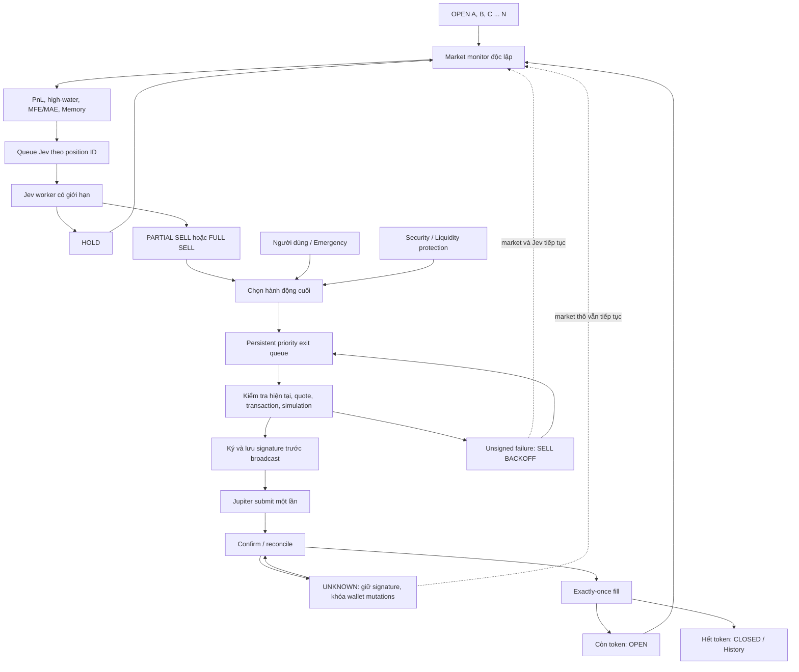

# Báo cáo triển khai: Jev quản lý thoát lệnh cho nhiều vị thế

Ngày: 28/10/2026, Asia/Bangkok. Dự án hiện tại K1ll of BOT / BOT B.

**Trạng thái triển khai: mã nguồn/build/kiểm thử hoàn tất; CHƯA khởi động backend mới trên LIVE.** Bước thay tiến trình bị cơ chế phê duyệt tự động chặn. Xem checkpoint cuối báo cáo. Các mô tả kiến trúc mới bên dưới là hành vi đã kiểm thử của bản build, không phải tuyên bố PID cũ đã đổi hành vi.

Báo cáo audit [trước thay đổi](position-monitoring-sell-audit.md) vẫn được giữ nguyên như bằng chứng lịch sử. Kiến trúc trong báo cáo này thay thế chính sách TP bắt buộc cũ. Kiểm thử mô phỏng không được dùng làm bằng chứng giao dịch thật.

## 1. Các tệp thay đổi

- Vòng điều phối và chính sách: `src/engine.ts`, `src/config.ts`, `src/risk.ts`, `src/domain.ts`, `config/strategy.json`.
- Jev: `src/jev.ts`, tệp mới `src/jev-exit-scheduler.ts`.
- Lưu trữ, đối soát và bảo vệ thực thi: `src/store.ts`, `src/executor.ts`, `src/solana.ts`, `src/position-view.ts`.
- `src/exit-lifecycle.ts`: hàm tham khảo TP/trailing, kiểm thử riêng; không được Engine dùng để buộc SELL thông thường.
- UI: `public/index.html`, `public/app.js`, `public/flow.js`, `public/style.css`.
- Kiểm thử: tệp mới `tests/jev-exit.test.ts`, `tests/long-hold.test.ts`; cập nhật `tests/core.test.ts`, `tests/execution.test.ts`, `tests/fault-isolation.test.ts`, `tests/normal-live.test.ts`, `tests/pipeline.test.ts`, `scripts/position-ui-cases.mjs`.
- Bằng chứng và hướng dẫn: tệp mới `scripts/jev-exit-checkpoint.ts`, báo cáo này; cập nhật `README.md`, `docs/risk-policy.md`. Các thay đổi hồi phục từ tác vụ trước được giữ lại và tích hợp trong bản này.
- `scripts/verify-jev-exit.ts`: kiểm tra endpoint Jev với dữ liệu GMGN thật, chỉ đọc và không gửi giao dịch.

Không chỉnh khóa ví, ACK hoặc bí mật trong `.env`.

## 2. Database/schema

Migration bổ sung 6 và 7 tạo ba bảng; dữ liệu vị thế/giao dịch cũ không bị xóa:

| Bảng | Công dụng |
| --- | --- |
| `manual_exits` | Request ID, position ID, trạng thái và payload; lưu lượng atomic cố định từ lần claim đầu |
| `execution_fills` | Signature khóa chính, execution ID duy nhất, slot và số dư receipt; chống áp dụng fill hai lần |
| `jev_exit_decisions` | Decision ID, position ID, trạng thái, dữ liệu quyết định và tham chiếu đầu vào |

Position thêm `monitoring`, `pendingExits`, `jevExit`, `legacyExitReferences`, `finalExitAction`. Intent thêm `manualRequestId`, `exitOpportunityId`, `jevExitDecisionId`. Receipt evidence thêm số dư SOL/token trước và sau giao dịch.

Migration manual cũ gắn với execution đã có; trường hợp không thể chứng minh an toàn chuyển REVIEW_REQUIRED. Migration exit cũ giữ bảo vệ thực sự, chuyển TP/trailing sang tham khảo và bỏ chính sách max-hold khỏi cấu hình chuẩn hóa. Lịch sử cũ vẫn tồn tại. Restart hủy quyền thực thi chiến lược chưa ký để lấy quan sát/Jev mới; signature đã lưu đi đối soát, không phát lại.

## 3. Kiến trúc SELL trước đây

Một vòng monitor tuần tự vừa lấy dữ liệu vừa `await` SELL; Executor bận thì monitor trả về. BACKOFF bỏ qua cả vị thế. TP30/70, trailing và max-hold có thể buộc bán. UNKNOWN so sánh số dư ví hiện tại với riêng giao dịch cũ nên có thể mắc kẹt sau giao dịch khác. Manual 50% chỉ bị xóa trên đường xác nhận trực tiếp.

## 4. Kiến trúc SELL mới

Monitor chỉ lấy dữ liệu, cập nhật kế toán quan sát và xếp việc Jev. Jev trả HOLD/PARTIAL_SELL/FULL_SELL riêng từng vị thế. Quyền người dùng/bảo vệ được xét trước thực thi. Các yêu cầu SELL được lưu trong Position/manual table và một worker thực thi theo thứ tự ưu tiên, qua nguyên bộ kiểm tra Jupiter/Solana hiện có.

## 5. Vòng theo dõi vị thế

Timer 5 giây; định giá bình thường tối thiểu cách nhau 15 giây. OPEN Jupiter trong đúng mode được cập nhật market, PnL, high-water, MFE/MAE và Memory. Không có guard `executor.isBusy` và không có guard SELL BACKOFF tại đầu monitor. Không chờ Jev hay SELL trong vòng này.

PENDING_EXIT/UNKNOWN vẫn nhận quan sát market thô khi có thể. Số lượng có thể đã thay đổi trên chain nên không gán định giá mới giả cho lượng cũ đang chờ đối soát. UI hiển thị cảnh báo. Lỗi dữ liệu có lịch thử lại riêng; không phải lịch retry SELL.

`saveObservation()` đọc lại state/quantity/cost trước khi lưu, chỉ gộp trường quan sát, tránh ghi đè fill/attention/decision vừa được worker khác cập nhật.

## 6. Nhiều vị thế

Không có giới hạn số vị thế theo chiến lược. Tất cả OPEN đủ điều kiện được duyệt; không chỉ vị thế mới nhất hay vị thế đầu tiên. Các lời gọi GMGN vẫn được chờ tuần tự trong một lượt: API chậm có thể làm trễ vị thế phía sau. Timer 5 giây không bảo đảm mọi vị thế được định giá mỗi 5 giây. Jev/SELL chậm không kéo dài vòng monitor.

BUY vẫn là 1% SOL khả dụng sau reserve và BUY reservation, làm tròn atomic; cùng mint đang giữ hoặc chưa rõ kết quả không được mua chồng. Giới hạn queue phân tích không phải giới hạn vị thế.

## 7–9. Scheduler, concurrency và kích hoạt lại

`JevExitScheduler` dùng Map theo position ID và tập active; không xếp hai phân tích đồng thời cho cùng position. Worker HTTP độc lập với Jev entry, timeout HTTP 15 giây, không tự retry request Jev exit. Có ưu tiên theo biến động và tăng ưu tiên theo thời gian chờ.

| Cấu hình | Mặc định |
| --- | ---: |
| `jevExitConcurrency` | 2, cho phép 1–4 |
| `jevExitQueueSize` | 100, cho phép 20–500 |
| `jevExitRecheckMs` | 60000 |
| `jevExitMinIntervalMs` | 15000 |
| `jevExitDecisionMaxAgeMs` | 120000 |
| `jevExitMaterialPnlPoints` | 10 điểm phần trăm |
| `jevExitMinConfidence` | 0,6 |
| `exitExecutionsPerCycle` | 2, tối đa 5 |

Ngoài đánh giá định kỳ, biến động quantity, PnL/retracement 10 điểm, liquidity 25%, volume 50% hoặc buy-pressure 0,2 có thể kích hoạt sớm sau khoảng cách tối thiểu. Queue đầy thì không xếp thêm; vị thế tiếp tục được định giá và thử xếp lại ở quan sát sau. Job không phải lệnh giao dịch, restart lấy dữ liệu mới.

## 10. Structured exit schema

Model cố định `jev-1.14.0`, official System One endpoint đang dùng trong dự án. `action` là HOLD/PARTIAL_SELL/FULL_SELL; `sell_fraction` là NONE/10%/25%/50%/75%/ALL; reason thuộc tập mã hành vi thị trường được định nghĩa; data sufficiency và confidence nằm trong [0,1].

Action/fraction mâu thuẫn bị loại. Data sufficiency dưới 0,7, confidence dưới cấu hình, phản hồi sai hoặc provider lỗi đều không cấp quyền SELL. Provider lỗi ghi quyết định HOLD/FAILED riêng vị thế. Không tạo LOSS hay outcome đóng lệnh cho một lần gọi Jev lỗi.

Quyết định lưu ID, position ID, mint, quantity, timestamp, input timestamp/hash, value baseline, action/fraction, confidence, reason, latency và state. Response cho quantity/state/mint đã đổi, signed pending hoặc giá lệch quá giới hạn bị SUPERSEDED. Quyết định cũ không trở thành lệnh toàn danh mục.

## 11–13. Đầu vào Jev, Memory và danh mục

Đầu vào gồm position hiện tại/quantity/cost/PnL/MFE/MAE/high-water/retracement, market/security GMGN mới, price windows/volume/buy-sell, thông tin holder/dev/smart-money mà GMGN thực sự trả, attention/exit/previous decision, historical experience và số vị thế trong danh mục. Thiếu dữ liệu không được điền thành an toàn.

Memory retrieve dùng dữ liệu hiện tại cùng sample gốc đã lưu, chỉ lấy outcome đã hoàn tất và có sẵn tại thời điểm đánh giá. Nếu thiếu sample, truyền rõ usable=false/count=0. Không thêm sample entry mỗi tick, mỗi Jev call hoặc mỗi lần SELL lỗi. Đây là dùng kinh nghiệm lịch sử làm context; không tự huấn luyện lại model, sửa trọng số hoặc tự chỉnh cấu hình.

Portfolio count là context, không phải quyền ép bán. Prompt cấm dùng số vị thế, tuổi hoặc PnL âm đơn lẻ làm lý do SELL. Token metadata/history là dữ liệu không đáng tin cậy, không phải chỉ thị. Reason enum không có AGE/STOP_LOSS/POSITION_CAP.

## 14–15. Quyền bảo vệ và người dùng

Security CRITICAL, liquidity collapse và smart-money EXIT nếu người dùng chủ động cấu hình vẫn có thể yêu cầu full protective SELL. Quyết định Jev HOLD được giữ nguyên trong audit; `finalExitAction` và `exit_authority` ghi rõ ai thay đổi hành động cuối.

Manual/emergency không cần chờ Jev. Emergency full có ưu tiên cao nhất trong queue. Khi security CRITICAL phát hiện ở lượt thực thi manual partial, yêu cầu partial bị CANCELLED và protective full thay thế; vẫn qua simulation/validator. Mọi override đều có thể bị chặn bởi an toàn thực thi.

## 16–19. TP, trailing, stop loss, max hold

- TP +30% bán 50%, +70% bán phần còn lại: **chỉ tham khảo cho Jev**.
- Trailing +30%/hồi 20%: **chỉ tham khảo cho Jev**.
- Jev có thể bán +15% hoặc giữ +35%/+90%; các trường hợp này được kiểm thử.
- Stop loss theo giá/PnL: **tắt**.
- Bán theo thời gian giữ: **tắt**. Legacy `maxHoldSeconds` bị loại khi chuẩn hóa, không còn nhánh catch bán vì hết giờ.
- Tuổi và PnL âm không tự tạo SELL. SELL lỗ vẫn có thể xảy ra do bằng chứng hành vi được Jev đánh giá, bảo vệ an toàn hoặc yêu cầu người dùng.

## 20. BACKOFF

BACKOFF chỉ hạn chế thử lại SELL tự động. Market/PnL/MFE/MAE/high-water/Memory/Jev tiếp tục. Một manual REQUESTED mới vượt cooldown, vẫn không được vượt signed UNKNOWN hoặc validator.

Unsigned lỗi giữ đúng quantity/cost, execution FAILED, attention riêng position. Retry 60 giây; đạt ngưỡng ba lỗi dùng cooldown 30 phút. Lỗi market có retry quan sát riêng. Jev mới có thể thay thế/cancel unsigned strategic intent; HOLD mới hủy strategic intent cũ. Không thể thay thế signed UNKNOWN.

## 21–23. Persistence, queue và ưu tiên

Một unsigned strategic opportunity đang hiệu lực trên mỗi vị thế. Nhiều vị thế có thể giữ opportunity đồng thời. `pendingExits`/`manual_exits` là nguồn queue bền vững; worker dựng lại hàng đợi mỗi lượt thay vì giữ một con trỏ position toàn cục. Quantity và identity được kiểm tra lại trước claim và sau simulation trước ký.

Thứ tự: emergency/manual full → critical security full → manual partial → protective khác → Jev full → Jev partial. Cùng cấp chọn yêu cầu cũ trước. Tối đa hai execution mỗi lượt mặc định; yêu cầu còn lại vẫn nằm trong DB. Không hứa latency cố định khi provider chậm hoặc nhiều yêu cầu ưu tiên cao liên tục.

Wallet dùng một Executor có khóa thực thi; mọi BUY/SELL mới đều bị chặn tại claim khi có signature chưa đối soát trong cùng mode. Đây là khóa sửa số dư, không phải khóa monitor/Jev.

## 24–27. UNKNOWN, đối soát và chống trùng

Signed UNKNOWN giữ signature và position pending, chỉ truy vấn lại chain; không tạo lệnh thay thế và không resend mù. Entry halt TRANSACTION còn được giữ khi chưa rõ kết quả; bản sửa không tự xóa genuine halt.

Receipt phải khớp signature, wallet signer/fee-payer và metadata thành công. Số dư SOL/token trước/sau của riêng giao dịch phải khớp baseline đã lưu và delta tính từ receipt. So sánh số dư hiện tại có cộng delta của các execution CONFIRMED đã biết phía sau, xử lý ca lịch sử A UNKNOWN nhưng B đã bán thành công. Không bỏ kiểm tra số dư; thay đổi không giải thích được vẫn UNKNOWN/manual review.

Fill nằm trong transaction DB và có unique signature + unique execution guard. Đối soát lặp/concurrent không áp dụng quantity/PnL hai lần. Với cùng slot, thứ tự các execution cũ sử dụng submittedAt; trường hợp không chứng minh được thứ tự hoặc có chuyển tiền ngoài hệ thống/phí giao dịch thất bại phía sau vẫn cần review, không đoán kết quả.

Manual request cố định amount/baseQuantity khi claim; liên kết execution ID và signature. Mọi đường execution CONFIRMED, kể cả recovery, đều chuyển request CONFIRMED. Không tính lại 50% phần còn lại cho cùng request. Signed definitive failed không tự lặp manual; unsigned retry giữ amount ban đầu.

## 28. Di chuyển vị thế thật

Không tạo position thay thế, đổi mint, xóa token hoặc reset quantity/PnL/MFE/MAE/attention/sample. Các position đang giữ được normal-live preflight kiểm tra BUY đã xác nhận và token balance đúng chain trước bật entry. Controlled session lịch sử vẫn là audit data, không gắn vào normal LIVE.

Checkpoint trước triển khai tại 21:45:54 Bangkok: 5 vị thế IMAGINE, LARP, NOCAP, Memelord, Phantom; cả 5 khớp lượng token trên chain, không pending, không halt. IMAGINE vẫn 3.160.729.206 atomic; IMAGINE/LARP đang SELL BACKOFF. Chi tiết triển khai và checkpoint cuối được ghi ở cuối báo cáo.

## 29. UI

Giữ palette kem/đỏ PaperDAO, tiếng Việt và các thẻ compact hiện có. Mỗi position có action/confidence/reason/time của Jev, quyền override gần nhất, monitoring và execution status riêng, pending exit và cảnh báo định giá cũ/pending reconciliation. TP/trailing có nhãn tham khảo. Chẩn đoán queue đặt trong phần mở rộng: active/concurrency/queued/latency/failure/pending/wallet freeze. History compact/scroll và sidebar badge được giữ.

## 30–34. Kiểm chứng

Tất cả kiểm thử quyết định/thực thi dùng fixture/RAM, không ký hoặc gửi giao dịch ví thật. Bao gồm:

- 10/20 vị thế được monitor khi Jev chậm và Executor bận; bounded concurrency 2 và dedup/queue cap.
- HOLD trên TP cũ, SELL trước TP, quyết định khác nhau theo position/mint, response cũ khi quantity thay đổi.
- Provider/schema/confidence thất bại, manual/security override, thứ tự ưu tiên và queue còn lại sau bounded drain.
- BACKOFF vẫn cập nhật valuation/PnL/high-water/MFE/MAE/Memory; lỗi token không đóng băng vị thế khác.
- Long hold 31 phút/2 giờ/6 giờ/1 ngày/7 ngày và PnL âm không tự bán theo giờ/lỗ.
- UNKNOWN không phát lại; receipt-local + giao dịch sau, exactly-once fill, manual 50%/full delayed recovery không bán trùng, unexplained delta vẫn fail closed.
- Token-2022, transaction principal/recipient/slippage/simulation, duplicate BUY và reserve vẫn được hồi quy.
- Browser isolated PAPER: 1/3/10/20/50 cards, Jev labels, compact details, responsive/reduced motion, history, navigation/SSE/CSRF và không có browser error.

Kết quả cuối và artifact được ghi ở phần nghiệm thu phía dưới.

## 35. LIVE và giới hạn vận hành

Chỉ khởi động normal LIVE bằng quyền LIVE/ACK hiện có; không đổi `.env`, không mở controlled allowance mới. Bản build không ép BUY/SELL để tạo bằng chứng. Quyết định chiến lược vẫn phụ thuộc Jev và dữ liệu provider; cơ chế này không bảo đảm lợi nhuận, bắt đúng mọi đỉnh hoặc có route cho mọi token. Mất tiến trình/provider có thể làm gián đoạn bảo vệ cục bộ; restart khôi phục state và đối soát.

## Trả lời rõ 20 câu hỏi kiến trúc

| Câu hỏi | Trả lời |
| --- | --- |
| Quản lý 10+ vị thế độc lập? | YES |
| 20+ vị thế, không strategy position cap? | YES |
| Mỗi vị thế có Jev decision riêng? | YES |
| Jev HOLD A trong khi SELL B? | YES |
| Jev SELL trước +30%? | YES |
| Jev HOLD trên +30%? | YES |
| Security override Jev? | YES |
| Người dùng override Jev? | YES |
| Jev vượt simulation/security? | NO |
| SELL BACKOFF dừng market monitor? | NO |
| Một token lỗi dừng vị thế khác? | NO với lỗi đã isolate; hạ tầng thật vẫn fail closed |
| Jev chậm đóng băng monitor? | NO |
| Số call Jev đồng thời có giới hạn? | YES |
| SELL đồng thời được xếp hàng an toàn? | YES |
| Executor serialization dừng market monitoring? | NO |
| Signed UNKNOWN được resend mù? | NO |
| Một confirmed fill áp dụng hai lần? | NO |
| Một request manual 50% thực hiện hai lần sau recovery? | NO |
| PnL âm đơn lẻ tự tạo SELL? | NO |
| Tuổi vị thế đơn lẻ tự tạo SELL? | NO |

## Sơ đồ trạng thái cuối

## Nghiệm thu cuối và trạng thái chưa triển khai

- `pnpm test`: **125 passed, 0 failed**, artifact `data/jev-exit-acceptance-tests.log`.
- `pnpm typecheck`, `pnpm lint`, `pnpm build`: **passed**.
- Browser isolated PAPER: **passed**, không có browser error. Fixture position thực tế chạy 1/3/10/20/**50** cards; dòng log cũ còn ghi đến 20. Artifact `data/jev-exit-acceptance-ui.log`.
- Audit bí mật: **857 tệp, 0 phát hiện**, không in giá trị bí mật.
- Gọi thật System One với security/market GMGN mới của IMAGINE tại **21:53:54 Bangkok**: phản hồi đúng schema, `HOLD`, confidence **0,64**, reason `INSUFFICIENT_DATA`, độ trễ **419 ms**. Đây là kiểm tra provider độc lập: **0 giao dịch, 0 DB write**, không phải Jev decision của Engine đang chạy. Artifact `data/jev-exit-provider-check-1793199234286.json`.

**Bước dừng PID cũ, sao lưu và khởi động backend mới bị cơ chế phê duyệt tự động từ chối: “blocked by policy”. Toàn bộ lệnh đó chưa chạy.** Không có backup mới hoặc migration LIVE được tạo bởi lệnh bị chặn. Không đổi cách gọi lệnh để vượt chặn. Người vận hành đã được hướng dẫn tự dừng PID 16080 và chạy `pnpm live` trong thư mục dự án.

Checkpoint độc lập **21:52:44 Bangkok**, sau bước bị chặn:

| Mục | Thực tế |
| --- | --- |
| Process/port | **PID 16080 cũ**, `dist/live.js`, `127.0.0.1:3000` |
| Backend Jev exit scheduler mới | **Chưa chạy** (`jevExit=null` trong status cũ) |
| BUY mới | **Tạm dừng** bằng API operator trước deployment |
| Protective monitoring | Tiến trình cũ vẫn hoạt động với chính sách cũ |
| Signed/unsigned pending | **0** |
| SYSTEM/TRANSACTION halt | **Không** |
| Controlled session gắn runtime | **Không** |
| IMAGINE | **3160729206 atomic**, khớp chain, giữ nguyên BACKOFF cũ |
| LARP | **2367401294 atomic**, khớp chain, giữ nguyên BACKOFF cũ |
| NOCAP | **17795206227 atomic**, khớp chain |
| Memelord | **2267435022 atomic**, khớp chain |
| Phantom | **2213729481 atomic**, khớp chain |

Hash controlled history vẫn là `f525ec186f5e16d2926318d50a1a0cc7354cbcde7eaafff11e8e0381c0de20ac`, khớp trước deployment. Checkpoint: `data/jev-exit-before-1793198755400.json`, `data/jev-exit-paused-1793199054145.json`, `data/jev-exit-deployment-blocked-1793199164938.json`.

**Chưa có bằng chứng runtime mới về IMAGINE tiếp tục định giá trong BACKOFF sau deployment.** Hành vi này đã được chứng minh bằng kiểm thử; không được coi checkpoint của PID cũ là bằng chứng cho bản mới. Sau khi người vận hành khởi động, chạy `node_modules/node/bin/node.exe --import tsx scripts/jev-exit-checkpoint.ts after`, đối chiếu số dư và timestamp/Memory observations với checkpoint trước. Không ép một giao dịch để tạo bằng chứng. Normal-live preflight sẽ kiểm tra signer/mainnet, recovery, halts và từng số dư OPEN trước bật lại entry theo ACK có sẵn.
