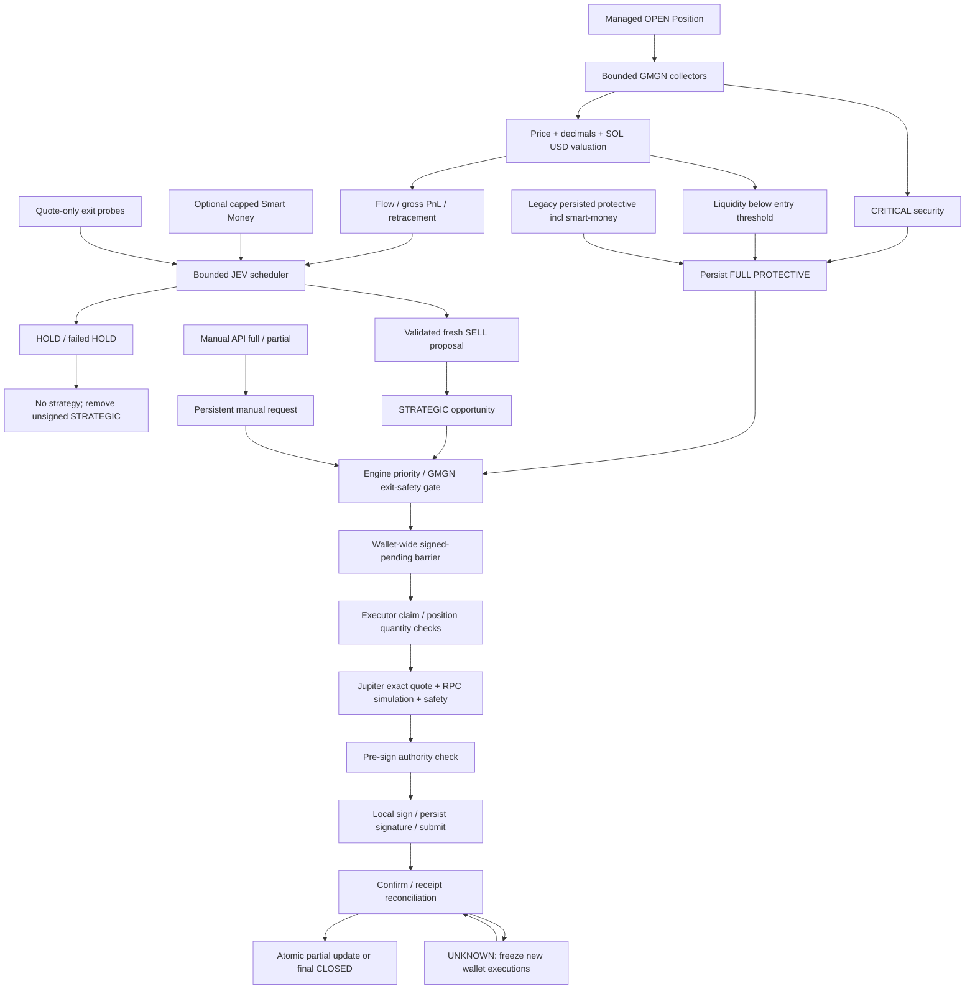

# AUDIT ONLY — Position SELL Architecture & JEV Authority

Ngày 2026-11-02, Asia/Bangkok. Kết luận từ source hiện tại, không dùng report cũ làm proof. Không sửa implementation/UI/config; không instantiate Engine, Store, Solana hoặc execution provider; không chạy bot hoặc full execution test suite. Có đọc SQLite qua `DatabaseSync({readOnly:true})`, `PRAGMA query_only=ON`, và chạy parser/scheduler/pure risk functions với fixtures trong bộ nhớ, chặn toàn bộ fetch.

Evidence: [integrity](position-sell-authority-audit-integrity.json), [runtime/config context](position-sell-authority-audit-runtime-context.json), [pure probes](position-sell-authority-audit-probes.json), [legacy context](position-sell-authority-audit-legacy-context.json). DB observations là các snapshot đọc riêng khi bot có thể đang hoạt động, không phải transaction snapshot chung.

## A. Executive Verdict

**D — CRITICAL SELL ARCHITECTURE RISK**, xét yêu cầu Position phải còn khả năng thoát trong critical conditions khi JEV/data/provider có vấn đề. Không có bằng chứng audit này rằng một transaction LIVE thực tế đã bị bỏ lỡ; đây là các đường điều khiển được xác minh trong code.

**JEV là single point of failure cho việc cấp quyết định strategic SELL mới: YES.** JEV không phải toàn bộ final execution authority. Manual, critical GMGN security và GMGN liquidity collapse có bypass. Tuy nhiên:

1. Price/flow collapse đơn thuần không có deterministic protective exit. JEV HOLD/down có thể giữ Position dù price đang sụp nếu chưa chạm điều kiện security/liquidity riêng.
2. Timeout/error/schema invalid tạo `HOLD + status=FAILED`. Nếu decision vượt apply guards, nó còn thay thế/xóa unsigned strategic opportunity cũ.
3. Liquidity protection trong monitor nằm **sau** token price/decimals và SOL/USD valuation. Có liquidity collapse evidence nhưng price/FX lỗi thì chưa tạo protective opportunity.
4. Manual/protective SELL chỉ bỏ qua **retryable GMGN ProviderFailure**. Auth/plan/missing-key hoặc loại lỗi khác vẫn chặn, ngay cả Jupiter/RPC còn hoạt động.
5. PRE_SELL backoff sau failure threshold có thể lên **30 phút**, áp dụng cả automatic critical protection; fresh manual REQUESTED mới được bỏ qua backoff.
6. Signed UNKNOWN của một giao dịch đóng băng mọi execution mới cùng mode/wallet. Chống duplicate tốt, nhưng chưa có bounded terminal resolution cho giao dịch không có receipt.

Các protections đáng ghi nhận: detached JEV snapshots, quantity/revision/price/time guards, independent bounded collectors/JEV workers, persistent manual/opportunity state, pre-sign checks, signature persisted trước broadcast, idempotent receipt reconciliation. Chúng không tạo một structural exit authority thay thế JEV.

**Scope runtime:** fingerprint `dist/build-info.json` trên đĩa khớp source/public/config hiện tại (`3292df44…d7fea8`); audit không xác minh bộ nhớ của process đang chạy đã nạp đúng build này. Runtime persisted strategy được đọc riêng bên dưới. Không tuyên bố “LIVE verified safe”.

## B. Current SELL Architecture

Normal production path, từ code:

```text
Engine.start → timer 5s
  ├─ processExits: reconcile signed pending trước; drain tối đa 2 exits/cycle
  ├─ ExitLiquidityMonitor.pump [LIVE, quote-only]
  └─ monitor → PositionCollector [4 workers]
       → GMGN security [cache10s]
       → record security; CRITICAL: rememberProtection ngay
       → GMGN token info [cache10s]
       → require token price + stored decimals
       → GMGN SOL/USD [cache30s]
       → mark value / gross accounting / MFE-MAE / flow / persist
       → LIVE: queue quote-only exit probes
       → protectiveExitDecision: critical hoặc liquidity below entry baseline
       → scheduleExitAnalysis [không await JEV]
       → optional Smart Money job [không await]

JEV scheduler → schema/confidence validation → applyExitDecision
  → HOLD: không tạo SELL, xóa unsigned strategic opportunities cũ
  → SELL: queue STRATEGIC nếu guards hợp lệ

processExits → chọn manual/protective/strategic → GMGN exit-safety read
  → exitPosition → Executor.execute / Store.claim
  → wallet balances → exact-quantity Jupiter quote
  → quote/fee/transaction/token compatibility checks → RPC simulation
  → final authority + unchanged wallet/decimals checks
  → local beforeSign check → sign → durable signature → submit Jupiter
  → confirmation → receipt/balance reconciliation → atomic fill/update/close
```

`Engine.monitor`703, security748, valuation769–804, protection863; `processExits`1335; `exitPosition`1552; `Executor.execute`77, `reconcileOne`589; `JupiterExecutionProvider.execute`541.

Không có class ExitEngine độc lập giữ một strategic safety policy. `Engine` điều phối; `exit-lifecycle.detectExits` là helper legacy, không có production caller từ Engine hiện tại.

## C. Files / Functions

| Layer | File / function | Responsibility |
|---|---|---|
| Startup/restart | `engine.ts:129` constructor,239 start,283 stop; `normal-live.ts:8` activateNormalLive | Restore/migrate state, revoke unsigned strategic authority, recover receipts, start/stop loops |
| Monitoring | `engine.ts:703` monitor; `position-collector.ts:9` collect | Bounded per-position collection, persist market/security/flow, schedule exits |
| Price | `gmgn.ts:193` normalizeMarket,830 info; `engine.ts:347` solUsd; `risk.ts:365` paperValue | GMGN mark valuation, not executable quote |
| Accounting | `trade-accounting.ts` tradeAccounting; `engine.ts:804` | Gross/fees/net, remaining principal, gross excursions |
| Flow | `capital-flow.ts:248` regimeFor,294 evolveFlow,498 observe,539 degraded | Rolling directional evidence, hysteresis, signalKey, missing/stale flags |
| Structure | `market-history.ts` oneShotStructure; `manipulation-structure.ts` analyzer; `one-shot-entry.ts` | Candidate BUY evidence/veto; no Position structural SELL loop |
| Smart Money | `gmgn.ts:957` smartMoneyFeed; `smart-money.ts` normalizeSmartMoney/smartMoneySupport; `engine.ts:1155` collectPositionSmartMoney | Optional capped participant context; revision updates |
| Security | `gmgn.ts:251` normalizeSecurity,865 security; `engine.ts:919` rememberProtection | GMGN CRITICAL → durable full protective opportunity |
| Liquidity trigger | `risk.ts:282` exitDecision,329 protectiveExitDecision | Current liquidity versus entry initialLiquidity |
| Quote monitoring | `exit-feasibility.ts:61` probeExits,222 exitLiquidityContext,238 ExitLiquidityMonitor |20/50/100% route/output/impact estimates; advisory |
| JEV contract | `jev.ts:122` decideExit,293 schema,340 parseJevExit,376+ questions | Strict action/fraction/reason/confidence schema and instructions |
| JEV queue | `jev-exit-scheduler.ts:37` schedule,49 pump,76 run | Clone, bounded workers/queue, failure HOLD |
| Event scheduling | `engine.ts:945` scheduleExitAnalysis | Fixed material triggers, minimum interval and periodic check |
| Apply/pre-sign | `engine.ts:1205` exitEvidenceChanged,1228 applyExitDecision,1607 checkExitAuthority | Reject stale/superseded actions; queue/cancel strategy |
| Priority/manual | `engine.ts:319` emergency,1335 processExits; `server.ts:270` POST /api/exit | Persistent user requests; deterministic priority |
| Execution | `executor.ts:53` validate,77 execute,802 sellIntent | Position sizing, claim, preflight, submit lifecycle |
| Jupiter/RPC | `execution-provider.ts:158` validateQuote,254 quote,354 simulate,541 execute,589 confirm; `solana.ts` | Exact route/direction/signer/quantity simulation and receipts |
| Persistence | `store.ts:224` savePosition,473 saveObservation,613 syncManual,632 syncJevExit,660 pending,713 claim | Revision/state/lock/idempotency semantics |
| Errors/backoff | `engine.ts:443` isolate,552 positionIssue; `failures.ts:20` failureInfo,59 ProviderFailures | Position/provider/system/transaction failure classification |
| Memory | `trading-memory.ts`, `runner-memory.ts:130/234/258` observe/decision/fill | Observation/audit context; no independent SELL transaction authority |
| UI | `public/app.js` BOTPositions/BOTOverview sell actions | Confirm then POST request; API validation/execution still required |
| Explicit tools | `live-controlled.ts`, `controlled-session.ts`; `smoke-live.ts:153` leg | Controlled harness uses Engine; smoke has separately invoked direct round-trip path, not normal Position loop |

Full-source searches covered SELL/PARTIAL_SELL/FULL_SELL/HOLD/emergency/exit/sellBps/quantity, direct `execute`, `sellIntent`, `exitPosition`, `detectExits`, and provider signing/submission paths.

## D. SELL Entry Points

1. Accepted JEV FULL_SELL/PARTIAL_SELL → STRATEGIC opportunity.
2. `Engine.emergency(positionId,bps)` from validated local API → manual request; default100%, API allows0.01–100%.
3. Monitor CRITICAL findings → `rememberProtection`, even before token price fetch.
4. Monitor liquidity threshold → `rememberProtection`, **after successful valuation**.
5. An already queued exit causes processExits to re-read security; critical can promote a strategic exit to protective. It can also discover liquidity collapse while refreshing info for a strategic opportunity.
6. Durable PROTECTIVE opportunities survive retries/restart. This includes a **legacy caveat**: `store.ts:582` migrates old failed reasons matching `smart-money` to PROTECTIVE; the JEV-policy migration removes TP/trailing references but does not remove those protective records.
7. Smoke CLI has a direct `provider.execute` SELL after its own confirmed BUY, outside normal Position/JEV architecture. It is explicitly invoked, not a background escape path. Not run in audit.

Recovery/reconciliation applies an existing signed transaction; it does not authorize a fresh SELL. Shutdown does not liquidate. Dismiss Position removes management without selling. Candidate Structure/Controlled Markup guard prevents BUY, not liquidation of an already held token.

## E. Authority Matrix

“Can JEV veto?” means a direct decision veto, not whether dependencies/locks can prevent execution.

| Trigger | Can request SELL? | Bypass JEV? | Can JEV veto? | Partial/full | Production? |
|---|---|---|---|---|---|
| JEV FULL_SELL | YES after guards | NO | YES: HOLD/failure/superseding before claim | Full tracked qty | YES |
| JEV PARTIAL_SELL | YES after guards | NO | YES |10/20/25/50/75% remaining | YES |
| GMGN critical security | YES | YES | **NO** | Full | YES, provider/execution gates remain |
| GMGN liquidity threshold | YES when detected | YES | **NO** | Full | YES, valuation dependency caveat |
| Manual full | YES | YES | **NO** | Full tracked qty | YES |
| Manual partial | YES | YES | **NO** | API-selected fraction | YES |
| Fresh Smart Money BUY/SELL/cluster | NO direct request | No independent path | No independent path; JEV may HOLD | Advisory only | YES context |
| **Legacy Smart Money PROTECTIVE** | YES if persisted/migrated | YES | **NO** | Usually full | Conditional legacy path; not observed active in DB read |
| Capital Flow, any regime | NO direct request | NO | YES for strategic consequence | JEV decides | YES evidence |
| Price/recovery/floor/structure failure | NO direct request | NO | YES; no deterministic structure SELL | None independently | Candidate evidence only for V3/analyzer |
| Profit/negative PnL/age | NO direct request | NO | JEV can HOLD | References/context | Normal path |
| Legacy TP/trailing helper | Not wired to normal executor | N/A | N/A | Helper calculations only | Tests/legacy; not production bypass |
| Recovery after restart | No fresh strategic authorization | Reconcile only | NO veto of submitted transaction | Signed amount fixed | YES |
| Transaction reconciliation | No new transaction | JEV irrelevant | **NO** | Existing fill | YES |
| Shutdown/restart action itself | NO liquidation | N/A | N/A | None | YES |
| Explicit smoke round-trip | YES, separate CLI | YES | **NO** | Test-acquired qty | Explicit tool, not normal Position production loop |

**Exact queue priority** (`engine.ts:1377`), first by rank then oldest trigger:

1. Manual FULL.
2. Manual PARTIAL.
3. PROTECTIVE reason containing case-sensitive `Critical`.
4. Other PROTECTIVE, including liquidity and legacy records.
5. JEV FULL.
6. JEV PARTIAL.

Above this ranking sit stopping/execution busy and wallet-wide signed-pending barriers. A rank is not preemption of an already submitted transaction. Manual partial actually precedes critical full; critical may sell the remainder in a later drain iteration. Protected opportunities are sorted using their reason strings; liquidity actions are labeled `finalExitAction.authority="SECURITY"`, not a distinct liquidity authority.

Conflicts: Security FULL vs HOLD → protective wins, subject to execution. Manual FULL vs HOLD → manual wins. Severe structure weakness vs HOLD → no independent structure exit, HOLD remains. JEV FULL vs healthy security → JEV can execute after validation; healthy security is not a veto.

## F. JEV Contract

Actual endpoint `POST https://api.typesafe.ai/v1/systemone`, model `jev-1.14.0`; code inspected, no request sent. `Jev.decideExit` does not use BUY decision cache.

Required answers: action `HOLD|PARTIAL_SELL|FULL_SELL`; sell_fraction `NONE|PERCENT_10|PERCENT_20|PERCENT_25|PERCENT_50|PERCENT_75|ALL`; primary_reason; data_sufficiency.noul0..1. Each choice includes confidence0..1 and probabilities record. Optional thesis/flow_assessment/invalidation_signal/reevaluate_on use finite enums. Primary reasons: MOMENTUM_DETERIORATION, ORDER_FLOW, LIQUIDITY_TREND, SMART_MONEY, HOLDER_BEHAVIOR, DEV_ACTIVITY, PROFIT_MANAGEMENT, HISTORY_CONTEXT, INSUFFICIENT_DATA, UNCHANGED (`jev.ts:280`).

Parser requires matching action/fraction. Scheduler revalidates integer bps and confidence, then applies configured minimum0.6. Data sufficiency<0.7 or a SELL with INSUFFICIENT_DATA/UNCHANGED reason becomes HOLD0. Reason may remain ORDER_FLOW even after insufficient-data conversion; there is not always a separate “insufficient” failure status.

Input from `engine.ts:1004`: discovery/rank; quote-only exitLiquidity with stale flag; GMGN metadata/provider state; current Position identity/revisions/remaining qty/value/principal/gross PnL/fee/net/MFE/MAE/retracement; token market/security/holder and smart-wallet counts; capitalFlow; optional smartMoneySupport; position count explicitly not an exit reason; policy/reference thresholds. It does **not** supply fresh Position OHLCV/V3/manipulation breakdown analysis.

JEV generates the strategic proposal. Engine accepts/rejects/queues it; Executor/provider retain transaction safety authority. Schema compliance does not prove the selected financial reason is true: no deterministic predicate binds ORDER_FLOW or PROFIT_MANAGEMENT to a demonstrated deterioration. The prohibition on PnL-only/age-only SELL is primarily prompt policy, not a semantic verifier of model reasoning.

## G. JEV HOLD Behavior

Accepted HOLD increments hold metrics, supersedes previous unsigned STRATEGIC decisions and removes STRATEGIC opportunities, saves p.jevExit and records meaningful context. It leaves PROTECTIVE/manual state intact (`engine.ts:1264–1333`). It does not stop collection or reset market/flow evidence.

Minimum schedule interval15s. Without material change, periodic eligibility60s from last accepted scheduling time (fallback previous.createdAt), **not necessarily response time**. Scheduling is called only on successful monitor collection or optional Smart Money completion using persisted market/security. Normal timer5s with a per-position lastQuoteAt throttle15s, plus provider/queue latency. Failed collection can postpone calls by60s or longer; there is no unconditional timer that evaluates JEV from independently fresh data every60s during a provider outage.

JEV's `reevaluateOn`/`invalidationSignals` are saved descriptive outputs, not dynamically registered event subscriptions. Fixed code determines subsequent scheduling.

Thus HOLD can continue during collapse if protection is not detected and subsequent JEV also holds/fails or cannot run. Periodic reevaluation exists; “no event means JEV is never called again” would be incorrect for healthy collection.

## H. JEV Failure Behavior

`Http.request` uses fetch timeout15s; decideExit passes retry=false, so no HTTP retry inside one JEV call (`util.ts:83–123`, `jev.ts:154`).

| Failure | JEV layer | Scheduler/output | Subsequent behavior |
|---|---|---|---|
| Timeout/network/API unavailable | Throws | HOLD0, FAILED, PROVIDER_UNAVAILABLE + error | May apply as failed HOLD; future bounded reevaluation |
| HTTP4xx/5xx/429 | Throws ProviderFailure;401/403 nonretryable classification | Same FAILED HOLD | No immediate JEV retry/fallback strategic model |
| Invalid JSON | Throws invalid response | Same FAILED HOLD | Same |
| Missing confidence/unknown action/schema invalid | Reject parse | Same FAILED HOLD | Same |
| Action/fraction mismatch | Throws | Same FAILED HOLD | Same |
| Confidence<0.6 | Valid response | HOLD0, LOW_CONFIDENCE, DECIDED | Normal next eligibility |
| Data sufficiency<0.7 | Parser conversion | HOLD0, valid response | No automatic emergency solely for missing data |

This is explicitly **JEV FAILURE = operational HOLD**, while error/status still distinguish failure. `applyExitDecision` has no `status===FAILED` exclusion before clearing old unsigned strategic work. If stale/quantity guards fail instead, it records SUPERSEDED and does not apply that HOLD.

Pure probes reproduce timeout/invalid output → FAILED HOLD and low-confidence → DECIDED HOLD. No HTTP/provider executed. Ten-minute outage means no new strategic decisions; a previously authorized valid pending action might execute before expiry/supersession, but there is no durable independent strategic fallback for the outage. Manual/protective remain conditional alternatives.

## I. Stale Decision Protection

Scheduler `structuredClone(job)` detaches nested state; it is a snapshot copy, not an `Object.freeze` security boundary (`jev-exit-scheduler.ts:42`). Apply (`engine.ts:1235`) checks Position exists/managed/OPEN, mint/quantity, **decisionRevision**, flowSignalKey, no same-position signed pending, future/old input, recent lastQuoteAt, and material value change. `exitEvidenceChanged` adds price delta>10% against a newer/equal-timestamp market and newer/equal-timestamp CRITICAL security. A usable Smart Money snapshot aged>45s invalidates non-HOLD decisions. These checks run again in strategic authority before signing (`engine.ts:1607`), with manual/protective supersession.

**Important distinction:** d.positionRevision is populated from p.decisionRevision. Generic p.marketRevision and p.flowRevision counters are included as context but not compared wholesale. Flow uses signalKey; a changed liquidity/route input is not always independently invalidated unless it changes a checked signal, protection revision, price/value or quantity. There is no direct comparison of exitLiquidity status/output/impact in apply. Degraded flow keeps its old signalKey; input-level flow/security age are not universally checked at `maxSnapshotAgeMs`.

| Input | Source/timestamp | Actual freshness/check | Missing/stale behavior |
|---|---|---|---|
| Price | GMGN token/info; market.at=local fetch/cache completion |10s cache; price delta gate; Position lastQuoteAt age≤120s | Missing price aborts valuation; no new JEV; no independent price fallback |
| PnL/value | Qty × token USD / SOL USD; lastQuoteAt set at local valuation | Same valuation/120s decision gate; no independent economic plausibility check | Nullable gross; scheduling priority substitutes0 only; JEV nullable input |
| SOL/USD | GMGN SOL info, cache30s | Positive validated; snapshot timestamp preserved for fee FX | Failure aborts valuation/protection downstream |
| Flow | Rolling info observations with fetchedAt, flow.at/signalKey |15s observation interval, quality/stale flags,90s degraded-stale setting; no universal execution flow-age veto | Missing remains unknown/degraded; stale flag to analyst; key may stay unchanged |
| Structure | No fresh Position candle structure input | NONE for V3 sequence in Position SELL | Does not independently request exit |
| Smart Money | Capped feed observedAt + individual event timestamps | Cache≤30s; usable input snapshot≤45s; usable non-HOLD evidence rechecked before signing | UNAVAILABLE/NO_MATCH not market-wide0, optional alone not veto |
| Security | GMGN token/security sec.at, cache10s; bounded listing fallback | CRITICAL detection before price, re-read in processExits, newer critical supersession | UNKNOWN is not CRITICAL; request failure can prevent analysis/execution |
| Pool liquidity | GMGN info liquidity/pool.liquidity, market.at |10s cache; no separate per-field publication timestamp; compare initialLiquidity | Unknown/baseline absent → no collapse trigger; invalid but accepted known values may trigger |
| Executable value | Jupiter probes checkedAt, quantity, validUntil | Default5min schedule, stale after10min or qty mismatch | Advisory stale/UNKNOWN; no automatic liquidation |
| Quantity | Persisted confirmed Position qty/revisions | Equality apply/pre-sign; actual wallet availability checked at execution | Not refreshed by RPC every valuation tick; external balance changes detected at preflight/startup |
| MFE/MAE | Persisted gross observed extrema | Updated on successful valuations/fills; no expiry of historical extrema | Missing historical extrema null; not independently verified from candles |

Fresh fetch completion is not proof of provider publication latency or correct price. T0 old HOLD with a known newer price -40% is rejected by the>10% material gate. Stale rejection is **NO_ACTION/SUPERSEDED**, not an emergency SELL.

## J. Event Detector / Concurrency

Fixed material checks (`engine.ts:976`): quantity; exitLiquidity **status**; Trending rank; decisionRevision; flowSignalKey; gross PnL delta≥10 percentage points; retracement delta≥10 points; liquidity relative change≥25%; volume relative change≥50%; buy-count pressure delta≥0.2. First decision waits only interval eligibility; no previous result means no material comparison. MFE/MAE alone have no separate predicate; retracement/PnL/flow may reflect changes. Raw price has no direct scheduling percentage predicate; price instead affects value/PnL/flow and stale guards.

Smart Money changed status/events/counts increments decisionRevision and attempts scheduling; security protection/manual request increments revision. Direct structure-collapse event is absent. A changed route expected output or impact **without status change** is not a dedicated trigger. Scheduled60s review remains the fallback when collection succeeds.

JEV queue: default2 concurrent workers, schema1–4;4 separate HTTP clients; maximum100 **queued** plus active. Queued same-position jobs replace with newest cloned state while preserving oldest queuedAt. Priority=min(500,abs(gross PnL%))+retracement+100 for flow-key change, with1 point/sec aging. One slow Position uses one worker; two slow requests can occupy both workers temporarily.

**A active; B/C worsen:** `schedule` immediately returns false for active same-position id. B/C are not enqueued or merged into a dirty marker. Position/market/flow still persist, so a later monitor can reschedule; no automatic latest-state rerun on completion. Pure probe: B=false,C=false, one provider mock call, zero queued after completion; original cloned price100 unaffected by caller mutation to60. Queue-capacity rejections also have no dedicated pending-event retry bit. This is notification loss/delay, **not loss of persisted market state**.

Collector defaults4; per-id in-flight promise prevents duplicate collection. Work errors are caught inside monitor, saved as degraded, and collector pumps remaining positions. `monitor` awaits all collection at its end, but other slots and5s timer can continue. GMGN global concurrency3 and shared SOL/USD coalescing/budget remain shared dependencies; enough slow reads or outage can delay everyone. Optional Smart Money/JEV jobs are not awaited for price/state save. Global wallet execution remains serialized and separate from collection.

## K. Security Emergency

GMGN reports active mint/freeze controls, explicit honeypot/cannot-sell, rug ratio≥configured0.8, or buy/sell tax>20% → CRITICAL (`gmgn.ts:285–333`). UNKNOWN fields do not become verified safe or automatically CRITICAL. Fresh endpoint can supersede older listing; still-current listing may supply missing warning evidence.

```text
GMGN CRITICAL → rememberProtection FULL10000 + decisionRevision
  → processExits priority3 [manual ahead]
  → GMGN exit-safety read
      retryable GMGN failure: saved protection may continue
      nonretryable/other failure: exits before Executor
  → wallet/route/simulation/token compatibility checks → SELL/reconcile
```

JEV is not asked for permission and cannot veto this path. It still requires an actual executable route and functioning RPC/wallet. Security is GMGN-dependent detection, not an always-on independent RPC authority watcher. RPC mint/account checks run later during execution. Reuse of `requireCompatibleToken` in SELL simulation can refuse unsupported/critical Token-2022 layouts/controls; not every security warning is a safely executable escape. Audit does not establish such a layout change occurred on a held token.

## L. Liquidity Emergency

Actual predicate (`risk.ts:299`): known current liquidity; truthy initialLiquidity from entry; `current*10000 < initial*(10000-liquidityCollapseBps)`. Persisted5000bps means **current<50% of entry liquidity**, strictly less. Pure probe baseline100:50 does not trigger;49 requests full10000. Not relative to most recent peak; no change-rate condition. USD liquidity decrease does not by itself prove LP withdrawal.

```text
GMGN security → token info → valid price/decimals → SOL/USD → valuation/save
  → known liquidity below entry threshold → rememberProtection
  → queue protective → shared execution path, bypass JEV
```

Missing price/decimals or SOL/USD prevents this detection even if the info payload contains known collapsed liquidity. A critical security flag is remembered earlier and does not share that exact valuation dependency. processExits can detect liquidity while refreshing an **already queued strategic exit**; it is not an independent scan of all open Positions when no opportunity exists.

After a liquidity opportunity exists, the path skips token-info refresh and does not revalidate recovery of that predicate before selling. Protection is sticky until consumed/Position closed; HOLD cannot remove it. This favors exit after a valid emergency but can also execute old/bad liquidity evidence later. PRE_SELL backoff still applies.

## M. Capital Flow

`capital-flow.ts:248` derives current rolling regimes; min observations/span/hysteresis mean newly held or missing data can be WARMING_UP. Negative net+buyPressure<0.3 can expose reversal immediately; otherwise configured2 confirmations. Transitions log evidence, not orders.

| Regime | Trigger JEV? | Direct SELL? | Other behavior |
|---|---|---|---|
| STRONG_INFLOW | Changed signalKey can request after min interval | NO | Context; no forced HOLD |
| INFLOW_ACCELERATING | Same | NO | Positive context, no authority |
| HEALTHY_EXPANSION | Same | NO | Context |
| INFLOW_DECELERATING | Same | NO | Weakening context |
| NEUTRAL | Same | NO | No deterministic exit |
| DISTRIBUTION | Same | NO | JEV may still HOLD |
| OUTFLOW | Same | NO | JEV may still HOLD |
| OUTFLOW_ACCELERATING | Same | **NO** | No emergency bypass |
| INSUFFICIENT_DATA | Key/quality transition or scheduled evaluation, if collection reaches scheduler | NO | Unknown/degraded; prompt encourages HOLD on insufficient decisive evidence |

No row bypasses15s minimum, active-position rejection, queue bounds, or provider prerequisites. `degraded` can retain signalKey while setting confidence0/quality flags, so degradation is not guaranteed to cause a new immediate event. Rolling totals are not full historical orderflow or deposits.

## N. Structure / Smart Money

Candidate V3 and Controlled Markup are implemented, but not recomputed continuously for Positions. No direct FLOOR_BREAK/RECOVERY_FAILED/CONTROLLED_MARKUP_BREAKDOWN SELL producer exists. Position uses rolling flow and participant support, not a fresh OHLCV recovery sequence.

Fresh Smart Money path: bounded100 feed, local mint/time alignment, nullable fields/dedup, events/participant counts/limitations; OFF skips it, WARNING and legacy EXIT mode are advisory in `risk.ts:306`. No-match does not mean no market buyers. Optional failure returns unavailable and does not stop collector. A job applies only to same managed OPEN Position/mint/quantity; changed evidence bumps revision.

**Residual legacy exception:** `store.ts:559–611` can reconstruct a full PROTECTIVE exit from an old failed unsigned reason matching `smart-money`. Existing PROTECTIVE records are also retained. `processExits` trusts kind PROTECTIVE and does not require a fresh Smart Money predicate or JEV; `migrateJevExitPolicy` removes only TP/TRAILING. Therefore “Smart Money can never directly sell anywhere in current code” is too broad. Current read found all migration flags already true and no active managed legacy Smart Money protection; this is a conditional migration/persisted-state capability, not an observed active exit.

Future extension points, **not implemented here**: typed protective policy producer beside `rememberProtection`/`protectiveExitDecision`; Position evidence collection before scheduling; explicit typed opportunity and apply/pre-sign validation. Adding a BUY guard alone will not create a structural SELL authority.

## O. PnL Dependency

Source now separates gross principal/proceeds/realized/unrealized from actual fee/rent/net; actual entry price is not signal price. Quantity/value/current token price and SOL/USD determine mark value; effective entry economics reflect actual quantity and FX provenance. Main gross PnL%, gross MFE/MAE and net are separate in SELL input (`engine.ts:1030–1072`). Missing old accounting remains null. Scheduler substitutes0 only for priority/comparisons, with `grossPnlKnown` flag protecting unchanged-evidence duplicate logic.

Normal deterministic protective decision filters out legacy TP/trailing. No PnL<−X, holding-age or fee-loss SELL trigger. Legacy `exitDecision`/`detectExits` still calculate TP/trailing from raw wallet basis, but normal Engine does not consume them as strategic exits. Flow retracement features still use p.highWaterLamports; JEV's explicit retracement uses grossHighWater. Do not assume every historical memory metric was redefined by accounting changes.

Wrong PnL blast radius: model input, model decision, queue priority, material-change scheduling, cooldown/unchanged suppression and gross extrema. Wrong token price/SOL price/decimals also corrupt valuation and comparisons. A schema-valid high-confidence model SELL with a plausible reason can still pass despite incorrect economic facts; there is no independent PnL-versus-executable-price consistency authority. Conversely collapse mislabeled−5% can reduce urgency and encourage HOLD. Negative PnL alone is prohibited by prompt, not proven absent from model reasoning by code.

Displayed rolling market return positive versus effective-position SOL return negative is not automatically proof of a bug: different entry/time/numeraire/impact can differ. This audit identifies authority blast radius, not a new NVIDIA accounting verdict.

## P. Manual SELL

UI confirmation → local POST `/api/exit` → UUID/fraction schema; Host/Origin/CSRF validation (`server.ts:102/105/270`) → emergency saves request/revision. Queue normally drains on5s timer; API202 means queued, not submitted. It does not execute immediately in the request handler.

Manual full/partial bypass JEV, strategy cooldown and **fresh REQUESTED** manual bypasses PRE_SELL backoff. They retain position ownership/dismissal/mode/ACK/available quantity checks, GMGN exit-safety exception policy, wallet-wide pending lock, quote/simulation/signing/reconciliation. A claimed/submitted manual cannot be replaced. Fixed baseQuantity/amount preserved through retries prevents repeated fractional shrinkage.

Manual full is100% **tracked remaining Position quantity**; it is not `sell entire wallet mint balance`. Preflight requires wallet balance≥requested amount and unchanged wallet through simulation. Extra external fungible tokens are not sold just because they exist. Startup normal-live currently requires actual balance equal tracked qty, potentially blocking startup on external balance changes (`normal-live.ts:34–58`).

Manual or security HOLD conflicts cannot override a signature already submitted. Manually dismissed Position is no longer eligible for management/SELL through this path until restored through a separate supported workflow.

## Q. Jupiter Execution / No Route / Latency

There **is pre-decision executable-route observation**: LIVE `ExitLiquidityMonitor` quotes20/50/100% quantities, default every5min per Position, one active job, global30s job spacing, queue cap100. It records expected/minimum SOL out, estimated costs, price impact, HEALTHY/LIMITED/POOR/NO_EXIT/UNKNOWN and transition history. It yields when actual execution is busy and is stale after10min or quantity mismatch. It only schedules after successful Position collection. It has no direct protective trigger or callback that forces JEV to reschedule immediately. It is not an every-tick liquidation valuation.

Actual SELL requests a new exact-quantity executable quote after authority selection. Route-only estimates and mark PnL do not guarantee that quote can execute. `validateQuote` enforces chain/direction/wallet/amount/slippage/min-out consistency, expiry/20s quote age and route connectivity. It does not require the background probe to be HEALTHY before an emergency SELL; probe impact classification is advisory for held Positions. RPC simulation inspects token program/transactions/accounts and requires expected debit plus positive SOL delta.

| Failure after decision | Actual outcome |
|---|---|
| Quote NO_SELL_ROUTE/no route | Unsigned execution FAILED/released to OPEN, opportunity generally retained, PRE_SELL attention/backoff; collection continues |
| Temporary Jupiter/RPC HTTP issue | HTTP helper may retry up to3 attempts on429/5xx; timeout throws; then scoped failure/backoff; no new model HOLD is fabricated here |
| Simulation/decimals/compatibility/fee reserve failure | Refuse signing, FAILED if claimed; no partial-size or slippage escalation fallback |
| Blockhash/expiry before signing | Validation/simulation may reject; later attempts must build a new quote if still authorized |
| Execute timeout/failure after durable signature | UNKNOWN, transaction scope; reconcile, no blind retry |
| On-chain receipt confirms failure | FAILED, fee recorded, release to OPEN; retry depends current manual/protective/strategic authority |

Failures increment attention count. Starting with no previous attention failures, the first/second PRE_SELL failures back off60s; accumulated count≥3 uses recentRejectTtlMs=1,800,000ms. Earlier Position failures can already contribute to that count. No total attempt ceiling while legitimate pending authority remains, but no guarantee of useful retries before market changes. Strategic max-age120s and later HOLD/supersession can remove it. New critical protection **does not bypass an existing PRE_SELL cooldown**; only REQUESTED manual does (`engine.ts:1361`).

NO ROUTE doesn't become a successful exit, doesn't automatically try other fractions/providers and doesn't trigger a new manual authority. If no route truly exists, software cannot manufacture liquidity. Code must distinguish market impossibility from scheduler/retry delay; neither should be called HOLD.

Logical latency, not benchmark/SLA:

- New market event → next collection: timer5s, lastQuoteAt throttle15s, plus shared GMGN queue/read delays. Failure/backoff can add60s/30min.
- Strategic: minimum interval15s or periodic60s eligibility, queue wait, JEV HTTP up to15s, apply → process queue/GMGN safety → wallet/quote/simulation/pre-sign/sign/submit. A further5s timer may matter; callbacks can also start drain.
- Critical detected before price: remember immediately → drain without JEV → same safety/quote/execution chain. Manual handler waits next drain, normally≤5s when idle. Liquidity must first survive valuation chain.
- Jupiter HTTP client is shared with background probes, serialized with2.2s spacing. A probe already in flight cannot be preempted; retryable HTTP failures can add three15s fetches plus backoff. RPC has its own400ms client spacing and multiple requests.
- Confirmation is up to12 polls with2s sleeps (22s sleeps plus RPC latency); execution busy remains held until confirm/reconcile returns. Abort/timeouts/shared locks mean no finite guaranteed time-to-exit.

## R. Duplicate / UNKNOWN Protection

`processExits` reconciles signed pending before selecting new actions; if any signed unresolved execution same mode remains, it breaks all new SELL dispatch (`engine.ts:1339/1344`). `Store.claim` repeats wallet-wide signed and per-mint pending checks in an atomic transaction and enforces unique intent key; sellIntent key binds Position/quantity/failure count (`store.ts:713`, `executor.ts:812`). Signature is saved before first possible broadcast (`execution-provider.ts:561`). Quote consumed WeakSet prevents duplicate execution of one quote.

Reconcile checks signature, transaction-local wallet/token deltas, current balances plus known subsequent fills, direction/amount; unique execution_fills signature/execution id and atomic updates prevent double application. Per-execution reconciliation promise coalesces concurrent recover/processExits. Final CLOSED only after confirmed zero remaining qty; receipt unknown does not close History.

**Tradeoff:** one signed BUY or SELL UNKNOWN blocks even another Position's emergency/manual exit in the same wallet/mode. No automatic terminalization based on expired blockhash/no receipt exists in this recovery loop. Confirmed failed receipt can release; simply unavailable receipt remains UNKNOWN. This is not a duplicate bug; it is a deliberate safety lock with severe availability consequences and no bounded recovery guarantee.

## S. Restart Recovery / Shutdown

Normal startup constructs Engine/migrates legacy queues; removes unsigned STRATEGIC opportunities and cancels their latest decision, unless a signed pending execution owns that Position. JEV jobs/active requests and exitScheduled map are memory-only. Existing p.jevExit context is persisted and can affect scheduling; it is not enough to replay a SELL. Manual/protective state remains durable. `Executor.recover` discards CREATED unsigned intents, reconciles submitted/unknown ones, never replays them.

Normal-live activation additionally requires existing ACK/enabled scanner/entries, mainnet identity, no signed pending, no haltReason/haltScope, valid entry signatures and actual holdings equal tracked qty. Therefore an unrelated persisted halt or unreachable startup dependency can prevent the process from entering monitoring with open holdings (`normal-live.ts`). `Store.halt` at runtime itself pauses **new entries**, not all SELLs; explicit signed-pending locks are what freeze new execution. These are different mechanisms.

Shutdown sets stopping/running flags, stops scheduler (clears queued jobs, doesn't apply later active result), stops provider collection, and waits active execution. It does not sell holdings. Crash after signature persistence is recover-only; crash before persisted unsigned authority needs fresh evaluation. While process is down/startup waits, no local software protection runs. There is no external on-chain protective order installed as fallback.

Partial fill: exact signed amount must reconcile; remaining tracked quantity, quantity/position revisions and decisionRevision change; pending completed opportunity removed; old JEV quantity cannot authorize another sell. Next JEV input uses remaining qty. Trade cooldown60s and same flow/PnL unchanged suppression can further block repeated SELL opinions; the latter can continue beyond60s until evidence materially changes. Protective/manual bypass that strategic suppression.

## T. Fail-Open / Fail-Closed Matrix

Here “closed” means **new SELL refused**, which may be dangerous for an open exposure; it does not mean the Position is liquidated.

| Dependency/input | Behavior in SELL context | Classification |
|---|---|---|
| GMGN transient security failure | Existing manual/protective may continue; strategic requires successful safety read | Conditional independent exit / otherwise retry-backoff |
| GMGN auth/plan/missing key/nonretryable failure | Not covered by bypass; manual/protective also stop before Executor | FAIL-CLOSED to new SELL |
| GMGN info/price/SOL value missing | Monitoring degraded, flow marked degraded, downstream liquidity/JEV schedule skipped | NO_ACTION/BACKOFF, no auto liquidation |
| JEV outage/invalid response | FAILED HOLD, existing unsigned strategy may be cleared | FAIL-HOLD for new strategy |
| Jupiter route unavailable | No executable transaction, retained request/opportunity with failure/backoff | FAIL-CLOSED/RETRY when possible |
| RPC/balance/simulation unavailable | Cannot validate/confirm; unsigned refusal or signed UNKNOWN | FAIL-CLOSED / UNKNOWN |
| GMGN security UNKNOWN | No critical trigger from missing fields; model may lack decisive evidence | NO_PROTECTIVE_TRIGGER, not “safe” |
| Smart Money missing/stale | Unavailable/limited evidence; no direct order; usable supplied data aging can invalidate strategic SELL | Optional evidence / selective veto |
| Flow insufficient/degraded | Context flags; no deterministic exit; may contribute to JEV HOLD | NO_DIRECT_ACTION |
| Structure insufficient/breakdown | Not a continuous Position input/trigger | NO_DIRECT_ACTION |
| Liquidity unknown/no baseline | Threshold not evaluated | NO_PROTECTIVE_TRIGGER |
| PnL unavailable | Null in JEV; scheduling numeric priority fallback0 with known flag | UNKNOWN_CONTEXT, no direct SELL |
| DB write/claim/decision persistence failure | No reliable authorization/signature ledger; callback halts entries, transactional work refuses/fails | FAIL-CLOSED/investigation, no safe execution guarantee |

There is no single trust hierarchy of the form “RPC > structure > flow > JEV > PnL”. There is an explicit **action priority** and a separate **execution safety veto chain**. Structure/flow/PnL are not competing deterministic authorities. RPC safety can veto even an emergency; healthy RPC does not itself discover market collapse.

## U. False HOLD Paths

| Path | Exact outcome | Why it can retain exposure |
|---|---|---|
| JEV timeout/error/schema failure | Literal HOLD + FAILED (`scheduler:82/135`) | No strategic fallback; can clear pending unsigned strategy |
| Low confidence | Literal HOLD + LOW_CONFIDENCE | Even valid suggested FULL becomes no sell |
| data_sufficiency<0.7 | Parser returns HOLD | Missing decisive evidence deliberately favors holding |
| SELL with INSUFFICIENT_DATA/UNCHANGED reason | Parser returns HOLD | Schema-valid action is downgraded |
| Optional fields/coverage interpreted by model as insufficient | Model or parser HOLD | Prompt protects missing≠bearish, but no exit availability fallback |
| Stale/revision/price rejection | SUPERSEDED/NO_ACTION, **not** manufactured HOLD | Refusing stale SELL doesn't arrange immediate fresh response |
| Active/queue-full scheduling rejected | No job accepted, **not** HOLD | No dirty rerun; wait next eligible successful collection |
| Price/SOL/security unavailable in monitor | Degraded/backoff, **not** HOLD | No JEV request and liquidity gate may not run |
| Strategic trade cooldown/unchanged filter | CANCELLED, **not** HOLD | Fresh sell opinion may be suppressed |
| Jupiter no-route, UNKNOWN, shutdown | Failure/lock/stopped, **not** HOLD | No usable execution path while exposure remains |

The distinctions matter operationally; UI/log consumers that display only action=HOLD obscure FAILED/low-confidence/parser conversion. Stale HOLD can be accepted when only unguarded evidence changed; protection is not a blanket comparison of every input revision.

## V. False SELL Paths

1. A schema-valid, high-confidence hallucinated strategic reason can pass if structural guards remain fresh. Prompts discourage unsupported/PnL-only sales; no deterministic corroboration checks every reason.
2. Bad but numerically valid GMGN price/SOL rate or stored decimals/basis can distort mark PnL/retracement/priority and JEV output. RPC verifies actual decimals before signing, preventing that specific quantity-format error but not proving the economic reasoning true.
3. Incorrect GMGN CRITICAL label or entry/current liquidity units/baseline can create full protective order. No independent market-wide/security confirmation is required to produce it. Normalized security thresholds and current listing rules reduce some stale warnings, not all upstream misinformation.
4. Sticky liquidity PROTECTIVE may execute after recovery; no maximum predicate age/revalidation for that opportunity. Reason contains `Critical` also persists after a later healthy endpoint.
5. Legacy `smart-money` PROTECTIVE records can retain direct authority although fresh V3 trades are advisory. Current DB read did not show an active managed example.

No evidence that a no-match Smart Money snapshot alone creates a new protective SELL in fresh current pipeline. No deterministic PnL-loss stop was found.

## W. Collapse Scenarios

These are source-based control-flow scenarios; only parser/scheduler/pure-risk portions were executed as in-memory probes. No Engine/trade simulation was run.

| Time | Market/event | Actual code behavior |
|---|---|---|
| T0 | Rising price, healthy state | Successful collector saves mark/flow, schedules cloned JEV input |
| T1 | JEV request evaluates/returns HOLD against T0 | If current guards still match, persist HOLD and remove unsigned strategy |
| T2 | Sharp collapse begins | No price-loss/structure stop; next successful collector/provider request must observe it |
| T3 | Flow becomes OUTFLOW(_ACCELERATING) | New signalKey/material event attempts JEV scheduling. If A active, B/C rejected; current state still persisted |
| T4a | Known liquidity<50% entry, valuation succeeded | Create full protection/revision; processExits bypasses JEV subject to gates/backoff/locks |
| T4b | Liquidity above threshold or unknown | No liquidity emergency; strategy still depends on JEV |
| T4c | Collapsed liquidity in payload but price/FX invalid | Valuation throws before liquidity trigger; no new liquidity opportunity from this collection |
| T5 | Old HOLD returns after fresh observed -40% price/value or changed key/revision | SUPERSEDED; no old HOLD application; no immediate automatic strategic sell/rerun |
| T5 alternative | Market collapse not collected, cached/missing data or changes outside compared guards | Old HOLD may remain/apply until age/other guards reject; no proof of healthy market |

**Fast collapse before JEV:** only detected critical security or threshold liquidity protection (and explicit user action), not a general structural breakdown policy. If they are absent/not observed, there is no independent automatic market-collapse SELL authority.

**JEV down10min:** monitoring/probes may continue; no new strategic authority. Manual/security/liquidity can still sell conditionally. **GMGN down:** cached evidence may work briefly; retryable failure permits preexisting manual/protective to continue through Jupiter/RPC. No newly detected liquidity/structure fallback; strategic refresh fails. Nonretryable auth/plan can block those bypass paths too.

**Wrong PnL, healthy market:** no direct deterministic loss SELL, but JEV can be misled into an admissible sell reason. **Collapsed market, understated loss:** JEV may HOLD; no PnL-independent structural authority currently corrects that.

## X. Authority Graph



Arrows from evidence mean scheduling/context, not direct execution authority. Quote probes are advisory to JEV at subsequent scheduling, not immediate callbacks. All three ordinary action paths share GMGN safety gating, wallet barrier and execution validators. Graph describes current code, not a proposed Exit Safety Engine.

## Y. Risk Table / Existing Tests

Severity is impact of the code path; it is not measured occurrence probability or proof of an incident.

| Risk | Severity | Evidence | Consequence |
|---|---|---|---|
| JEV HOLD during collapse | HIGH | `risk.ts:329`, Engine has no structural exit producer | Price/flow breakdown can retain exposure unless distinct protection fires |
| JEV unavailable/error | HIGH | `jev-exit-scheduler.ts:82–143`; pure probes | FAILED HOLD, no new strategic authority, can clear unsigned sell |
| Emergency depends on GMGN nonretryable safety read | HIGH / P0 | `engine.ts:1414–1428` | Auth/plan error can block manual/protective with Jupiter/RPC healthy |
| Liquidity detection depends on successful valuation | HIGH / P0 | `engine.ts:769/792` precede863 | Missing price/FX prevents available liquidity evidence becoming protection |
| Protective exit backoff30min | HIGH / P0 | `engine.ts:579–594`,1361 | New critical event can wait behind old PRE_SELL cooldown |
| Stale JEV | MEDIUM–HIGH residual | `engine.ts:1205–1257`,1607 | Strong guards for price/qty; omitted evidence revisions/no immediate rerun leave gaps |
| Event loss while active | MEDIUM–HIGH | `scheduler.ts:38`; B/C probe | Notifications dropped; later monitor required |
| Wrong PnL/valuation | HIGH | `engine.ts:794/1030`, reason validation schema only | Wrong strategic sell/hold; no economic cross-check authority |
| Stale market/security provider publication | HIGH | Local completion timestamps/cache; no provider SLA | Fresh-local timestamps can accompany incorrect/delayed market facts |
| Liquidity collapse false or stale predicate | HIGH | Entry-relative threshold, sticky PROTECTIVE | False full exit or missed collapse when unknown/baseline absent |
| Jupiter NO ROUTE | HIGH availability | `executor.ts:248/376`, positionIssue | Can't exit; retry/backoff, no alternate fraction/provider |
| Duplicate SELL | LOW residual, mitigated | Atomic claim, signature-before-broadcast, unique fills | Strong protection; persistence/RPC integrity still required |
| UNKNOWN tx | HIGH availability, intentional safety | `engine.ts:1344`, `store.ts:724` | One transaction can indefinitely block other emergency exits |
| Restart | HIGH conditional | `normal-live.ts:20–58`, `engine.ts:239` | Recovery/startup dependencies can prevent local monitoring; unsigned strategy not replayed |
| Legacy Smart Money authority | MEDIUM conditional | `store.ts:582`, Engine generic PROTECTIVE | Older persisted state can bypass current advisory-only policy |
| Shared Jupiter/wallet execution | MEDIUM–HIGH | Single Http/executor/exit loop | One slow preflight/confirmation blocks other exits while collectors continue |

Inspected tests (not rerun in this audit):

| Tests | Coverage observed in source |
|---|---|
| `tests/jev-exit.test.ts:58/133/183/223/254/295/317/356` | Delayed quantity, bounded queue/concurrency, HOLD, scoped outage, malformed/low confidence, parser insufficiency, manual+critical override/priority |
| `tests/capital-flow.test.ts` | Regime math/missing/hysteresis; HOLD across gains/long losses; partial remaining fractions; cooldown; manual revision; UNKNOWN; collector scaling |
| `tests/one-shot.test.ts:591`, `tests/structure-v3.test.ts:312/417` | A/B/C collector isolation, stale analyst evidence, Smart Money expiry, slow optional enrichment |
| `tests/trending-exit-feasibility.test.ts:275–473` | Exact20/50/100 probes, NO_ROUTE/UNKNOWN/thin output, bounded multi-position checks/stale quote context |
| `tests/long-hold.test.ts:207/284/450/508/556` | HOLD supersedes unsigned strategy, pending UNKNOWN, receipt-local reconciliation, restart manual consume once, mismatch/duplicate fail-closed |
| `tests/normal-live.test.ts:197/252` | Position error isolation, startup holding checks, preserved halts |
| `tests/manipulation-accounting.test.ts` | Accounting/JEV wire, gross/fee/net, final/partial/restart/unknown lifecycle |
| `tests/token-program.test.ts` and execution/provider tests | Token compatibility, transaction/signer/route validation; not a market-collapse escape proof |

Coverage gaps requiring purpose-built tests in a later change: liquidity-known + price/FX missing; nonretryable GMGN auth error during manual/protective with healthy Jupiter/RPC; failed-HOLD cancellation of a pending unsigned strategy; active B/C events forced follow-up semantics; isolated liquidity/route change stale HOLD; critical trigger during30min PRE_SELL backoff; cross-position emergency while another UNKNOWN lacks receipt; expired-but-never-landed signed resolution; legacy smart-money protective migration; wrong-but-valid valuation with plausible hallucinated model reason. Existing mock success tests do not establish LIVE time-to-exit/SLA.

## Z. Recommendations — KHÔNG IMPLEMENT

**P0 — resolve before treating this build as safe for autonomous critical-condition exits:**

1. Separate detection/execution availability from BUY eligibility/valuation: process known critical liquidity independently of price/PnL/SOL FX. Define a narrowly bounded emergency/manual policy for unavailable/nonretryable GMGN safety reads while preserving wallet/transaction/RPC validation. Do not blanket bypass token transfer or signing safety.
2. Give critical exits dedicated retry/escalation rules; do not inherit30min entry rejection TTL or let a previous ordinary PRE_SELL failure suppress newly detected critical evidence. UNKNOWN must remain reconcile-only.
3. Define explicit strategic availability behavior for JEV failure/HOLD during independently proven market invalidation. Separate FAILED/NO_DECISION from affirmative HOLD and do not silently erase a still-valid exit on an analyst transport failure. Any deterministic structural authority needs evidence, lifecycle/priority and tests; **not a new fixed negative-PnL stop**.
4. Bound unresolved signed-transaction investigation with explicit alerts/receipt/signature/blockheight evidence and documented recovery. Never solve UNKNOWN by blind resubmission. Evaluate the wallet-wide lock's blast radius and startup monitoring availability.

**P1:** active-position dirty/latest-state rerun; compare all decision-critical evidence timestamps/material changes including route status/output and flow degradation; periodically revalidate sticky protective predicates; test legacy Smart Money opportunity revocation/migration; economic consistency checks and explicit mark-versus-executable divergence; prioritize execution over probes with bounded network occupancy; test startup/recovery with open exposure and provider degradation.

**P2:** typed authority/critical severity instead of string matching; distinct liquidity authority label; expose FAILED HOLD versus affirmative HOLD and waiting-for-data/route/reconciliation/backoff separately; latency/queue freshness/blocked-exit observability and broad deterministic replay controls. No provider/threshold/policy change implemented by this audit.

## 23 câu trả lời bắt buộc

1. **FINAL authority:** Engine selects MANUAL/PROTECTIVE/JEV authority; Executor + Store locks + RPC/Jupiter validation and beforeSign check determine whether a transaction can be signed/submitted. Receipt reconciliation determines actual fill/close.
2. **JEV final authority? NO** for all SELL; **YES as the required proposer of fresh strategic exits**, subject to superior overrides and safety vetoes.
3. **HOLD vẫn SELL bởi:** manual full/partial, detected critical security, detected threshold liquidity, or retained legitimate PROTECTIVE (including conditional legacy). Submitted transactions continue reconciliation.
4. **Security bypass JEV? YES**, but not execution validation/provider/lock/backoff dependencies.
5. **Liquidity bypass JEV? YES once detected**, with price/FX detection dependency and existing cooldown caveats.
6. **Structure collapse bypass? NO** in current Position loop.
7. **OUTFLOW_ACCELERATING bypass? NO**, JEV context/material scheduling only.
8. **Timeout/error:** scheduler produces FAILED HOLD; valid application can clear unsigned strategic queue; later reevaluation requires scheduling/data.
9. **Long JEV outage strategic SELL? No new strategic authority.** Previous still-valid action may execute until expiry/supersession; manual/protective alternatives remain conditional.
10. **HOLD reevaluate:** material checks after15s minimum or periodic60s eligibility, gated by successful collectors/queue; no strict wall-clock guarantee under failures.
11. **Market change invalidates old decision? PARTIAL.** Quantity/revision/key/price/value/security/time guards work; not every evidence timestamp/revision or route/liquidity-only change is directly compared.
12. **Events lost? YES notifications while same Position active or queue full can be rejected.** State remains persisted; no automatic dirty rerun after completion.
13. **Wrong PnL affects decisions? YES**, model context/priority/events/cooldown; also wrong price/FX corrupt valuation. No independent economic consistency authority guarantees correction.
14. **PnL direct authority? NO** in normal strategic production path. Legacy TP/trailing helpers are not a wired bypass.
15. **Executable route before decision? YES**, bounded background20/50/100 probes default5min/30s spacing; advisory/stale, not continuous mark or guarantee. Actual fresh quote follows chosen SELL.
16. **NO ROUTE during collapse:** unsigned FAILED/release, attention/backoff, pending authority may retry if still valid; no automatic fraction/provider fallback; no successful exit can be guaranteed without liquidity.
17. **UNKNOWN duplicate retry? NO.** Signed pending freezes new same-wallet/mode execution; reconcile only. Can block unrelated emergency too.
18. **Manual bypass JEV? YES**, same execution/reconciliation safeguards; nonretryable GMGN dependency still applies.
19. **One Position blocks others? PARTIAL.** Collection/JEV have bounded independent workers; shared provider budgets, serialized exit/preflight/confirmation and wallet-wide UNKNOWN can block other exits.
20. **JEV strategic single point of failure? YES** for new strategic authorization; not for manual/security/liquidity paths.
21. **Fast collapse deterministic protection:** observed CRITICAL GMGN security or known liquidity<50% entry baseline; no independent structural/flow-loss exit; manual action available conditionally.
22. **ERROR/UNKNOWN/STALE→HOLD? YES for JEV failure/invalid/low-confidence/insufficient cases.** Other stale/no-route/UNKNOWN transaction paths are SUPERSEDED/NO_ACTION/BACKOFF/frozen, not all literal HOLD.
23. **P0:** independent critical detection from valuation, explicit emergency GMGN failure policy, dedicated protective retry, honest NO_DECISION/fallback strategic policy, bounded UNKNOWN/startup recovery. No P0 fix applied in audit.

## Safety

```text
source modified: NO
database modified: NO (audit read-only)
.env modified: NO
bot restarted/killed: NO
real BUY: NO
real SELL: NO
transaction signed: NO
transaction submitted: NO
provider/network calls by audit: NO
```

Chỉ thêm report/evidence dưới docs. Pure probes dùng actual parser/scheduler/pure risk functions với fake JEV callback, không Engine/Store/provider/executor instance, không signer hoặc wallet access. Không full-suite run/build vì không cần execution fixtures để chứng minh control flow của audit. LIVE tự ghi DB/giao dịch nếu vẫn đang hoạt động không phải hành động của audit; không dùng whole-DB hash để tuyên bố DB bất biến. Source/public/config/scripts/tests/dist và protected file hashes được so sánh cuối audit.
