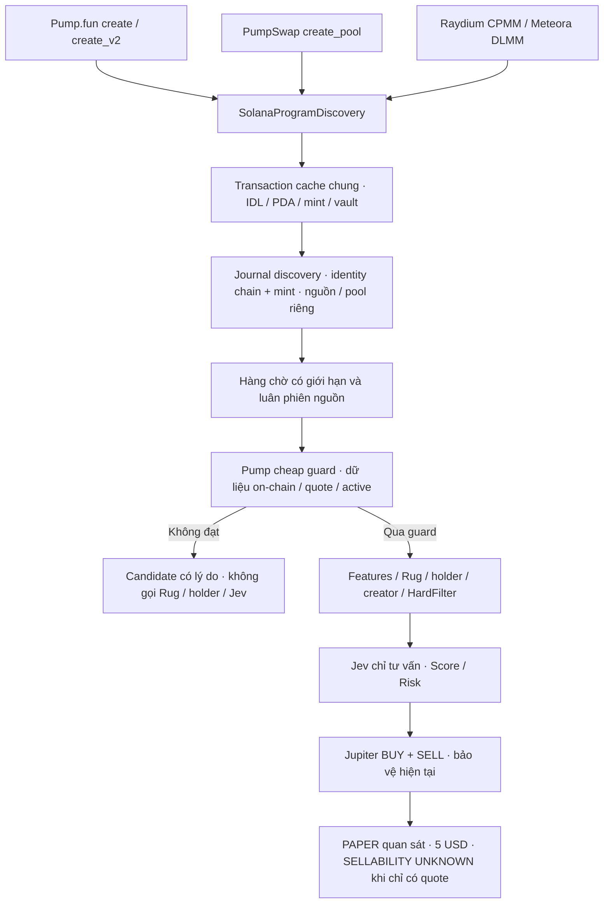

# Pump.fun và PumpSwap: nguồn đã xác minh

## Nguồn và phiên bản

Ngày đối chiếu: 2026-10-27. Repository chính thức [pump-fun/pump-public-docs](https://github.com/pump-fun/pump-public-docs), ghim commit `639b87fb45c3adeffa6f7c4a1bf0cb85e392bf22`. IDL được tải nguyên bản, kiểm tra Program ID và SHA-256 bằng manifest hiện có; không dùng offset/discriminator tự đặt.

- [IDL Pump.fun](https://github.com/pump-fun/pump-public-docs/blob/639b87fb45c3adeffa6f7c4a1bf0cb85e392bf22/idl/pump.json): `6EF8rrecthR5Dkzon8Nwu78hRvfCKubJ14M5uBEwF6P`.
- [IDL PumpSwap](https://github.com/pump-fun/pump-public-docs/blob/639b87fb45c3adeffa6f7c4a1bf0cb85e392bf22/idl/pump_amm.json): `pAMMBay6oceH9fJKBRHGP5D4bD4sWpmSwMn52FMfXEA`.
- [Coin creation](https://github.com/pump-fun/pump-public-docs/blob/639b87fb45c3adeffa6f7c4a1bf0cb85e392bf22/docs/instructions/COIN_CREATION.md): create_v2, tài khoản còn lại cho quote, Token-2022 và tham số tùy chọn ở cuối.
- [Pump program](https://github.com/pump-fun/pump-public-docs/blob/639b87fb45c3adeffa6f7c4a1bf0cb85e392bf22/docs/PUMP_PROGRAM_README.md): Global, BondingCurve, complete, migration, các trường thêm cuối có giá trị mặc định trên account cũ.
- [PumpSwap](https://github.com/pump-fun/pump-public-docs/blob/639b87fb45c3adeffa6f7c4a1bf0cb85e392bf22/docs/PUMP_SWAP_README.md): Pool, create_pool, PDA và dự trữ hiệu dụng.
- [Phí và dự trữ quote ảo](https://github.com/pump-fun/pump-public-docs/blob/639b87fb45c3adeffa6f7c4a1bf0cb85e392bf22/docs/VIRTUAL_QUOTE_RESERVES_FEE_ADJUSTMENT.md): i128 có dấu, fee đang giữ trong vault không phải thanh khoản.
- [Synthetic migration](https://github.com/pump-fun/pump-public-docs/blob/639b87fb45c3adeffa6f7c4a1bf0cb85e392bf22/docs/SYNTHETIC_MIGRATION.md): v3 có thể mua phần pool tổng hợp khi hoàn tất curve; sau complete, giao dịch curve không còn hợp lệ cho đến migration thật.
- [Fee recipients](https://github.com/pump-fun/pump-public-docs/blob/639b87fb45c3adeffa6f7c4a1bf0cb85e392bf22/docs/FEE_RECIPIENTS.md): 8 recipient thường, 8 mayhem và 8 buyback; không đồng nhất creator/user/recipient. Hệ thống discovery không dựng lệnh trực tiếp hoặc tự chọn fee account. Jupiter builder và kiểm tra giao dịch hiện có vẫn chịu trách nhiệm cho tuyến thực thi.

## Nhận dạng và lifecycle

Pump.fun là vòng đời bonding curve, PumpSwap là AMM riêng. Nhận dạng token ổn định `solana:mint`; pool/source giữ lịch sử riêng. Pump.fun tạo bằng `create` hoặc `create_v2`, xác minh mint/curve và creator qua instruction cùng event thuộc đúng program. BondingCurve PDA dùng seed `bonding-curve` và mint. Không đồng nhất creator được chỉ định để nhận phí với người ký triển khai.

PumpSwap `create_pool`: Pool PDA dùng `pool`, index u16 little endian, creator, base mint, quote mint. Mint LP dùng `pool_lp_mint` và pool. Các vault phải khớp ATA của pool, mint và token program. `creator` của pool khác `coin_creator` nhận phí; migration canonical có index 0, nhưng index 0 riêng lẻ không chứng minh migration.

Nguồn quote hiện tin cậy theo cấu hình WSOL/USDC; quote mặc định zero của Pump.fun được chuẩn hóa sang WSOL theo tài liệu. Pump hiện hỗ trợ quote token khác và quote là pump coin nhiều tầng; hệ thống phải nhận diện rồi giữ UNTRUSTED_QUOTE nếu quote chưa được cấu hình, không tự suy diễn giá USD. `create` cũ dùng SPL Token, `create_v2` dùng Token-2022. Mint/vault được xác minh owner, initialized, token program và identity trước phân tích sâu.

## Dữ liệu thị trường và giới hạn

Giá cận biên curve lấy tỷ lệ virtual_quote_reserves/virtual_token_reserves, hiệu chỉnh decimals và giá USD quote đã xác minh. Không coi virtual reserve là tiền thật. Chỉ xuất raw virtual/real reserves, supply và complete khi account giải mã được; không tự đặt phần trăm tiến độ từ hằng số nguồn không phù hợp loại quote.

PumpSwap: effective_quote = quote_vault.amount + virtual_quote_reserves (i128 có dấu). Giá dùng effective quote và base reserve, hiệu chỉnh decimals. Real quote inventory = vault.amount − protocol_fees − creator_fees; không cộng boost ảo vào thanh khoản thật. Số liệu inventory/liquidity là ước tính có nhãn, không chứng minh khả năng khớp lệnh. Phiên bản account cũ chỉ được xử lý trường thêm cuối theo quy tắc chính thức, không chấp nhận account thiếu phần bắt buộc.

Rolling windows tái sử dụng bộ quan sát hiện tại. Khi WS/polling chỉ lấy mẫu, volume/count/unique buyers thiếu coverage tiếp tục UNKNOWN; không dùng log lấy mẫu để chứng nhận stream đầy đủ, không dùng 0 thay dữ liệu thiếu. Synthetic post-complete trades không được cộng thiếu rồi công bố volume đầy đủ.

## Giới hạn vận hành bắt buộc

Discovery không phải cấp quyền mua. Cheap guard không kết luận an toàn; chỉ loại identity sai, quote chưa tin cậy, curve complete/chưa có dự trữ có thể đọc hoặc dữ liệu thị trường chưa đủ. Không thêm ngưỡng volume/buyers/liquidity tùy ý. Token qua guard vẫn phải vào feature/security/Rug/holder/creator/Jev/Risk hiện có.

Jupiter vẫn là swap provider; quote BUY/SELL phải thử với amount/slippage hiện hành. Không viết executor Pump trực tiếp hoặc tăng slippage. Quote-only không chứng minh SELLABLE. LIVE giữ khóa, UNKNOWN/NOT_SELLABLE giữ chính sách hiện tại. Ngân sách quan sát hiện là 5 USD theo quyết định người dùng, không đổi sizing của tác vụ khác.

## Kiến trúc đã tích hợp

Trình tự sâu giữ đúng pipeline hiện tại; các bước sellability/trading được móc vào Rug workflow đang có. Không di chuyển quyền quyết định sang AI. Không viết nhánh mua riêng cho Pump.

## Giới hạn hiệu năng và đo lường

- Cache transaction dùng chung giữa bốn watcher: TTL 30 giây cho kết quả đã xong, tối đa 256; request đang chạy được tái sử dụng và không bị đẩy ra để tạo fetch trùng. Đầy toàn bộ pending thì trả backpressure.
- Mỗi watcher tối đa 128 init hints, 10 signature mỗi lượt; fallback 5 signature/program mỗi 15 giây. Dedupe 1024 signature; cache lỗi tối đa bằng hints, TTL 120 giây, backoff 1→2→4→8→16→30 giây. Không retry dồn theo từng WS wakeup.
- Inbox tổng theo `maxPools` (hiện 300); mỗi nguồn Pump tối đa `floor(maxPools/6)` (hiện 50), gồm cả đang ghi và đã xếp hàng. Tối đa 3 job phân tích; chọn nguồn luân phiên. RPS/concurrency giữ cấu hình RPC hiện hành.
- Cache market 3 giây, tối đa 256; lifecycle cache `maxPools*20`, tối đa 8 pool/identity. Lịch sử source/pool thực vẫn nằm trong SQLite qua journal hiện tại, không thêm migration.
- API `/api/snapshot.discovery`: funnel bốn nguồn, reasons, watcher queue/drop/duplicate/TTL, inbox/active, tốc độ sự kiện đã chấp nhận/ứng viên, độ trễ và thống kê RPC logic (gồm chờ/retry, không phải số HTTP retry vật lý).
- `detected` là curve/pool đã lưu, không phải tổng launch toàn chuỗi. Bước sâu là lượt phân tích, có thể có reanalysis; `Jev` là lượt gọi. Counter backpressure là số lần không nhận được vào hàng chờ, không phải số token khác nhau.
- Signal bị vượt giới hạn/hết TTL được thống kê; không lấp bằng dữ liệu giả và không chứng nhận đủ volume. Ngưỡng thị trường không được thêm; chỉ dùng cấu hình chiến lược hiện có sau guard.

## Kiểm tra vận hành

`pnpm verify:idls` kiểm tra checksum và Program ID. Khi server đang chạy, `pnpm verify:pump` yêu cầu REAL/PAPER/OBSERVATION_ONLY, đọc funnel thật, lấy mẫu candidate và kiểm tra quote Jupiter BUY/SELL theo ngân sách quan sát từ snapshot. Script không build/simulate/sign/send transaction; không đọc hoặc sử dụng signer. Báo cáo lưu tại `data/pump-paper-verification.json`; xem thêm [báo cáo triển khai](solana-pump-discovery-report.md).
